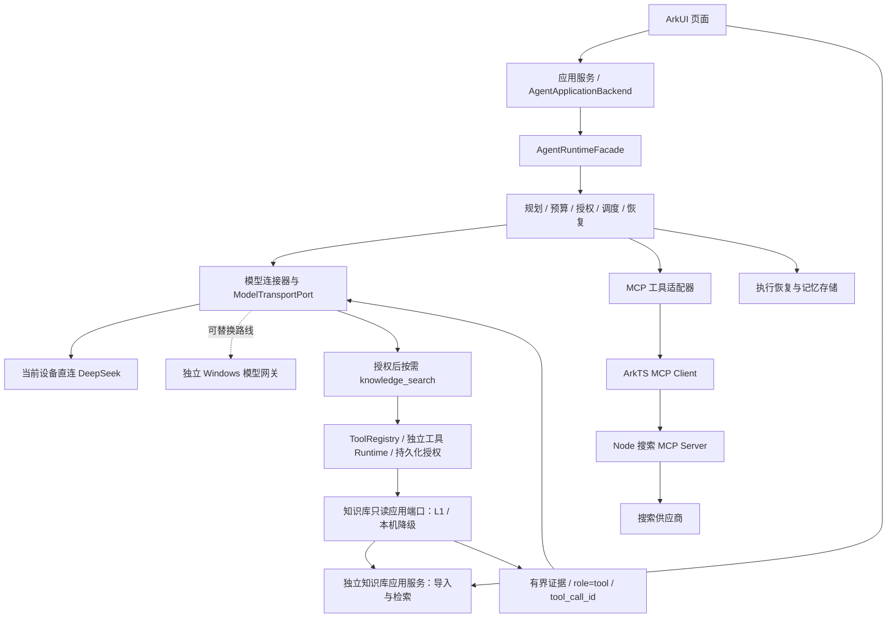

# Agent 运行时架构

> 状态：已实现待验收（debug 主对话已接入授权下自主知识库工具循环，host、签名构建及模拟器保数据安装通过；真实模型效果、完整设备矩阵、核账与正式发布待完成）。
> 更新日期：2026-10-29。主对话 L2 改为授权下自主检索，实施范围与验证见 [L2 实施记录](../verification/主对话L2实施记录.md)；应用搜索仍采用独立模式。
> 适用版本：`modules/harmony_agent/UPSTREAM.json` 固定的 `f177176`。

## 1. 整体边界

Agent Runtime 是手机应用内的 ArkTS 任务运行层，负责规划、预算、授权、调度、取消与恢复。它没有聊天页面。Windows 模型网关是独立服务，搜索 MCP 也是独立服务；迁入同一仓库并不改变这三个运行位置。

debug 主助手使用同一个 PERSONAL 模型工具循环。个人知识库默认关闭；用户允许本机检索与片段外发后，可另外选择允许查询 Embedding 或只用本机检索。开关只恢复本机状态，不启动入库；模型按输入自主选择工具、直接回答或澄清。`knowledge_search` 经 Registry、生产 Runtime 授权与持久化后调用共享知识库，最多两次查询、累计去重后 5 条/3200 字符回到同一模型循环；回答在主聊天显示，来源由宿主记录并重验。现有本机降级仍为统一字面策略，spec 14 FTS5 待实现，不能标为已接通。见 [UI 契约](../integration/知识库回答UI交接契约.md) 与实施记录。

独立 PUBLIC 普通对话仍使用单 LLM 步骤；主助手工具循环持有有界历史，并在新对话或知识库授权修订变化时清除历史。搜索继续使用用户明确填写的关键词、独立授权和独立回答任务；不与 L2 自动合并。未实现多 Agent 协作、跨进程续跑、真实账单导入与未知费用额度释放。知识库复合工具沿用待核账机制保留未知费用，不虚构零账单。

## 2. 控制入口和执行边界

公共任务控制入口是 [AgentRuntimeFacade](../../modules/harmony_agent/agent_runtime/src/main/ets/api/RuntimeApi.ets)。页面使用应用服务投影后的状态，不访问内部 Coordinator，也不直接调用供应商或工具。`AgentApplicationBackend` 是面向应用的封装，仍委托同一个 Facade，不另建一套任务状态机。

Planner 输出需要校验，不能凭类型断言变成可执行计划。工具调用经过 Registry 身份、参数摘要、预算与授权绑定；远端工具自称“只读”不能替代本地 allowlist。搜索可用工具和操作授权是两件事。

失败、取消和进程中断分别处理。取消底层网络不保证远端副作用撤销；恢复必须依据持久化检查点和操作记录，不能直接重放所有未完成步骤。长期记忆与执行恢复存储承担不同职责，RAG 不应直接修改 Runtime 检查点。

## 3. 宿主负责装配

Ability 所在的应用宿主创建并注入凭据、执行存储、记忆存储、MCP 连接与 Runtime 工厂。`createSingleAgentHostRuntime` 管理资源打开、失败回滚和关闭次序。页面不持有密钥或直接打开数据库。

模型接口允许替换具体网络实现。导入的 `createShuviApplicationBackend` 通用组合保留 Local AI Gateway 路线；当前页面通过应用层 `ChatRuntimeFactory` / 搜索装配与 `DeepSeekModelTransport` 走设备直连，二者不能混为唯一入口。Ability 负责生命周期，凭据仅在本次会话有效；退后台停止，返回不自动续跑。[接入说明](../integration/agent/接入与边界.md) 列出了装配与未完成项。

## 4. 策略与研究边界

模型选择、协作选择和工具集合选择提供建议，不能自行授权或执行工具。T53 的协作策略准备为有界异步阶段，同步选择消费校验后的候选；默认关闭 learned 路径，研究样例成功不等于训练产物可上线。见 [ADR-016 整合说明](decisions/ADR-016-协作策略准备的整合边界.md)。

上游 MTRouter、MasRouter、HYSET、AFlow 的研究资料尚未整体迁移。本仓库不据此声称论文复现、训练质量或真实生产策略验收完成。

## 5. 来源与维护

当前说明按导入源码及主仓库状态整理。上游 [架构原文](../archive/harmony-agent-f177176/docs/architecture/HARMONY_AGENT_ARCHITECTURE.md) 包含设计目标与阶段性结论，保留用于追溯；其版本号和历史测试结果不覆盖当前 [模块职责](Agent模块与职责.md) 与验收记录。
