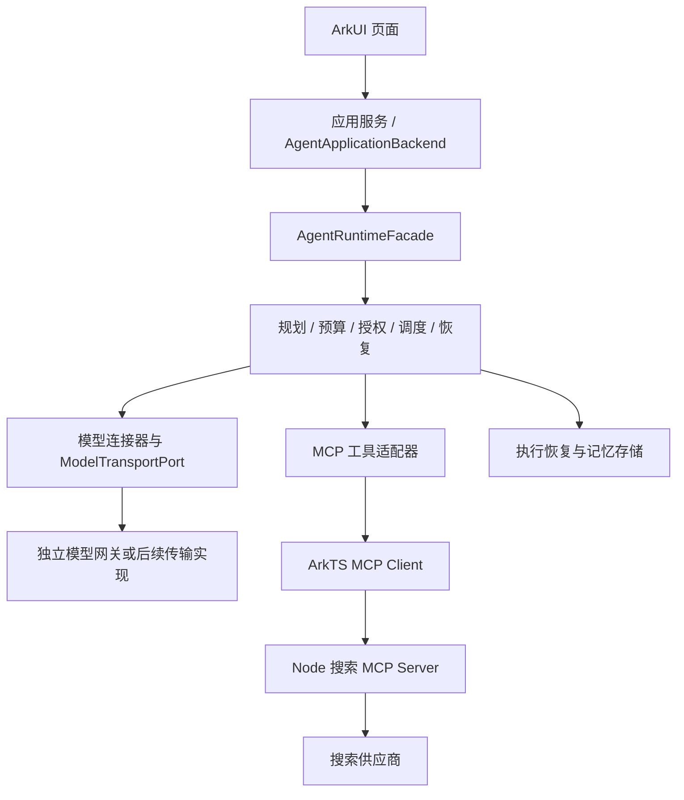

# Agent 运行时架构

> 状态：已实现待验收（源码及本机测试已迁入，产品宿主尚未接通）。
> 更新日期：2026-10-23。
> 适用版本：`modules/harmony_agent/UPSTREAM.json` 固定的 `f177176`。

## 1. 整体边界

Agent Runtime 是手机应用内的 ArkTS 任务运行层，负责规划、预算、授权、调度、取消与恢复。它没有聊天页面。Windows 模型网关是独立服务，搜索 MCP 也是独立服务；迁入同一仓库并不改变这三个运行位置。

这是接入目标。当前产品页面仍使用日程/搜索 Mock，另有 MCP 连接检查；上图完整生产链路尚未接入页面。迁移状态与实测证据见 [项目进度](../08-项目进度与验收.md)。

## 2. 控制入口和执行边界

公共任务控制入口是 [AgentRuntimeFacade](../../modules/harmony_agent/agent_runtime/src/main/ets/api/RuntimeApi.ets)。页面使用应用服务投影后的状态，不访问内部 Coordinator，也不直接调用供应商或工具。`AgentApplicationBackend` 是面向应用的封装，仍委托同一个 Facade，不另建一套任务状态机。

Planner 输出需要校验，不能凭类型断言变成可执行计划。工具调用经过 Registry 身份、参数摘要、预算与授权绑定；远端工具自称“只读”不能替代本地 allowlist。搜索可用工具和操作授权是两件事。

失败、取消和进程中断分别处理。取消底层网络不保证远端副作用撤销；恢复必须依据持久化检查点和操作记录，不能直接重放所有未完成步骤。长期记忆与执行恢复存储承担不同职责，RAG 不应直接修改 Runtime 检查点。

## 3. 宿主负责装配

Ability 所在的应用宿主创建并注入凭据、执行存储、记忆存储、MCP 连接与 Runtime 工厂。`createSingleAgentHostRuntime` 管理资源打开、失败回滚和关闭次序。页面不持有密钥或直接打开数据库。

模型接口允许替换具体网络实现，但当前 `createShuviApplicationBackend` 的现成组合仍走 Local AI Gateway 路线。端口存在不代表生产适配器已经齐全；更换部署方式须落实具体实现、配置和测试。[接入说明](../integration/agent/接入与边界.md) 列出了现有入口和未完成项。

## 4. 策略与研究边界

模型选择、协作选择和工具集合选择提供建议，不能自行授权或执行工具。T53 的协作策略准备为有界异步阶段，同步选择消费校验后的候选；默认关闭 learned 路径，研究样例成功不等于训练产物可上线。见 [ADR-016 整合说明](decisions/ADR-016-协作策略准备的整合边界.md)。

上游 MTRouter、MasRouter、HYSET、AFlow 的研究资料尚未整体迁移。本仓库不据此声称论文复现、训练质量或真实生产策略验收完成。

## 5. 来源与维护

当前说明按导入源码及主仓库状态整理。上游 [架构原文](../archive/harmony-agent-f177176/docs/architecture/HARMONY_AGENT_ARCHITECTURE.md) 包含设计目标与阶段性结论，保留用于追溯；其版本号和历史测试结果不覆盖当前 [模块职责](Agent模块与职责.md) 与验收记录。
