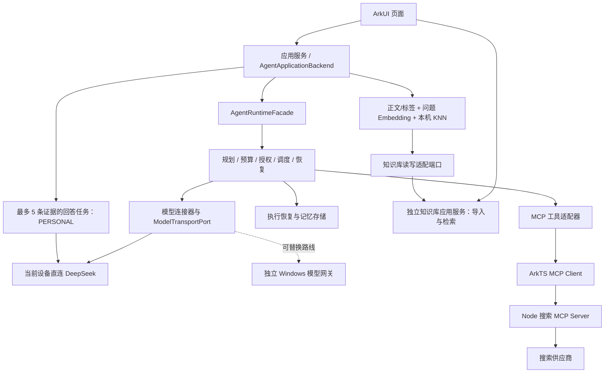

# Agent 运行时架构

> 状态：已实现待验收（debug 普通对话、显式关键词搜索与检索优先 RAG 已接入页面；RAG 仅完成 host 与未签名构建验证；真实 Provider、签名安装、设备证据、核账与正式部署待完成）。
> 更新日期：2026-10-26。应用搜索的两个 Runtime 任务与调试边界见 [spec 03 §6.11](../../specs/03-联网搜索.md)；下文通用网关装配并非唯一产品调用方式。
> 适用版本：`modules/harmony_agent/UPSTREAM.json` 固定的 `f177176`。

## 1. 整体边界

Agent Runtime 是手机应用内的 ArkTS 任务运行层，负责规划、预算、授权、调度、取消与恢复。它没有聊天页面。Windows 模型网关是独立服务，搜索 MCP 也是独立服务；迁入同一仓库并不改变这三个运行位置。

上图表示当前接线与可替换路线。debug 页面已能提交普通对话、授权搜索和知识库 RAG；现有知识库开关即当前会话许可，不新增 Key 或逐问题确认 UI（交接见 [知识库回答 UI 契约](../integration/知识库回答UI交接契约.md)）。开关先检查当前 Embedding Provider 与向量空间；提问后固定执行本机正文/标签检索、当前问题向量化与本机 KNN，再把合并去重后的最多 5 条片段（每条 800、总计 3200 字符）交给独立 PERSONAL DeepSeek 会话。空结果、Tag-only、失效证据或语义步骤失败均不调用模型；普通 PUBLIC 对话不承载知识库片段。日程/搜索 Mock 仍是独立演示模式，真实搜索依赖电脑 Node 服务，并非正式部署；迁移状态与分层证据见 [项目进度](../08-项目进度与验收.md)。

普通对话使用确定性单 LLM 步骤，不带历史上下文。搜索使用用户明确填写的关键词，通过授权后派发；保存来源后再启动独立模型任务生成回答，允许仅重试回答。它不是模型自主规划、多 Agent 协作或一个可跨任务自动恢复的事务。一次派发后的搜索限额持久化保留，账单导入与额度释放尚未实现。

## 2. 控制入口和执行边界

公共任务控制入口是 [AgentRuntimeFacade](../../modules/harmony_agent/agent_runtime/src/main/ets/api/RuntimeApi.ets)。页面使用应用服务投影后的状态，不访问内部 Coordinator，也不直接调用供应商或工具。`AgentApplicationBackend` 是面向应用的封装，仍委托同一个 Facade，不另建一套任务状态机。

Planner 输出需要校验，不能凭类型断言变成可执行计划。工具调用经过 Registry 身份、参数摘要、预算与授权绑定；远端工具自称“只读”不能替代本地 allowlist。搜索可用工具和操作授权是两件事。

失败、取消和进程中断分别处理。取消底层网络不保证远端副作用撤销；恢复必须依据持久化检查点和操作记录，不能直接重放所有未完成步骤。长期记忆与执行恢复存储承担不同职责，RAG 不应直接修改 Runtime 检查点。

## 3. 宿主负责装配

Ability 所在的应用宿主创建并注入凭据、执行存储、记忆存储、MCP 连接与 Runtime 工厂。`createSingleAgentHostRuntime` 管理资源打开、失败回滚和关闭次序。页面不持有密钥或直接打开数据库。

模型接口允许替换具体网络实现。导入的 `createShuviApplicationBackend` 通用组合保留 Local AI Gateway 路线；当前页面通过应用层 `ChatRuntimeFactory` / 搜索装配与 `DeepSeekModelTransport` 走设备直连，二者不能混为唯一入口。Ability 负责生命周期，凭据仅在本次会话有效；退后台停止，返回不自动续跑。[接入说明](../integration/agent/接入与边界.md) 列出了装配与未完成项。

## 4. 策略与研究边界

模型选择、协作选择和工具集合选择提供建议，不能自行授权或执行工具。T53 的协作策略准备为有界异步阶段，同步选择消费校验后的候选；默认关闭 learned 路径，研究样例成功不等于训练产物可上线。见 [ADR-016 整合说明](decisions/ADR-016-协作策略准备的整合边界.md)。

上游 MTRouter、MasRouter、HYSET、AFlow 的研究资料尚未整体迁移。本仓库不据此声称论文复现、训练质量或真实生产策略验收完成。

## 5. 来源与维护

当前说明按导入源码及主仓库状态整理。上游 [架构原文](../archive/harmony-agent-f177176/docs/architecture/HARMONY_AGENT_ARCHITECTURE.md) 包含设计目标与阶段性结论，保留用于追溯；其版本号和历史测试结果不覆盖当前 [模块职责](Agent模块与职责.md) 与验收记录。
