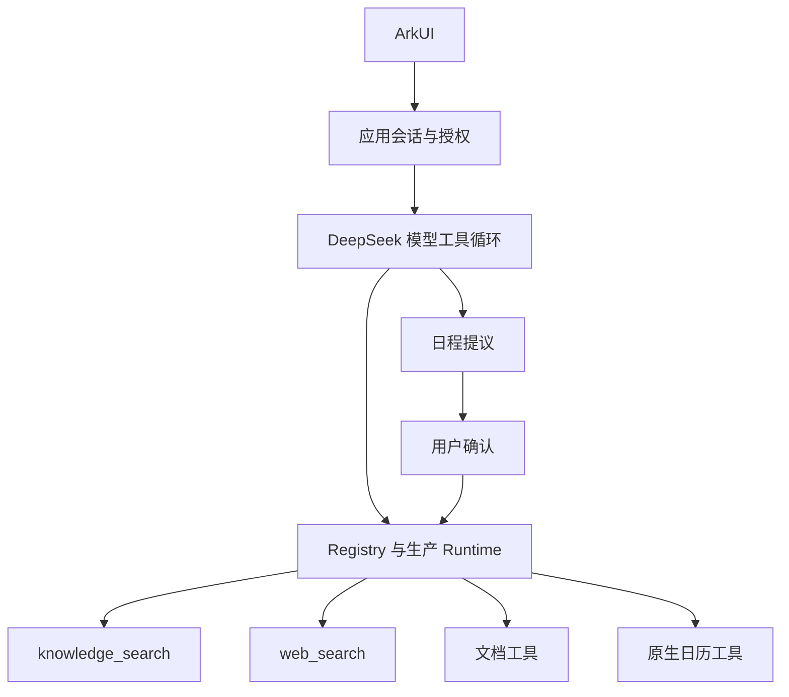

# Agent 运行时架构

> 状态：主助手与真实工具已接入；完整产品、账单及目标设备验收仍待完成。

## 1. 当前执行链路

模型选择回答、澄清或已提供的工具。知识库和搜索分别开启授权，可以组合使用；工具执行经过参数、许可、预算、持久化派发与结果记录。来源回到同一循环，最终回答再校验引用并投影到页面。

## 2. 模块与宿主

AgentRuntimeFacade 是任务控制入口。`entry` 装配实际凭据、时钟、执行存储、记忆与平台适配器，页面使用应用服务。`modules/harmony_agent/` 提供公共契约、执行内核、Runtime、连接器、MCP、存储和原生工具；[模块职责](Agent模块与职责.md) 说明边界。

应用直连 DeepSeek 与 Tavily。Windows 模型网关、MCP 搜索服务为独立子项目，当前主链路不要求运行它们；固定样例服务仅用于测试。

## 3. 取消、记忆与恢复

授权、任务和对话身份绑定到本轮操作；取消、关闭、后台和换对话使旧调用失效。返回前台不自动继续旧派发，结果未知按对应工具核查。

普通模型记忆与历史对话本机保存。知识库来源及派生上下文仅进入当前授权会话临时历史，UI 来源快照只恢复显示。搜索执行记录、日历操作和文档版本使用各自账本，互不伪造成功。

## 4. 知识库与策略

知识库 [L0/L1/L2](知识库L0-L1-L2链路架构.md) 共用检索底座，页面查询与助手工具各自持有会话。只有用户允许的命中片段进入回答模型，语义问题向量化另受授权与配置约束。

协作、模型和工具集合选择提供策略建议，Runtime 仍负责执行授权。learned 路径、离线权重和至少三个子 Agent 的产品协作未完成验收；[ADR-016](decisions/ADR-016-协作策略准备的整合边界.md) 保留策略准备边界。

## 5. 契约与证据

- [主对话契约](../../specs/07-Runtime普通对话接入.md)
- [宿主接入边界](../integration/agent/接入与边界.md)
- [当前进度](../08-项目进度与验收.md)、[验收记录](../verification/README.md)
- [上游固定归档](../archive/README.md)
