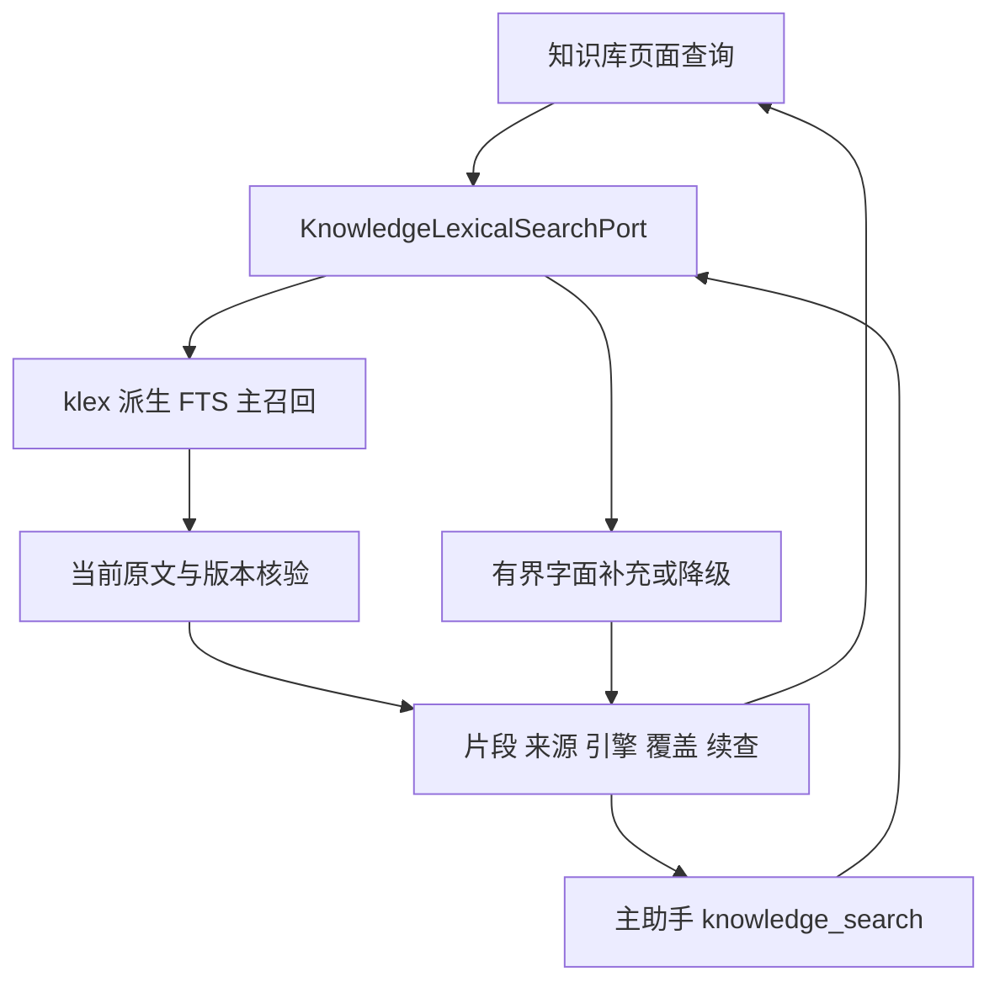
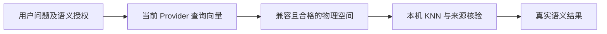
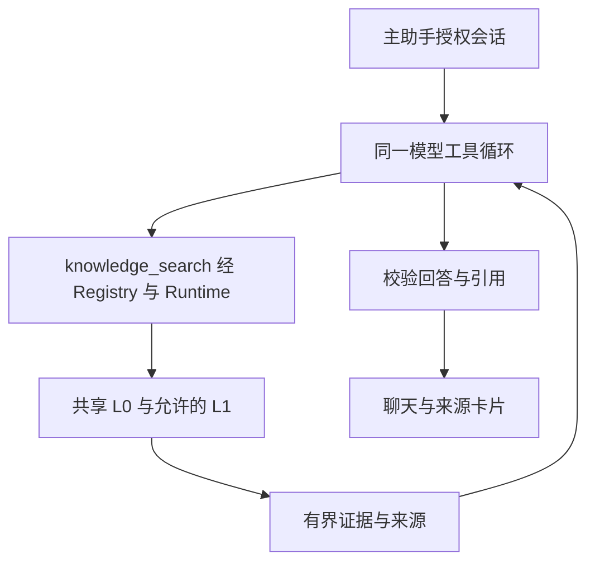

# 知识库 L0 / L1 / L2 链路架构

> 状态：统一接口已接入页面与主助手，设备引擎、质量与性能按场景验收。

## 1. 共同底座

L0 使用统一查询规范，区分 Keyword / Literal 和真实引擎。资料身份、generation、epoch、标注及当前成员状态决定候选有效性；历史卡片存储不作为语料变化。

## 2. L1 语义检索

兼容性按 Provider、区域/工作区、模型、维度、预处理、tokenizer、角色、归一化与供应商版本等条件判定。已有向量保持原空间和回执，配置修订变化不自动删除或重嵌入。

## 3. L2 自主知识库工具

每轮最多两次知识查询，累计最多 5 条 / 3200 字符。命中来源及派生上下文仅在本次授权会话使用；持久 UI 快照与普通模型记忆分别管理。

## 4. 实现入口与验收

| 落点 | 职责 |
|---|---|
| KnowledgeLexicalSearchPort / KnowledgeLexicalRepository | L0 端口与派生索引 |
| KnowledgeQuerySession / UnifiedQueryService | 页面查询、L1 授权和结果 |
| KnowledgeAgentSearchAdapter / KnowledgeAgentRuntime | 工具查询与 Runtime 派发 |
| ModelKnowledgeTools | 工具定义、证据预算与引用收尾 |
| ChatKnowledgeSources | 即时来源绑定和历史卡片恢复 |

契约见 [知识库总 spec](../../specs/02-个人知识库问答.md)、[L0](../../specs/12-统一知识库L0关键词检索与FTS5接入.md)、[L2](../../specs/11-主对话Agent知识库L2检索增强.md)。证据见 [L0/L1 验证](../verification/知识库L0重构验证记录.md)、[L2 实施](../verification/主对话L2实施记录.md)、[集成回归](../verification/PR26-main合入与RAG三链路回归.md)。
