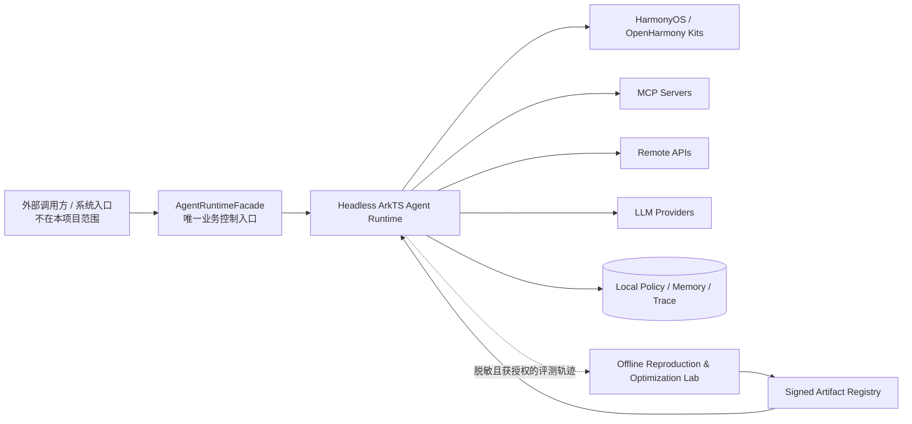
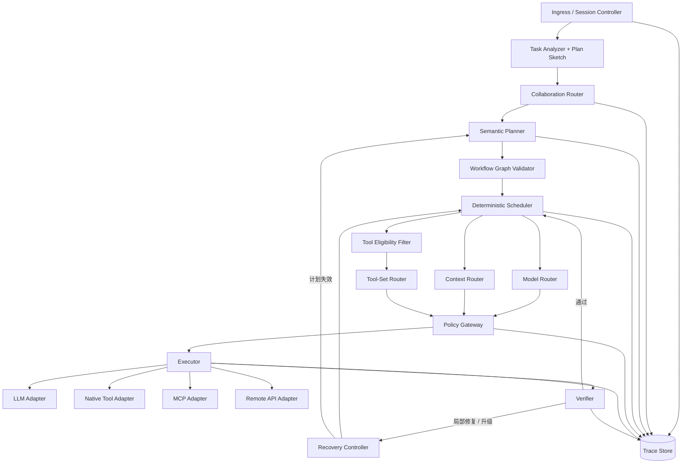
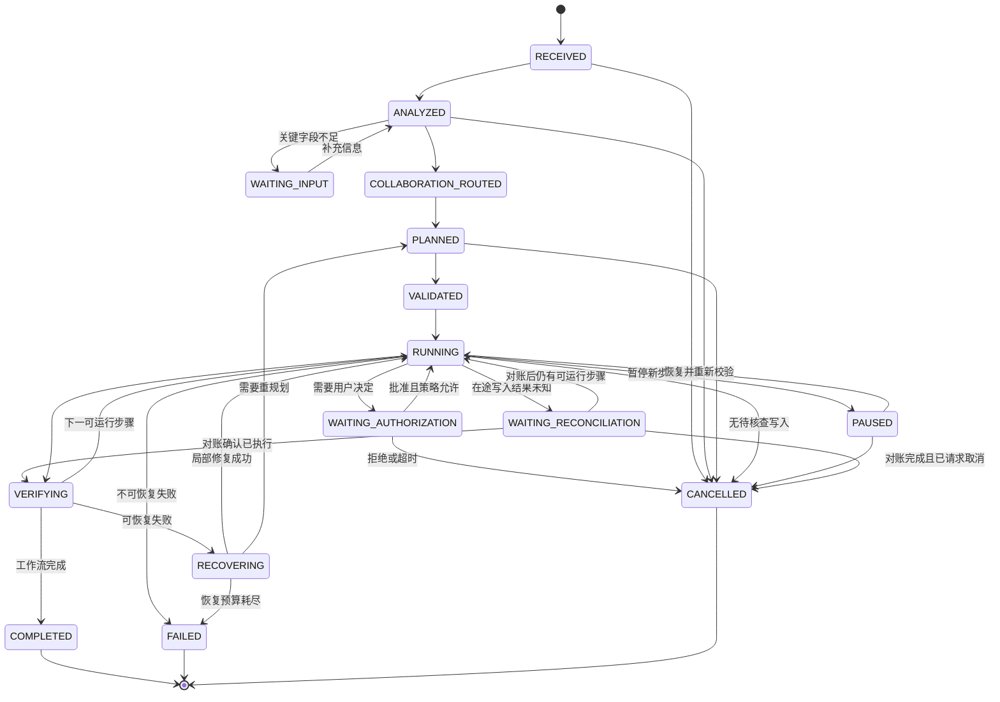

> **历史归档，不是当前操作指南。** 来源：Harmony_agent `f1771764f129193725a8bccb5da2be6c3604e998` 的 `docs/architecture/HARMONY_AGENT_ARCHITECTURE.md`。归档日期：2026-10-23。
> 原文版本、机器路径、授权与验收结论只适用于上游现场；Shuvi 当前状态以 [项目进度与验收](../../../../08-项目进度与验收.md) 为准。原相对文档链接改指固定上游版本，不代表所链接的制品已经迁入。

# harmony_agent Agent Runtime 架构

2026-10-02 已按项目所有者要求统一命名，模块引用按当前名称展示。更名前的设备验收和原始产物不变，当前名称、数据兼容及复验边界见 [HARMONY_AGENT_NAMING.md](https://github.com/AlterGo-xzy/Harmony_agent/blob/f1771764f129193725a8bccb5da2be6c3604e998/docs/HARMONY_AGENT_NAMING.md)，最新进度见 [PROJECT_STATUS.md](https://github.com/AlterGo-xzy/Harmony_agent/blob/f1771764f129193725a8bccb5da2be6c3604e998/PROJECT_STATUS.md)。

状态：**In progress / T01–T48、T50–T52 已完成各自记录的任务门，T51 已验收并作为 T52 基线；S6、S7 已关闭，S8 暂缓，S9 已完成来源冻结、复现准入、环境输入合同与 adaptation handoff 结构门**
日期：2026-10-19
适用范围：无 UI 的 OpenHarmony / HarmonyOS harmony_agent Agent Runtime、MCP/系统能力接入、远程 LLM，以及与在线 Runtime 严格隔离的离线算法实验域。产品 UI、ArkUI 页面、Entry Ability 和产品 HAP 明确不在本项目交付范围内。

## 1. 结论

harmony_agent 不应被实现成一个固定的“多 Agent 团队”，也不应把论文代码直接塞进 HarmonyOS 应用。建议采用以下总架构：

> **确定性 ArkTS Runtime 负责计划校验、权限、安全、调度、执行、恢复和审计；可学习 Router 只提供可替换的决策建议；Python/GPU 复现、训练和工作流搜索全部留在离线实验域。**

本项目交付的是可被任意外部调用方集成的 headless Agent SDK/HAR。外部调用方负责界面、Ability 生命周期和收集用户决定；Agent 只暴露版本化任务提交、授权决定、取消、恢复、事件与结果契约，不依赖任何 UI 类型。`AgentRuntimeFacade` 是唯一受支持的任务执行与控制入口；公共 DTO、observer、factory 和 adapter ports 只承载数据、订阅或依赖装配，不能形成第二条执行通道。

在线主路径是：

```text
用户任务
  -> 任务分析 / 计划草图
  -> 单 Agent / 多 Agent 协作路由
  -> Typed Workflow
  -> 逐步选择模型、上下文与工具集
  -> 权限与风险门
  -> 确定性执行
  -> 验证 / 有界恢复
  -> 带来源的结果 + 决策轨迹
```

算法在架构中的位置固定为：

| 算法 | 位置 | 在线职责 | 不允许承担的职责 |
|---|---|---|---|
| MTRouter | `ModelRouter` 插件 | 每个 Agent turn 选择候选模型 | 不能授权工具、绕过预算或直接执行动作 |
| MasRouter | `CollaborationRouter` 插件 | 选择 single-agent / multi-agent、角色和模型分配 | 不能预设固定团队，也不能创建未注册角色 |
| HYSET | `ToolSetRouter` 插件 | 从已具备资格的工具中选择可共同完成步骤的工具集 | 不能把“相关”解释为“已获授权” |
| AFlow | 离线 `WorkflowOptimizer` | 基于 benchmark 和历史轨迹搜索工作流，输出版本化候选策略 | 不能参与在线实时规划或直接发布生产策略 |

Context Routing 与 Verification / Recovery 暂时使用确定性 baseline，并保留可替换接口。R2-Router、LLMCompiler、固定多 Agent、embedding top-k 分别保留为对照组，不进入 v1 的强依赖链。

## 2. 事实、提案与待定项

### 2.1 当前仓库中已经存在的事实

- `agent_contracts/` 是独立的 `@harmony_agent/agent-contracts` HAR，已经定义版本化 Task、Workflow、Router、Tool、Policy、Trace 和 Artifact 契约，并通过 host 侧契约测试与 Release HAR 构建。
- T44 已把 Artifact 契约收紧为可审计的 checkpoint/policy/workflow manifest：完整 source commit、许可证、数据 lineage、模型/Provider 快照、runtime compatibility、通用 payload digest、三类独立结果、审批、签名和 rollback target 均有显式字段与 fail-closed 校验。T45 以 canonical JSON package 和 Ed25519 完成 payload/manifest/signature/key-ID 验证及篡改拒绝；T46 增加 compatibility evaluator、宿主验签端口、durable CAS Registry 和按 digest 的 active/canary 选择与回滚；T47 又完成 baseline-first shadow/canary/active/fallback runner、deterministic basis-point assignment 和 durable rollback 后策略选择恢复演练。M11-E 为每次策略调用补充有界 timeout、外部取消和协作资源释放信号，超时按 shadow/canary/active/baseline 边界稳定观察或回退，并忽略迟到结果。S7 通用策略供应链门已关闭；生产密钥治理、policy loader、具体策略资源释放实现和 learned Router 属于宿主与 M12–M14。
- T48 已在 `offline/paper_repro/mtrouter/` 冻结 MTRouter 官方 commit/tree、MIT license、arXiv v1、Python/research 依赖边界和论文实验协议，并预注册三次运行、六模型池、两个 benchmark 四项结果的容差。该门只证明来源锁与准入 spec 可离线复验；尚未安装原环境、运行官方测试或 benchmark，也没有形成 checkpoint、parity 或在线 Router 质量证据。
- T50 已在 `offline/paper_repro/masrouter/` 冻结 MasRouter 官方 commit/tree、Apache-2.0 license、15 个关键源码文件和 arXiv v1，并分别记录论文与源码的模型池、协作模式、训练参数和五项 benchmark 目标。上游没有依赖清单或 checkpoint，入口路径大小写及价格元数据还有冲突，所以当前结论是来源审计完成、严格复现尚不可执行；没有修改在线 Runtime。
- T51 在同一目录新增环境、数据集、Provider/model revision 和价格快照四类版本化 schema，以及 34 个直接依赖候选（全部 unresolved）、五个 benchmark 的数据集锁定骨架、严格分离的 4+1 论文模型池/5 模型源码 profile、Claude 价格冲突记录和 17 项未解决问题。checker 使用本地严格 JSON Schema 校验四份输入文档（未知字段、类型错误和必填缺失均 fail-closed），报告 `sha256:0f4367d6de077b0a6df712ff41d1e45af3681e7338f13cbe9973e8ee73440fa3`，13/13 fail-closed 自测通过。该门只完成环境输入合同，不证明依赖可安装、数据已下载、Provider 可调用或论文可复现；T54 继续暂停。
- T52 在同一目录新增 MasRouter adaptation handoff 合同、纯 Node checker、21/21 fail-closed 自测和 research-only fixture。合同把 feature envelope、Role/Model Registry 快照、single/multi 有序角色分配、advisory-only 模型集合、source digest 和文件预算固定为结构准入门；encoder/tokenizer/Python/PyTorch/optimizer state/数据集/训练日志、任务控制字段和同步网络声明均 fail-closed。发布继续复用 M11 `ArtifactManifest`/`ArtifactRegistry`/`ArtifactPolicyReleaseRunner`；checker 通过不证明训练、parity、包体或生产发布。
- T56 已在 `offline/paper_repro/hyset/` 固定 HYSET 官方 commit/tree、MIT 根许可证、ToolBench/StableToolBench 的 Apache-2.0 tracked-tree 边界、arXiv v2、26 个关键文件、13,860-tool corpus、六个 100-query split、论文参数与结果表。上游 `.gitmodules` 声明与实际普通 tree 存储不一致，checkpoint、encoder/Agent/DFSDT revision/digest、raw ToolBench/UltraTool、reward/trajectory 和 judge snapshot 仍 unresolved；因此当前只完成来源审计，严格复现、ArkTS adaptation 和质量结论均未运行。离线 checker 以 11/11 fail-closed 自测覆盖来源、执行和架构边界漂移。
- `agent_core/` 是独立的 `@harmony_agent/agent-core` HAR，已经实现语义 DAG 校验、确定性状态机与调度、deadline/取消传播、operation journal、有界恢复决策及 `UNKNOWN_OUTCOME` 对账边界，并通过 host 侧内核测试与 Release HAR 构建。
- `agent_core/` 已增加 task、step、provider 三层 Budget Ledger；预留、结算、释放和未知费用保留均为同步确定性状态转换。
- `agent_runtime/` 已建立 `@harmony_agent/agent-runtime` HAR，并实现 M02 的确定性资格过滤、Policy Gateway、内部 grant 签发/校验/撤回和 secret 脱敏。
- `agent_runtime/` 已实现 M09-A 的 `AgentRuntimeFacade` 接口、observer/subscription、明确标记的 headless fake runtime 与 fake consumer。
- `agent_runtime/` 0.14.0 已用 M09-B production factory 把 M03 内部 Session/Task Analyzer/Planner/RuntimeCoordinator 包装到唯一 Promise-based `AgentRuntimeFacade`；T32 将 Semantic Planner 的 plan/resume/replan 统一为 Promise，并在 Planner 完成前阻止 workflow drive 与 Tool dispatch。composition 2.5 新增可选的版本化 `CollaborationPlanSelectorPort`，计划固定 Role Registry/decision 摘要与角色身份并进入 Planner/checkpoint；模式标签式 Multi 会在 Provider 前失败。原 checkpoint 1.1、authority 写入、只读恢复源、异步 recovered factory 和 active operation durable normalization 边界继续保留。内部 coordinator 与生产实现类均不从公共入口导出。
- `agent_runtime/` 已实现 M04 的 Model/Role/Tool/Workflow Registry 与确定性 Model、Collaboration、Context、Tool Router；硬资格过滤先于评分，learned Model/Tool policy 可关闭并在低置信度、异常或越界输出时回退。
- `agent_storage/` 已建立 `@harmony_agent/agent-storage` HAR：当前包含执行恢复 Repository ports、纯 ArkTS 恢复协议 Store、完整快照 integrity/migration 边界、snapshot CAS durable session、Runtime persistence bridge，以及接收宿主已打开 `RdbStore` 的 API 26 RDB backend；主机测试与 Release HAR 构建已通过。
- `agent_storage/` 0.8.0/schema 1.2 保存版本化 opaque Runtime checkpoint 并提供任务枚举；`RuntimeExecutionRecoveryBridge` 用 backend CAS 保存 checkpoint、Policy、完整预算、operation 和 lease/fencing，并从这些 durable 记录组装严格验证的恢复 authority。T25 新增 `openForRuntimeRecovery` 与单 CAS active normalization；T26 新增只返回唯一 Facade 的 `createRdbRecoveredAgentRuntime`。主机 47/47 与 Release HAR 已通过，签名 API 26 设备验收进一步完成 seed 就绪/PID、force-stop、recover 1/1、UNKNOWN 归一化、Adapter 零重放和卸载核对。
- `agent_storage/` 0.2.0 已新增 M05-B 的类型化 Memory/Artifact/Index/Transfer ports、纯 ArkTS `DeterministicMemoryStore`、完整快照 `DurableMemoryStore` 和宿主注入式 API 26 `RdbMemorySnapshotBackend`；主机证据验证受控导入、分块检索、隐私默认值、脱敏导出、级联失效、CAS/并发、重开重建、损坏与迁移；当前命名签名主 HAP/ohosTest HAP 已在 API 26 通过 `MemoryDeviceRecovery` 3/3，并完成卸载清理。
- `mcp_client/` 是独立的 `@harmony_agent/mcp-client` HAR，提供多 Server MCP Streamable HTTP 客户端。
- 公共 MCP 能力以 `{ serverId, kind, name }` 标识，避免跨 Server 同名冲突。
- MCP 工具调用已采用默认拒绝的 `McpInvocationPolicy`；宿主负责认证秘密和授权策略。
- MCP 客户端已把安全查询和有副作用的工具调用区分开：安全查询可在特定传输失败下有界重试，工具调用不自动重试。
- `test_host/` 是无页面的 MCP/Agent HAR 设备测试宿主，不是 harmony_agent 产品宿主；当前已包含 MCP 网络、M05 RDB 恢复和 M08 battery status 设备测试。T30 已在 API 26 通过 unsigned `McpFacadeDevice` 1/1。T36 的 signed `LocalAIGatewayFacadeDevice` 又把真实 Provider Planner、唯一 Facade、显式授权和一次 MCP 调用串成同一设备闭环，并在 API 26 实际通过 1/1。T43 继续通过 signed 主/ohosTest HAP 完成 12×2 真实 Provider/system Bench；各次验收后 bundle、反向映射、bridge、fixture 和网关均已清理。
- `agent_connectors/` 0.8.0 已完成 M06/M07、Local AI Gateway transport、MCP Production Facade、Provider Semantic Planner、具体 production composition 与 T37–T40 协作接线/逐角色规划的本地主机门。composition 保留宿主显式注入的 `CollaborationPlanSelectorPort`，也保留旧 `CollaborationSelectorPort` 的 Strong Single/兼容路径；有效计划会为每个角色产生独立 Provider request/activation trace，并顺序修订 typed workflow，模式标签式 Multi、计划外角色和累计预算越界会在 Provider 前失败。外部仍只获得 `AgentRuntimeFacade`。合并 connector 主机套件为 55/55；Release HAR 为 61,831 bytes、SHA-256 `120A65A82BA87CB7A79C948C1963A2070CA2E678ABC8F54134156A94BA10A540`。T36 的单任务真实 Provider Planner → Facade → MCP signed API 26 证据继续有效；T40 没有运行真实 Provider 或设备，也不等于 S6 的十二类任务双 arm system Bench。
- `native_tools/` 0.1.0 已实现首个 API 26 只读 battery status Tool Adapter，包含 capability、grant、参数/identity、后台和取消边界，并通过 M03 `StepDispatchPort` 接线；主机 12/12、Release HAR、签名主/ohosTest HAP 验证与安装、`BatteryStatusDevice` 设备运行 1/1 和卸载清理均已通过。
- 当前仓库已完成 Local AI Gateway Provider Planner 的具体 production composition，并以 signed API 26 设备用例验证真实 Facade Planner → MCP 闭环。Runtime 0.14.0 与 Storage 0.8.0 已接通版本化协作计划、异步 Planner/Facade lifecycle、checkpoint/authority、单 CAS dispatch gate、lease/fencing、outcome/reconciliation 写入、启动恢复和具体 RDB composition；T46 完成 Artifact Registry 的 compatibility/verifier/durable CAS/rollback 数据面，T47 完成 baseline-first shadow/canary/active/fallback 运行与 durable rollback 后选择恢复，M11-E 完成通用 policy timeout/cancel 控制。connector 0.8.0 已实现按计划逐角色 Provider 规划与结果修订。T43 已在真实设备完成 12×2 双 arm Provider/system Bench，形成 19/24 质量通过、38 次请求和 US$0.031083 的基线。宿主生产 credential store、具体 Provider/Tool/learned policy 的取消资源释放、需要系统权限或带写副作用的 Native Kit 工具、宿主长期记忆加密接线、生产 Artifact key/verifier/policy loader 治理、真实 learned Router artifact 和离线 Router 工程仍未完成。产品 Entry HAP 属于外部调用方范围。
- 当前仓库已有首个 source snapshot commit，并按模块维护远端分支；每个任务仍须以对应 commit、构建日志和设备证据分别判断，不能把分支存在当作发布完成。

### 2.2 本文提出、但尚未实现的内容

- `agent_connectors` 的 M06/M07 本地门与 T29 M09-B MCP Facade composition 门已由 T30 的 API 26 `McpFacadeDevice` 1/1 补齐受控只读 S2 设备闭环；T36 又以 signed 测试包和真实 Provider Planner 补齐一次生产 composition → 唯一 Facade → MCP 的设备闭环。发布签名、宿主生产 credential store、真实取消/timeout 及第三方远端 MCP 兼容性仍待各自验收。`native_tools` 首个 permission-free battery adapter 已完成签名 API 26 设备运行和卸载验收，需要权限/写能力的 Kit、`agent_storage` 宿主加密接线及后续 Runtime 能力仍待后续任务。
- 宿主生产 credential store、Artifact key/verifier/policy loader 治理，以及 M12–M14 learned Router artifact 到具体 Model/Collaboration/Tool Router 的接线。
- Strong Single Agent baseline、MTRouter / MasRouter / HYSET 端口和 AFlow 离线流水线。
- harmony_agent Bench、shadow routing、端侧 parity test 和生产 Go/No-Go 门。

### 2.3 尚未锁定的工程参数

以下参数必须通过配置和实验冻结，架构不替用户猜测：

- 目标设备的 SoC、RAM、NPU 与后台执行约束；
- 端侧允许常驻的模型、embedding 与 checkpoint 大小；
- Router 是否可访问远程推理服务；
- 生产 LLM provider/model pool、价格、region 和版本；
- 单任务成本、token、时延和并发上限；
- 个人记忆、原始轨迹是否允许离开设备；
- 典型 Tool Registry 规模；
- 许可证白名单、训练预算、团队规模和发布日期。

在这些参数明确前，HYSET 原版大模型只属于离线/服务端复现候选，不能假设可在手机端常驻。

## 3. 架构原则

1. **Strong Single Agent 是永久基线。** 多 Agent 是路由动作，不是默认拓扑。
2. **Planner 只产出数据，Executor 才产生副作用。** LLM、Router 和 workflow optimizer 都不能直接调用系统能力。
3. **选择与授权分离。** Router 可以推荐模型、角色或工具；Policy Gateway 才能批准实际调用。
4. **确定性外壳包住概率策略。** 图校验、预算、权限、重试上限、状态迁移和审计必须由确定性代码控制。
5. **在线与离线域隔离。** 论文复现、训练、GPU 依赖和 AFlow 搜索不进入在线 Agent HAR 或调用方产品包。
6. **每个 learned policy 都有 fallback。** checkpoint 缺失、超时、漂移或不兼容时，Runtime 降级到可解释 baseline。
7. **不可逆动作不自动重放。** 写操作必须声明副作用、幂等策略和确认要求。
8. **本地优先和数据最小化。** 原始个人数据与完整轨迹默认不出端；导出必须脱敏、最小化并显式授权。
9. **确定性决策可审计、可回放。** 记录输入摘要、候选集、策略版本、选择理由、预算变化和结果，但不记录认证秘密；输入 digest 只能证明一致性，不能单独重建原始输入，也不能保证外部模型响应逐字复现。
10. **论文复现与 harmony_agent 改造分账。** `paper-repro` 和 `harmony_agent-adapted` 使用不同 artifact、结果表和版本号。

## 4. 系统上下文



信任边界：

- 外部调用方提交的任务、授权结果和生命周期信号必须在 Agent 边界重新校验，不能因来自本机调用方就默认可信。
- Agent Runtime 和本地受保护存储属于 Agent 信任域；调用方负责其自身 UI、Ability 与用户身份交互安全。
- MCP Server、远程 API、LLM Provider 和下载的策略 artifact 均视为外部输入。
- Tool description、模型输出、网页内容和历史记忆都可能包含 prompt injection，不能作为授权证据。
- 离线实验域可以读取公开 benchmark；读取用户轨迹必须经过独立的数据导出策略。

同一进程内的普通 SDK 无法仅凭对象字段证明恶意宿主真实展示了确认内容。v1 把已注册宿主和 adapter 视为受控集成方，但仍校验所有输入；如果未来要防御恶意宿主，必须另行定义可信授权来源、签名/证明和进程或设备级隔离，不能把 ArkTS 可见性当成安全边界。

外部集成只通过 headless API：调用方输入 `TaskSubmission`、`AuthorizationDecision`、取消/暂停/恢复命令和 `ReconciliationReport`；Agent 输出消费者安全的任务事件、需要外部授权的 `PolicyRequest`、结果、错误与版本化 snapshot。`TaskEnvelope` 和 `AuthorizationGrant` 由 Agent 在边界内创建，不能由普通调用方直接签发。Agent 不展示确认界面，也不接收 `UIAbilityContext`、ArkUI 状态或页面对象。

## 5. 在线 Runtime 分层



### 5.1 Ingress / Session Controller

职责：

- 接收带 `requestId` 的 `TaskSubmission`，负责重复提交去重；
- 生成规范的 `taskId`、`sessionId` 和取消令牌；
- 固化 locale、隐私等级、用户身份域、设备状态和任务预算；
- 固化相对时间使用的基准时间、用户时区及恢复时沿用的时间语义；
- 把自然语言请求与系统事件规范化为 `TaskEnvelope`；
- 在进入任何模型前移除不必要的秘密和个人字段；
- 管理暂停、恢复、取消与最终结果流。

它由 `AgentRuntimeFacade` 调用，不拥有 UI/Ability 生命周期，也不解析并执行模型生成的工具调用。

### 5.2 Task Analyzer 与两阶段 Planning

为避免“先完整规划还是先决定单/多 Agent”的循环依赖，Planning 分两段：

1. `TaskAnalyzer` 生成无副作用的 `TaskFrame` / plan sketch：目标、约束、风险、可能的能力类别、复杂度特征和可并行性提示。
2. `CollaborationRouter` 基于 `TaskFrame` 选择 single-agent 或 multi-agent；随后 `SemanticPlanner` 针对已选模式生成完整 Typed Workflow。

如果 Workflow Validator 或执行证据证明模式选择不成立，Recovery Controller 可以触发一次受限的协作模式重判；禁止在失败循环中无限扩张 Agent 数量。

### 5.3 Collaboration Router

接口输出：

```text
mode: SINGLE | MULTI
roles: 已注册角色的有序集合
assignments: role -> model eligibility profile
confidence
policyVersion
fallbackReason?
```

v1 baseline 使用确定性规则：默认 `SINGLE`；只有可独立分解、需要明显不同能力或需要独立验证者，并且预算允许时，才考虑 `MULTI`。

MasRouter 进入时只能替换该策略实现，不能修改角色注册表、预算上限或权限边界。低置信度、超时、checkpoint 不兼容统一回退到 single-agent。

T50/M13-A 又把这一边界写入可离线复验的预注册：目标端口是 `CollaborationPlanSelectorPort`，Multi 在选择后必须受现有 Agent activation budget 约束并先保留完整预算，一次任务最多重判一次；研究源码、Python runtime、sentence encoder 和模型 artifact 都不进入 HAR/HAP。该门只冻结来源与实验协议，没有声明 learned collaboration policy 已实现或论文结果已复现。

### 5.4 Semantic Planner 与 Typed Workflow

Planner port 的 `plan`、`resume` 与 `replan` 均为异步 Promise 边界。生产 Facade 的同实例 FIFO 会等待该 Promise 完成，之后才能推进 Scheduler 或调用 Adapter；Promise 拒绝以稳定的 `plannerInvocationFailed` 事件和快照闭合，Provider/transport 异常文本不进入公共证据。该边界允许后续 Provider-backed Planner 接入，同时保持 `AgentRuntimeFacade` 为唯一任务控制入口。

Planner 输出不可执行的声明式图。每个步骤至少声明：

```text
stepId
kind: LLM | TOOL | VERIFY | JOIN | USER_CONFIRMATION
goal
dependencies[]
inputBindings
expectedOutputSchema
capabilityRequirements[]
sideEffect: NONE | REVERSIBLE | IRREVERSIBLE
riskLevel
permissionRequirements[]
idempotencyMode
timeoutMs
retryPolicyRef
verificationPolicyRef
```

Workflow Validator 在执行前验证：

- 图无环、依赖存在、输入输出类型可连接；
- 所有 capability、role、model profile 和 policy reference 均已注册；
- 每个写步骤都有副作用等级、确认策略和幂等/对账方案；
- 预算上限在最坏情况下仍可满足；
- 并行步骤不存在已知资源冲突；
- 未经确认的不可逆步骤不能进入 `READY`。

### 5.5 Model Router

`ModelRouter` 每个 Agent turn 调用一次，而不是为整个任务永久选定单一模型。输入只包含结构化任务特征、经过 Context Router 处理的历史摘要、候选模型快照和剩余预算。

硬过滤先于评分：region、隐私策略、模型可用性、能力要求、成本上限不满足的模型不会进入候选集。MTRouter 只能在候选集中排序。

v1 fallback：按能力等级、任务风险和预算使用静态策略。MTRouter 的上线顺序是 `offline replay -> device parity -> shadow -> canary -> active`。

### 5.6 Context Router

Context Router v1 是确定性的 token-budget selector：

1. 系统约束和当前步骤契约；
2. 当前任务的直接用户输入；
3. 已验证的依赖步骤输出；
4. 与当前步骤相关的短期历史摘要；
5. 经隐私策略允许的长期记忆；
6. 其余内容按相关性和新鲜度在预算内加入。

模型输出、工具输出和长期记忆分别标注来源与信任等级。任何外部内容都不能覆盖系统策略、工具权限或预算。

### 5.7 Tool Registry、Eligibility 与 Tool-Set Router

统一 Tool Registry 规范化三类能力，但保留来源适配器：

```text
Native Kit Tool
MCP Tool
Remote API Tool
```

统一 `ToolDescriptor` 至少包含：

```text
toolId = sourceType + providerId + capabilityName
toolIdentityVersion / schemaVersion
displayName / description
inputSchema / outputSchema
inputSchemaDigest / outputSchemaDigest / descriptionDigest
retrievalRelationVersion
capabilityTags[]
riskLevel / sideEffect
permissionRequirements[]
dataBoundary
availability / health
latencyClass / costClass
idempotencyMode
adapterRef
```

调用顺序必须是：

```text
Registry
  -> Eligibility Filter（平台、权限可申请性、网络、预算、健康状态）
  -> Tool-Set Router（top-k baseline 或 HYSET）
  -> Policy Gateway（本次调用的真实授权与外部确认结果校验）
  -> Executor
```

HYSET 解决“哪一组工具共同完成步骤”，不解决安全问题。Tool description 或 co-invocation 关系改变时，更新 description/retrieval version 并重做 embedding/索引；输入 schema 或授权身份改变时，分别使 contract cache 或旧 grant 失效。不能用一个含义不清的 `schemaHash` 同时承担所有职责。

### 5.8 Policy Gateway

Policy Gateway 是不可被 Router 或 LLM 替换的强制边界，负责：

- capability allow/deny；
- HarmonyOS/OpenHarmony 所需权限元数据、当前授权状态，以及是否应向外部调用方返回 `SYSTEM_PERMISSION_REQUIRED`；
- 外部调用方返回的 `AuthorizationDecision`、组织策略、年龄/身份域与数据边界，并据此签发内部 grant；
- 单次与累计成本、token、时延、Agent 数和工具调用数上限；
- 写操作的幂等键、重复调用检测和不可逆动作二次确认；
- secret injection：凭据只在适配器调用时注入，不进入 prompt、workflow 或 trace。

“工具已被 Router 选中”绝不等于“工具已获授权”。

### 5.9 Deterministic Scheduler 与 Executor

Scheduler 只执行 Validator 接受的图：

- 依赖满足后步骤才可进入 `READY`；
- 只有独立且无资源冲突的步骤可以并行；
- 并行结果在显式 `JOIN` 节点合并；
- 每个步骤有 deadline、取消传播和预算预留；
- Executor 不解析自由文本中的隐式工具请求，只接受类型化 invocation；
- Native、MCP、Remote API 与 LLM 调用分别由独立 adapter 承担。

现有 `@harmony_agent/mcp-client` 作为 `McpToolAdapter` 的传输依赖继续保持独立。它不应感知 Planner、Router 或多 Agent 概念。

对可能产生副作用的动作，Runtime 不宣称通用 exactly-once。优先级是：

1. 供应方原生 idempotency key；
2. 端侧 operation journal + 状态查询/对账；
3. 无法确认结果时转为 `UNKNOWN_OUTCOME`，由外部调用方或对账器处理；
4. 永不盲目重放不可逆调用。

### 5.10 Verifier 与 Recovery Controller

Verifier 根据步骤声明的 schema、后置条件、工具返回和必要的独立证据判断结果，不使用“LLM 说成功了”作为唯一成功条件。

恢复阶梯固定为：

```text
错误分类
  -> 安全的同策略有界重试
  -> 同模型局部修复
  -> 模型升级
  -> 当前步骤重新规划
  -> 受影响子图重新规划
  -> 整体重规划（最后手段）
  -> 失败 / 等待用户
```

每一级都有独立次数和成本上限。认证失败、策略拒绝、用户拒绝和不可逆调用结果未知不得通过普通重试解决。

## 6. Runtime 状态机



任务状态、步骤状态和各能力结果分开存储。应用重启后的恢复只能从已提交的状态边界继续；处于 `IN_FLIGHT` 的写操作必须先对账，不能直接再次执行。

- 澄清是补足任务信息，授权是批准特定动作，两者使用不同 request/decision 契约。
- 所有非终态都可接收取消请求；若不存在待核查写入则终止，存在未知结果则先进入 `WAITING_RECONCILIATION`，对账后再完成取消。
- 暂停只阻止新步骤分派；已经开始的调用仍需等待结果，或在结果不可确认时进入 `UNKNOWN_OUTCOME`。
- 取消不撤销已经发生的系统操作；撤销必须是新的、经过校验和授权的 Tool invocation。
- 任务可以结束为部分成功；每个能力结果分别记录 `SUCCEEDED`、`FAILED`、`DENIED`、`CANCELLED` 或 `UNKNOWN_OUTCOME`，不能把未知简单映射为失败。
- 迟到事件只有在 sequence/snapshot version 更新时才能应用，不能覆盖较新的任务状态。

## 7. 核心契约

T01 已实现基础 ArkTS 契约，T03/T04 已继续补齐任务提交、授权决定、控制、事件/快照、对账和澄清契约。下面标明现有公共与内部边界；尚未进入代码的类型不得描述为已经实现。

### 7.1 TaskSubmission 与 TaskEnvelope

```text
TaskSubmission（外部输入，已实现）
  schemaVersion
  requestId / conversationId?
  userId / userIntent
  locale / timeZone / referenceTime
  privacyClass
  inputRefs[]
  requestedBudget
  consentContext

TaskEnvelope（内部规范任务，已实现）
  taskId / sessionId
  requestId / conversationId?
  userIntent
  locale / timeZone / referenceTime
  privacyClass
  inputRefs[]
  executionBudget
  consentContext
  deviceSnapshotRef
  createdAt
```

调用方生成 `requestId` 作为重复提交的幂等键；Session Controller 生成规范的 `taskId`/`sessionId`，并把通过校验的提交转换为内部 `TaskEnvelope`。恢复后继续使用原任务冻结的 `timeZone` 和 `referenceTime`，避免“明天”等相对时间发生漂移。

### 7.2 ExecutionBudget

```text
ExecutionBudget
  maxWallTimeMs
  maxInputTokens / maxOutputTokens
  maxMonetaryCost
  maxToolCalls
  maxAgentActivations
  maxRetries / maxReplans
  deadline
```

所有组件只能预留、结算或按规则释放预算，不能自行扩大预算。并发调用先预留再分派；取消或断线不代表远端没有计费，未知费用保持占用或进入核查状态，不能立即全部释放。

### 7.3 RouterDecision

```text
RouterDecision<T>
  decisionId
  routerKind
  policyVersion / artifactDigest
  inputFeatureDigest
  eligibleCandidates[]
  selected: T
  scoreSummary
  confidence
  fallbackUsed
  latencyMs
  costEstimate
  createdAt
```

不在 trace 中保存原始 secret 或无必要的个人文本；使用 digest 和受控摘要保证可审计性。

### 7.4 Invocation 与结果

```text
ToolInvocation
  invocationId / taskId / stepId
  operationId / attemptId
  toolId / toolIdentityVersion
  inputSchemaDigest / argumentsDigest
  typedArguments
  idempotencyKey?
  authorizationGrantRef
  timeoutMs

ToolOutcome
  status: SUCCEEDED | FAILED | DENIED | CANCELLED | UNKNOWN_OUTCOME
  typedResult?
  errorClass?
  providerReceipt?
  startedAt / finishedAt
```

当前 `schemaDigest` 是 T01 的兼容字段。进入跨版本 Router、缓存和授权前，需要把不同失效原因拆开：接口输入 schema、工具描述、检索关系/索引版本和授权身份版本分别管理；描述或检索缓存变化不应含糊地等同于业务授权身份变化。

### 7.5 AgentRuntimeFacade 与唯一控制入口

普通调用方只通过 `AgentRuntimeFacade` 启动或控制任务：

```text
submitTask(TaskSubmission) -> TaskHandle
getTaskSnapshot(taskId) -> AgentTaskSnapshot
cancelTask(TaskControlCommand[action=CANCEL]) -> CommandReceipt
pauseTask(TaskControlCommand[action=PAUSE]) -> CommandReceipt
resumeTask(TaskControlCommand[action=RESUME]) -> CommandReceipt
provideAuthorization(AuthorizationDecision) -> CommandReceipt
provideClarification(ClarificationResponse) -> CommandReceipt
provideReconciliation(ReconciliationReport) -> CommandReceipt
subscribe(SubscriptionRequest, AgentRuntimeObserver) -> AgentSubscription
shutdown(ShutdownMode)
```

`createAgentRuntime(config, ports)` 只负责装配依赖；DTO 只传输数据；observer 只接收消费者安全事件；Model/Tool/Store/Credential ports 只允许 Runtime 调用。它们都不得创建任务、推进状态或绕过 Policy Gateway。Planner、Scheduler、Policy Engine、Repository 实现和具体 adapter 不是普通消费者 API。

### 7.6 用户决定与内部执行 grant

```text
Agent 输出 PolicyRequest
  -> 外部调用方展示或按组织策略收集决定
  -> 外部调用方回传 AuthorizationDecision（批准/拒绝）
  -> Policy Gateway 校验 request、task、tool、参数和当前策略
  -> Policy Gateway 生成仅供内部 Executor 使用的 AuthorizationGrant
  -> Executor 在调用前再次校验 grant 与当前 invocation
```

`AuthorizationDecision` 必须绑定 `commandId`、`policyRequestId`、`taskId` 和决定时间；重复回传应幂等。过期、撤回、跨任务复用、参数或 schema 改变、错误 request 关联都不得产生额外执行。工具风险和副作用来自受控 Registry 与平台当前状态，不能相信 Planner 或远端 Tool 自报。业务 grant 不替代操作系统权限。

### 7.7 事件、快照与恢复连续性

公共 `AgentRuntimeEvent` 是从内部 `TraceEvent` 派生的脱敏视图，不暴露凭据、原始系统提示词、无必要个人文本或模型内部推理。事件包含 `eventId`、`taskId`、单调 `sequence`、`snapshotVersion`、类型和时间；snapshot 包含其覆盖到的最后 sequence。订阅从已知 version/sequence 继续，调用方按 ID 去重，并在关闭订阅时释放资源。

草稿、澄清问题、授权请求、对账请求和最终结果都具有稳定 ID、schema version、有效期及与 task/step 的关联。草稿确认绑定草稿版本和参数摘要；修改草稿后旧确认自动失效。领域结果通过类型化 artifact/result 映射，不把日程等产品字段硬编码进通用内核。

## 8. 错误分类与恢复策略

| 错误类别 | 默认动作 | 禁止动作 |
|---|---|---|
| 临时网络失败（只读） | 指数退避的有界重试 | 无限重试 |
| 写调用连接中断 | 查询状态或进入 `UNKNOWN_OUTCOME` | 自动重放 |
| 认证失败 | 停止并请求凭据修复 | 协议降级或换工具绕过 |
| 权限未授予 | 进入用户授权流程 | 把系统拒绝交给 LLM“修复” |
| 策略拒绝 | 终止该路径并记录原因 | 通过其他 adapter 绕过 |
| Schema 漂移 | 使缓存失效、重新发现、跑 contract check | 继续使用旧参数猜测调用 |
| 模型容量不足 | 在预算内升级模型 | 无上限扩大 reasoning/token |
| 验证失败 | 局部修复或受影响子图重规划 | 默认整体重跑 |
| Router 不可用/低置信度 | deterministic fallback | 阻塞整个 Runtime |
| 预算耗尽 | 返回部分结果和明确状态 | 隐式追加成本 |

## 9. 存储与数据边界

端侧至少需要五个逻辑存储域，具体使用 RDB、Preferences 或文件要在实现阶段按数据形态选择：

| 存储域 | 内容 | 规则 |
|---|---|---|
| Policy Store | 用户偏好、provider 开关、预算默认值、确认策略 | 小而稳定；变更可审计 |
| Registry Store | tool/model/role/workflow metadata、分域 digest/version、健康状态 | 可重建；版本化 |
| Task & Trace Store | 状态机、步骤结果、决策和错误事件 | append-oriented；支持恢复与保留期 |
| Operation & Budget Store | 稳定 operation ID、执行意图、在途状态、provider receipt、预算预留/结算 | 写前持久化；支持 lease/fencing 和对账 |
| Memory Store | 经选择写入的用户长期记忆 | 默认本地；可查看、撤回和删除 |

秘密不属于上述任一普通存储域，应通过宿主提供的受保护 credential provider 按调用注入。日志、崩溃报告和离线导出必须经过统一脱敏器。

存储按安全关键性分两批交付：

1. **执行恢复存储是写能力前置条件。** 先交付 Task、Operation Journal、必要 Trace、Budget Ledger、迁移、损坏处理和恢复锁；没有这一批，不得把真实写 adapter 标记为可用。
2. **长期记忆随后交付。** Memory、派生索引、复杂检索、导入/分块和受控导出有独立验收，不以 Repository 类存在代替功能完成。

真实副作用遵守固定顺序：

```text
校验 + 预算预留
  -> 可靠保存 operationId、执行意图、参数摘要和 PREPARED 状态
  -> 标记 IN_FLIGHT 并调用平台能力
  -> 保存明确结果，或在无法确认时保存 UNKNOWN_OUTCOME
  -> 结算预算、更新任务和发布新 snapshot/event
```

写前保存失败时不得调用工具；系统可能已经执行但结果未可靠落盘时必须进入对账，不能当作普通失败重放。恢复过程通过 lease/fencing 或等价机制避免多个执行者同时处理同一 operation。内存 journal 的测试只证明状态语义，不替代持久化、崩溃点和多执行者恢复验证。

当前 M05-A 实现采用三层结构：`ExecutionRecoveryStore` 负责同步、确定性的恢复状态转换；`DurableExecutionRecoveryStore` 在隔离副本上执行转换，并在完整 snapshot 的 revision CAS 成功后才发布结果；`RuntimeExecutionRecoveryBridge` 把 Runtime persistence port 映射到 checkpoint、Policy/Budget、operation 与 lease/fencing 的原子事务，并实现只读 recovery source。`RdbSnapshotBackend` 再把 CAS 映射到宿主注入的 API 26 `RdbStore` 单槽表。bridge 不接收 `Context`，不打开数据库，也不控制 Ability 或任务；实际预算和确认型对账结算由宿主窄端口提供。当前接口会在 Adapter 调用前 durable 标记 `IN_FLIGHT`。0.8.0 的 `createRdbRecoveredAgentRuntime` 固定组合 deferred runtime reopen、RDB backend、bridge 和 recovered Runtime，并只返回 Facade。T26 已在签名 API 26 包上用存活 seed 进程、明确 force-stop 和新进程 recover 1/1 验证真实 RDB 跨进程归一化，Adapter 调用为 0，卸载清理完成。

当前 M05-B 使用 `DeterministicMemoryStore` 实现 owner 隔离、版本写入、受控导入、确定性分块/词法索引、隐私过滤、脱敏导出和派生数据级联失效。`DurableMemoryStore` 只持久化权威记录与非索引 artifact，以完整快照 revision CAS 发布；chunk 与词法索引在重开后从权威记录重建。`RdbMemorySnapshotBackend` 把 CAS 映射到独立的 API 26 RDB 单槽表，并继续由宿主负责数据库打开、加密、备份和关闭。主机已验证 CAS、并发、损坏与显式迁移；当前命名签名 HAP 的 `MemoryDeviceRecovery` 3/3 已验证真实 RDB close/reopen/索引重建、stale session CAS 单胜者和损坏 fail-closed，最终卸载并独立确认 bundle 不存在，证据位于 `artifacts/t08-signed-device-acceptance/20261002-195000/`。T08 已关闭；宿主加密接线仍属于单独未验证边界。

## 10. 离线复现、训练与发布域


每个 artifact manifest 至少包含：

```text
artifactId / algorithm / version
sourceCommit / sourceLicense
trainingDataLineage
modelAndProviderSnapshot
featureSchemaVersion
runtimeCompatibility
checkpointDigest
paperReproResults
portParityResults
HarmonyAgentBenchResults
approvalStatus / signedAt
```

建议把 deterministic router 的 ArkTS 端口目标设为 **至少 99% decision agreement**。这是 harmony_agent 的拟定工程门，不是论文结论；带随机采样的策略改用 ranking/probability tolerance 和统计 outcome 比较。该指标只评价策略迁移，不能替代授权、预算、重复写入和恢复等安全不变量全部通过。

AFlow 只能读取稳定的 evaluator 与版本化 benchmark，输出候选 workflow。候选仍需 Graph Validator、隐藏集评测、复杂度上限、安全评审和人工发布批准。

## 11. 安全模型

### 11.1 主要威胁

- 用户或外部内容诱导昂贵模型、额外 Agent 或高风险工具；
- 恶意/低质量 Tool description 污染 Tool Router；
- LLM 在参数中携带秘密、越权路径或间接 prompt injection；
- MCP schema/Server 身份变化后复用旧授权；
- 写操作超时后被重复执行；
- 轨迹、长期记忆或 crash log 泄露个人数据；
- 恶意或错误 checkpoint 造成成本放大、路由偏置或运行时崩溃。

### 11.2 强制控制

- Router 输入使用结构化特征；自由文本只作为不可信字段。
- model/tool eligibility 先应用 hard policy，再交给 learned scorer。
- 高成本模型、不可逆工具和敏感数据出端各自有独立 gate。
- Tool identity 绑定 provider、schema version/hash 和授权上下文。
- 所有下载策略做 digest、兼容性和签名验证，并支持立即回滚。
- 端侧设置 per-task / per-day cost ceiling 与异常成本告警。
- 模型和外部调用方都不能直接生成或修改执行 grant；外部调用方只回传 `AuthorizationDecision`，Executor 只接受 Policy Gateway 发行的 grant reference。
- 业务授权与操作系统权限分别检查；系统权限缺失或拒绝不能通过更换 Router、Tool 或 adapter 绕过。
- 结果展示包含关键来源、已执行动作、失败与未确定状态。

## 12. 可观测性与评测

Trace event 统一包含：

```text
eventId / taskId / stepId / parentEventId
eventType / monotonicTimestamp
component / componentVersion
policyOrArtifactDigest
budgetBefore / budgetAfter
inputDigest / outputDigest
latencyMs / token / monetaryCost
errorClass / recoveryAction
privacyRedactionVersion
```

生产指标至少覆盖：

- task success、验证失败率、部分完成率；
- Cost@Quality、Quality@Budget、Latency@Quality；
- end-to-end 和各 Router 的 p50/p95；
- wrong-tool rate、tool-set completeness、schema drift；
- Agent activation、unnecessary activation、消息量；
- retry、local repair、replan、model escalation 和 recovery success；
- router fallback、confidence、regret 和 distribution shift；
- 用户拒绝率、策略拒绝率、`UNKNOWN_OUTCOME` 数量。

对照实验必须保证 Strong Single Agent 与多 Agent 使用相同工具权限、上下文策略、总任务定义和有竞争力的 prompt，不能人为削弱 baseline。

## 13. 建议的仓库模块边界

详细开发任务、端侧构建模块、依赖关系和逐项完成标准见 [HARMONY_AGENT_DEVELOPMENT_MODULES.md](https://github.com/AlterGo-xzy/Harmony_agent/blob/f1771764f129193725a8bccb5da2be6c3604e998/docs/architecture/HARMONY_AGENT_DEVELOPMENT_MODULES.md)。以下是高层目标结构，**架构文档本身不创建这些实现模块**：

```text
Harmony Agent/
  agent_contracts/       # HAR：纯类型、workflow/trace/router/tool 契约
  agent_core/            # HAR：图校验、状态机、预算、scheduler、recovery
  agent_runtime/         # HAR：会话编排、planner、router/policy coordination
  agent_connectors/      # HAR：MCP、LLM 与 Remote API adapters
  agent_storage/         # HAR：task/operation/budget/trace/registry/memory repositories
  agent_testkit/         # HAR：确定性故障注入、共用 fixtures 与 benchmark 评估
  mcp_client/            # 已存在 HAR：MCP 协议和传输
  native_tools/          # HAR：HarmonyOS/OpenHarmony Kit adapters
  test_host/             # 无页面 test-only HAP，仅用于 MCP/Agent HAR 设备测试
  offline/
    paper_repro/         # MTRouter/MasRouter/HYSET/AFlow 原始环境
    parity/              # Python reference vs ArkTS decision fixtures
    harmony_agent_bench/          # 数据集、runner、统计与报告
    artifact_tooling/    # manifest、digest、签名和发布
  docs/
    architecture/
    research/
```

依赖方向只能向内：

```text
external_consumer (out of scope)
  -> agent_runtime / AgentRuntimeFacade
      -> agent_core
          -> agent_contracts
  -> agent_connectors（通过端口注入）
      -> agent_contracts
      -> mcp_client
  -> agent_storage（通过端口注入）
      -> agent_contracts
  -> native_tools（通过端口注入）
      -> agent_contracts
  -> agent_testkit（仅测试与评估调用方）
      -> agent_contracts
```

`agent_core` 不依赖 ArkUI、Ability、产品页面、具体 MCP Server、具体模型 Provider 或论文 Python 包。`agent_runtime` 只依赖抽象端口，并提供 headless `AgentRuntimeFacade`；外部 composition root 通过这些端口注入 connector、storage 和 native tool。`agent_testkit` 只产生故障决策、fixture 描述、评估报告与脱敏证据校验结果，不能提交、控制或恢复任务。所有 Agent 在线交付物保持 HAR 形态，不创建产品 Entry HAP。离线目录不成为 Hvigor 在线模块。

源码交接与运行证据分别管理。一个可交接版本至少绑定 source commit/tag、模块版本、锁文件、SDK/系统要求、构建命令、HAR digest、测试报告和已知限制；host test、HAR build、test HAP build、安装、模拟器和真机证据不能相互替代。当前已有版本化 source commit 与模块分支，但尚无 release tag；各阶段仍按自身证据边界报告。

## 14. 分阶段实施与验收门

### Phase 0A：契约与确定性内核

交付：`agent_contracts`、Workflow Validator、状态机、Scheduler、Trace schema、内存 operation journal 和 fake executor。T01/T02 已在本地完成；持久化恢复和公共 Runtime Facade 不属于本阶段。

验收：

- 非法 DAG、缺失依赖、类型不匹配和未声明写副作用全部在执行前拒绝；
- 取消、deadline、内存 snapshot 恢复和 `UNKNOWN_OUTCOME` 边界可重复测试；
- 不接 LLM 也能用固定 workflow 完成 fake tool 场景。

### Phase 0B：Policy/Budget 与最小 SDK 契约

交付：Budget Ledger、Policy Gateway、`PolicyRequest -> AuthorizationDecision -> internal grant`、M09-A 公共契约、headless fake runtime/consumer。T03 已完成 Policy/Budget，T04 已完成公共接口及 fake runtime/consumer；Phase 0B 本地实现门已通过。

验收：调用方不能签发 grant；重复/过期/错任务/参数变化的决定不产生额外执行；不接 UI、LLM 或系统 Kit 也能验证提交、澄清、授权拒绝、取消、事件/快照去重和对账契约。该阶段只证明接口与安全语义，不证明真实 Provider 或系统写入。

### Phase 1：Strong Single Agent + Read-only Tools

交付：生产 `AgentRuntimeFacade` 编排、单 Agent planner、静态 Model Router、deterministic Context Router、tag/keyword Tool Router baseline（embedding/top-k 可选）、只读 MCP adapter 和选定 Model Provider。

验收：

- 现有 `@harmony_agent/mcp-client` contract 不被破坏；
- 工具选择与调用授权有独立测试；
- 写调用断线不会被自动重放；
- 每个结果可追溯到 workflow step、tool/model version 与证据。

### Phase 1B：持久化恢复与首个写能力

交付：执行恢复存储、持久化 Budget Ledger、operation lease/fencing、选定 Native Tool adapter 及独立 test harness。

验收：分别覆盖调用前退出、调用中退出、收到结果但提交前退出；恢复后保留 operation ID、已知结果和未知状态，不重复执行写操作。系统权限、安装和设备运行只在对应 test harness 中验证，不产生产品 UI/HAP 交付物。

### Phase 2：Trace 与 harmony_agent Bench Pilot

交付：首批十二类任务、故障注入、成本/延迟/质量采集、32/128/512 工具规模测试。

验收：baseline 可重复，模型、价格、region、schema 与日期全部冻结到报告。

当前进度：TestKit 0.6.0 已冻结十二种 pilot task、32/128/512 Tool Registry fixture、零成本本地 fixture 价格、双 arm 公平策略和可重复 JSON 报告，并以 schema 2 固定真实 System Bench 证据合同。合同要求完整 source/environment/Provider/价格身份、真实单调时钟、12×2 完整覆盖、case expected evidence，以及每次 Agent 激活的唯一角色、独立 Provider 请求和轨迹摘要；T41 Recorder 会在追加前验证并防御性复制单条脱敏证据，只在完整 24 条 run 通过 validator 后封存。T42 又增加无任务控制权的执行前检：活动网关 Profile/revision、上游模型/价格、显式批量授权、最多一轮澄清、39 次 Provider 请求、每请求 4096/8192 Token 与 US$0.43134 最坏费用必须同时匹配才准入。T43 在提交 `a1ac9df`、harness 1.2.0 和 revision 13 `deepseek` Profile 上完成 signed API 26 真实双 arm 批次：设备套件 1/1，通过 Recorder 封存 24 条记录，38/39 次请求、US$0.031083/US$0.43134，Strong Single 10/12、Multi 9/12、总计 19/24 质量通过。请求正文、响应正文和凭据均未写入证据；应用、转发、bridge 与网关已清理。S6 Bench Pilot 至此关闭，实际质量结果作为后续 Router、策略供应链与工作流优化的基线。

### Phase 3：MTRouter

交付：论文严格复现、决策 fixture、ArkTS/bridge 端口、shadow routing。

验收：原 benchmark 达到预先定义的复现容差；端口达到 parity 门；harmony_agent Bench 显示稳定 Pareto 改善，否则保持 baseline。

### Phase 4：MasRouter

交付：single/multi 路由、角色注册表、Agent activation 审计。

验收：multi-agent 只在净收益任务启用；低置信度回退 single；Agent 数和消息量严格受预算约束。

### Phase 5：HYSET

交付：官方环境复现、大 Tool Registry set retrieval、端侧/服务端适配实验。

验收：与 independent top-k 相比提升 tool-set completeness 且不破坏风险门；原版资源不满足端侧约束时不强行部署。

### Phase 6：AFlow Offline Optimizer

前置条件：harmony_agent Bench evaluator 与 trace schema 已稳定。

验收：候选 workflow 在隐藏集、跨 judge、安全和复杂度门上通过；支持一键回滚到手写 workflow。

## 15. Go / No-Go 规则

任一 learned policy 只有同时满足下列条件才可进入 active production：

1. 官方环境的 strict reproduction 通过预注册容差；
2. source/license/data lineage 已完成审计；
3. ArkTS/bridge parity 达标；
4. Router 额外时延与资源没有吃掉主要收益；
5. 在同一 harmony_agent Bench、模型池、权限和价格快照下形成稳定 Pareto 改善；
6. 中文、中英混合、长上下文、工具失败和 Registry 扩张下仍成立；
7. shadow/canary 没有成本放大、越权、崩溃或不可回滚问题；
8. deterministic fallback 在策略缺失和失败时始终可用。

满足退出条件时保留接口和实验记录，但移除 active dependency：连续复现失败、端口决策漂移不可接受、无稳定收益、资源超预算、许可证不兼容或安全门无法闭合。

## 16. 架构决策摘要

| ID | 决策 | 状态 |
|---|---|---|
| ADR-001 | 在线执行内核使用 ArkTS 确定性 Runtime | Proposed |
| ADR-002 | Strong Single Agent 为默认与永久 fallback | Proposed |
| ADR-003 | Multi-Agent 由 Collaboration Router 按任务启用 | Proposed |
| ADR-004 | Router 只建议，Policy Gateway 才授权 | Proposed |
| ADR-005 | Typed Workflow 是 Planner 与 Executor 的唯一边界 | Proposed |
| ADR-006 | MTRouter -> MasRouter -> HYSET -> AFlow 分阶段进入 | Proposed |
| ADR-007 | AFlow 仅离线运行，输出版本化候选 workflow | Proposed |
| ADR-008 | Context 与 Recovery v1 使用确定性 baseline | Proposed |
| ADR-009 | 论文复现与 harmony_agent adaptation 使用独立 artifact/结果 | Proposed |
| ADR-010 | 现有 MCP HAR 保持协议层独立，不吸收 Agent 语义 | Proposed |
| ADR-011 | 项目只交付 headless Agent HAR/API，不实现 ArkUI、Entry Ability 或产品 HAP | Accepted |
| ADR-012 | `AgentRuntimeFacade` 是唯一任务控制入口；factory、DTO、observer 和 ports 不形成旁路 | Accepted |
| ADR-013 | 外部调用方回传用户决定，Policy Gateway 在 Agent 内部签发执行 grant | Accepted |
| ADR-014 | 真实写能力启用前必须完成持久化 operation/budget 恢复链 | Accepted |
| ADR-015 | 公共事件与 snapshot 使用 sequence/version 衔接，内部 Trace 不直接暴露 | Accepted |

## 17. 研究依据

本架构吸收了 `deep-research-report.md` 的算法选型，但没有把报告中的操作建议视为执行授权。核心原始入口：

- [MTRouter paper](https://arxiv.org/abs/2604.23530) / [official code](https://github.com/ZhangYiqun018/MTRouter)
- [MasRouter paper](https://arxiv.org/abs/2502.11133) / [official code](https://github.com/yanweiyue/masrouter)
- [HYSET paper](https://arxiv.org/abs/2607.25718) / [official code](https://github.com/stormwther18/HYSET)
- [AFlow paper](https://arxiv.org/abs/2410.10762) / [official code](https://github.com/FoundationAgents/AFlow)
- [R2-Router paper](https://arxiv.org/abs/2602.02823) / [official code](https://github.com/UCF-ML-Research/R2-Router)

这些链接用于追踪证据和复现来源；本文没有声称已在当前环境端到端运行这些论文实现。
