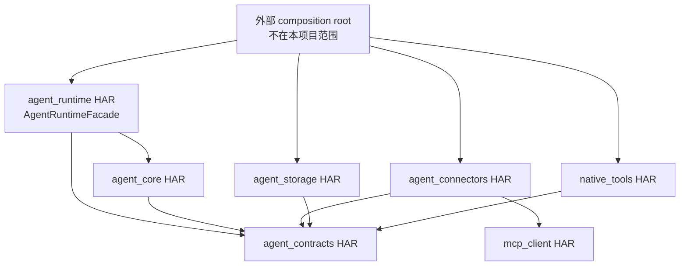

> **历史归档，不是当前操作指南。** 来源：Harmony_agent `f1771764f129193725a8bccb5da2be6c3604e998` 的 `docs/architecture/HARMONY_AGENT_DEVELOPMENT_MODULES.md`。归档日期：2026-10-23。
> 原文版本、机器路径、授权与验收结论只适用于上游现场；Shuvi 当前状态以 [项目进度与验收](../../../../08-项目进度与验收.md) 为准。原相对文档链接改指固定上游版本，不代表所链接的制品已经迁入。

# harmony_agent 开发模块拆分

2026-10-03 已统一命名并保留原有任务划分。更名前的设备证据不作为当前命名版本复验结果；命名与兼容边界见 [HARMONY_AGENT_NAMING.md](https://github.com/AlterGo-xzy/Harmony_agent/blob/f1771764f129193725a8bccb5da2be6c3604e998/docs/HARMONY_AGENT_NAMING.md)，最新完成门以 [PROJECT_STATUS.md](https://github.com/AlterGo-xzy/Harmony_agent/blob/f1771764f129193725a8bccb5da2be6c3604e998/PROJECT_STATUS.md) 为准。

状态：**In progress / T01–T48、T50–T52 当前任务门已通过，T51 已验收并作为 T52 基线；S6、S7 已关闭，S8 暂缓，S9 已完成来源冻结、复现准入、环境输入合同与 adaptation handoff 结构门**
日期：2026-10-19
上位架构：[HARMONY_AGENT_ARCHITECTURE.md](https://github.com/AlterGo-xzy/Harmony_agent/blob/f1771764f129193725a8bccb5da2be6c3604e998/docs/architecture/HARMONY_AGENT_ARCHITECTURE.md)

## 1. 拆分结论

开发工作分为两套互相映射但不等同的结构：

1. **6 个 Agent 侧构建模块**：控制 HAR 依赖、SDK 权限与发布边界；不包含产品 UI/HAP。
2. **16 个开发模块 M00–M15**：控制任务分工、实施顺序和独立验收。

算法不是独立产品 Runtime：MTRouter、MasRouter、HYSET 和 AFlow 分别作为 M12–M15 接入已经完成的基线接口。任何算法模块失败，都不能破坏确定性 baseline。

本项目只交付 Agent。为保持 M00–M15 的编号和追踪稳定，M05 和 M09 使用 A/B 子交付而不增加新的顶层编号：M05-A 先交付执行恢复存储，M05-B 后交付长期记忆；M09-A 先交付公共契约和 headless fake，M09-B 再交付生产 Runtime Facade。原 Product Host/UI 工作整体移出本项目。

## 2. Agent 侧构建模块

### 2.1 目标目录

```text
Harmony Agent/
  agent_contracts/       # HAR：跨模块纯契约和 schema
  agent_core/            # HAR：确定性 workflow kernel
  agent_runtime/         # HAR：headless facade、session、planner、router/policy 编排
  agent_connectors/      # HAR：MCP adapter、LLM/Remote API adapter
  agent_storage/         # HAR：task/operation/budget/trace/registry/memory 持久化
  native_tools/          # HAR：HarmonyOS/OpenHarmony Kit adapters
  mcp_client/            # 已存在 HAR：MCP 协议和传输
  test_host/             # 无页面 test-only Entry HAP：测试 MCP 与 Agent HAR 设备边界

  offline/               # 非 Hvigor 在线模块
    paper_repro/
    parity/
    harmony_agent_bench/
    artifact_tooling/
```

当前 `build-profile.json5` 已包含 `agent_contracts`、`agent_core`、`agent_runtime`、`mcp_client` 和 `test_host`。其余新增模块必须按垂直切片逐个加入，不能一次性创建全部空壳。

### 2.2 依赖规则



强制规则：

- `agent_contracts` 不依赖任何其他业务模块，也不调用系统 API。
- `agent_core` 不依赖 ArkUI、Ability、网络、数据库、MCP、具体模型 Provider 或论文 Python 包。
- `agent_runtime` 只依赖抽象端口并暴露纯 ArkTS `AgentRuntimeFacade`；它是唯一任务执行与控制入口。factory、DTO、observer 和 ports 不得创建任务或推进状态。
- `agent_connectors` 可以依赖现有 `mcp_client`，但 `mcp_client` 不能反向依赖 Agent 模块。
- `native_tools` 独立承载 Kit、权限和设备能力差异。
- 产品 UI、Ability 生命周期和交互式用户授权由外部调用方负责，不属于本项目；Agent 发出结构化 `PolicyRequest`，校验调用方回传的 `AuthorizationDecision`，并在 Policy Gateway 内部签发执行 grant。
- `test_host` 只服务 MCP 与 Agent HAR 的设备验收，不升级成产品宿主，也不承载产品页面。
- `offline/` 不写入在线 Agent 的 `oh-package.json5`，也不进入运行时 HAR 或调用方产品包。

### 2.3 构建模块职责

| 构建模块 | 公共输出 | 禁止包含 |
|---|---|---|
| `agent_contracts` | Task、Workflow、Router、Tool、Policy、Trace、Artifact 契约 | SDK 调用、网络、存储实现、UI |
| `agent_core` | Graph Validator、状态机、Scheduler、Budget Ledger、Recovery | LLM Prompt、MCP transport、Kit 调用、数据库 |
| `agent_runtime` | Session Controller、Planner facade、Router coordination、Policy Gateway | ArkUI、具体 Provider secret、论文训练代码 |
| `agent_connectors` | MCP/LLM/Remote API adapter、provider catalog | Native Kit 权限逻辑、业务 UI |
| `agent_storage` | 执行恢复/预算/Trace/Registry/Memory Repository、迁移、保留期、脱敏导出 | Planner、Router 评分、UI |
| `native_tools` | 系统能力 ToolDescriptor 和 invocation adapter | MCP、模型 Provider、Agent 调度 |

## 3. 开发模块总表

依赖分为三个门：**可开始设计**只允许冻结接口和 fixture；**可实现**允许写模块内部代码；**可完成集成验收**才允许声明该能力已接入 Runtime。设计门通过不代表可以绕过后续策略、持久化或设备验收。

| ID | 开发模块 | 主要构建位置 | 可开始设计 | 可实现 | 可完成集成验收 |
|---|---|---|---|---|---|
| M00 | 契约与 Schema | `agent_contracts` | 无 | 无 | contract tests |
| M01 | Workflow Kernel | `agent_core` | M00 | M00 | M00 |
| M02 | 预算、策略与授权内核 | `agent_core` + `agent_runtime` | M00 | M00、M01 | M01 |
| M03 | Session、Planner 与 Runtime 编排 | `agent_runtime` | M00 | M01、M02 | M02 |
| M04 | Registry 与确定性 Router Baseline | `agent_runtime` | M00 | M02 | M02 |
| M05-A | 执行恢复存储 | `agent_storage` | M00、M01 | M00–M02 | M01、M02 |
| M05-B | 长期记忆与派生索引 | `agent_storage` | M00 | M05-A | M05-A |
| M06 | MCP Agent Adapter | `agent_connectors` | M00、现有 `mcp_client` | M00、现有 `mcp_client` | M02、M03 |
| M07 | LLM 与 Remote API Connectors | `agent_connectors` | M00 | M00 | M02、M03 |
| M08 | Native Kit Tools | `native_tools` | M00、目标 SDK 证据 | M00 | M02、M03；写能力另需 M05-A |
| M09-A | 公共 SDK 契约与 headless fake | `agent_contracts` + `agent_runtime` API shell + 测试源集 | M00 | M00、M01 | M01 |
| M09-B | 生产 Headless Agent SDK | `agent_runtime` | M00、M09-A | M02、M03 | M03、M05-A、实际启用的 adapter |
| M10 | TestKit、故障注入与 harmony_agent Bench | `agent_testkit` + 测试源集 + `offline/harmony_agent_bench` | M00 | M00，逐步接入 | 对应被测模块 |
| M11 | Artifact、Parity 与策略发布链 | `offline/parity` + `artifact_tooling` | M00、M10 | M00、M10 | M10 |
| M12 | MTRouter 接入 | offline + `agent_runtime` policy | M04、M10 | M04、M10、M11 | M04、M10、M11 |
| M13 | MasRouter 接入 | offline + `agent_runtime` policy | M03、M04、M10 | M03、M04、M10、M11 | M03、M04、M10、M11 |
| M14 | HYSET 接入 | offline + `agent_runtime` policy | M04、M10 | M04、M06、M08、M10、M11 | M04、M06、M08、M10、M11 |
| M15 | AFlow Offline Optimizer | `offline/paper_repro` | M01、M10 | M01、M10、M11 | M01、M10、M11，稳定 evaluator |

## 4. 基础模块

### M00：契约与 Schema

目标：建立所有模块唯一共享的稳定语言，不带任何运行时实现。

主要契约：

- `TaskSubmission`、`TaskHandle`、`TaskEnvelope`、`TaskFrame`、`ExecutionBudget`；
- `WorkflowGraph`、`WorkflowStep`、input/output binding；
- `RouterRequest<T>`、`RouterDecision<T>`；
- `ToolDescriptor`、`ToolInvocation`、`ToolOutcome`；
- `PolicyRequest`、`AuthorizationDecision`、内部 `AuthorizationGrant`；
- `AgentRuntimeEvent`、`AgentTaskSnapshot`、控制命令/回执、`ReconciliationReport`；
- `TraceEvent`、`ArtifactManifest`；
- 版本号、枚举、错误分类和分域 digest/version 规则。

任务：

1. 冻结 `requestId`、`conversationId`、`taskId`、`sessionId`、`operationId`、`attemptId` 的生成方、关联、幂等和序列化规则。
2. 冻结 reference time、time zone、locale、金额、token 和 deadline 的单位及恢复语义。
3. 冻结 `sideEffect`、`riskLevel`、`idempotencyMode` 和 `outcome` 枚举。
4. 设计向前兼容的 schema version、snapshot/event continuity 与未知字段处理。
5. 为每个契约提供合法、非法、重复、过期和兼容性 fixture。
6. 只从 `Index.ets` 导出经过评审的公共面。

完成标准：

- 纯 ArkTS 单元测试可验证 round-trip、必填字段和版本兼容；
- 契约中没有 `UIAbilityContext`、HTTP client、数据库 handle 或具体 Provider 类型；
- 其他模块不再自行定义重复的 task/tool/trace 类型。

T01 已完成基础契约；T03/T04 又完成了 `TaskSubmission`、`AuthorizationDecision`、澄清请求/回复、公共 event/snapshot、控制回执、对账报告，以及 operation/attempt/tool identity 等绑定字段的 M00 版本化增量。M09-A headless fake 已基于这些契约交付。

### M01：Workflow Kernel

目标：不接 LLM、不接真实工具，也能可靠执行一个类型化 DAG。

子组件：

- Graph Validator；
- Task/Step state machine；
- dependency scheduler；
- deadline、取消传播和 join；
- operation journal；
- deterministic recovery controller。

任务：

1. 校验无环、依赖、binding 和 output schema。
2. 实现 `PENDING -> READY -> RUNNING -> VERIFYING -> terminal` 状态迁移。
3. 只对无冲突的独立步骤并行调度。
4. 实现 `UNKNOWN_OUTCOME` 和重启后写操作对账边界。
5. 用 fake executor 验证完整流程。

完成标准：

- 非法图在任何副作用前失败；
- 取消、超时和并行 join 可重复测试；
- 不可逆步骤断线后不会自动重放；
- 同一个 fixture 的事件顺序在允许的并发边界内确定。

### M02：预算、策略与授权内核

目标：任何模型、Router 和 Tool 都无法绕过硬限制。

子组件：

- Budget Ledger；
- candidate eligibility filter；
- Policy Gateway；
- authorization decision validator 与 internal grant issuer；
- cost ceiling 与调用配额；
- secret reference 与脱敏器。

任务：

1. 支持 task、step 和 provider 三层预算预留/结算。
2. 把“被 Router 选中”与“获准调用”定义为两个独立状态。
3. Agent 输出 `PolicyRequest`；外部调用方只回传批准/拒绝的 `AuthorizationDecision`，不能直接签发 grant。
4. Policy Gateway 生成内部 grant，并绑定用户、task、step、tool identity version、输入 schema digest、参数摘要、policy version 和有效期。
5. 明确重复决定、过期、撤回、参数变化、跨任务复用和错误 request 关联的拒绝规则。
6. Tool 风险、副作用和权限元数据来自受控 Registry 与平台探测，不信任 Planner 或远端 Tool 的自报值。
7. 写操作必须声明幂等或对账方案；业务 grant 不替代操作系统权限。
8. 并发调用先预留预算；取消、断线和未知费用不得立即释放全部预留。
9. 日志和错误对象统一过脱敏器。

完成标准：

- 没有内部 grant 的工具调用默认拒绝，调用方构造的 grant 无效；
- 重复/过期/撤回/错任务/参数变化/schema 或 tool identity 变化的决定不能触发额外执行；
- Router 无法扩大预算、角色数或候选范围；
- 系统权限拒绝返回明确 outcome，不能通过替换 Router、Tool 或 adapter 绕过；
- 并发、重试、重启和费用未知不能突破预算；
- secret 不出现在 prompt fixture、trace 和异常消息中。

## 5. 在线编排模块

### M03：Session、Planner 与 Runtime 编排

目标：把用户任务转成可验证 workflow，并驱动 M01/M02，而不亲自执行外部调用。

子组件：

- Session Controller；
- Task Analyzer；
- Semantic Planner port；plan/resume/replan 使用 Promise，Facade 串行队列在规划完成前禁止 workflow drive 和 Tool dispatch；
- plan sketch -> collaboration -> full plan 两阶段流程；
- 内部 Runtime application service 与 composition API；
- `TaskSubmission -> TaskEnvelope` 规范化、重复提交去重和 ID 分配；
- 澄清、暂停/恢复、取消、授权等待、对账等待、部分结果和迟到结果的编排语义；
- partial/full replan controller。

M03 实现 M09 公共接口所需的内部编排行为，但不另行定义第二套 `AgentRuntimeFacade`。公共方法、版本、observer 和兼容性由 M09 统一拥有。

当前实现状态（T05）：内部 `RuntimeCoordinator`、Session Controller、Task Analyzer、composition ports、异步 step dispatch 边界和 partial replan controller 已落地；`RuntimeCoordinator` 不从 HAR 公共 `Index.ets` 导出，外部仍不能绕过 `AgentRuntimeFacade` 控制任务。当前只以 fixture ports 验证编排行为，不代表 M09-B 生产 Facade、真实 Planner/Tool/Provider 或持久化恢复已经完成。

完成标准：

- 固定 Planner fixture 能产出 M01 可执行 workflow；
- Planner 的自由文本不能直接触发 Adapter；
- partial replan 只替换受影响子图，不重建已成功操作，也不丢失仍待对账的 operation；
- 澄清与授权使用不同状态和契约；暂停只停止新分派，取消不等于撤销已发生的系统操作；
- snapshot/event 使用单调 version/sequence，迟到事件不能覆盖较新状态；
- Agent 数、replan 次数和 planner 调用都计入预算。

### M04：Registry 与确定性 Router Baseline

目标：在 learned policy 进入前提供完整、可解释、可生产降级的路由能力。

子组件：

- Model Registry、Role Registry、Tool Registry、Workflow Registry；
- static Model Router；
- single-first Collaboration Router；
- token-budget Context Router；
- deterministic tag/keyword Tool Router baseline，可选叠加 independent embedding/top-k；
- policy version 与 router trace。

完成标准：

- 每个 learned router 都能被配置关闭并无缝回退；
- Registry 使用稳定 ID、版本和 digest；
- hard eligibility 在任何评分前运行；
- embedding 不可用或不值得部署时仍能使用 deterministic Tool Router 完成基础流程；
- 同一输入、候选快照和配置产生可重复决策。

当前实现状态（T06）：四类内存 Registry、static Model Router、single-first Collaboration Router、token-budget Context Router 和无 embedding 的 tag/keyword Tool Router 已落地。Model/Tool 的 hard eligibility 先于评分和 learned port；learned policy 可配置关闭，低置信度、异常、越界候选和超预算选择均回退到确定性 baseline。Registry 同一稳定 ID/版本的内容漂移会拒绝，entry schema/description/retrieval digest 的职责保持分离。公共 Router/Registry API 只产生快照或决策，不能绕过 `AgentRuntimeFacade` 推进任务，也不能替代 Policy Gateway 授权。

## 6. 数据与连接器模块

### M05：执行恢复存储与长期记忆

目标：先闭合真实执行的恢复安全，再交付长期记忆；不把存储模型泄漏给核心模块。

#### M05-A：执行恢复存储

Repository 端口：

- `TaskRepository`、`OperationRepository`；
- `BudgetRepository`、`TraceRepository`；
- `RegistryRepository`、`PolicyRepository`；
- recovery lease/fencing port。

任务：

1. 持久化 task/step snapshot、稳定 operation ID、执行意图、参数摘要、provider receipt 和 `UNKNOWN_OUTCOME`。
2. 实现 append-oriented trace、预算预留/结算、migration、schema version、损坏处理和 retention。
3. 固定写入顺序：预算预留与 PREPARED 记录可靠保存后才能调用平台能力；随后保存明确结果或未知状态。
4. 写前保存失败时不调用工具；系统可能已执行但结果未提交时进入对账，不能当作普通失败重放。
5. 通过 lease/fencing 或等价机制避免多个恢复执行者处理同一 operation。

完成标准：

- 分别覆盖调用前退出、调用中退出、收到结果但提交前退出；
- 应用重启后保留原 operation ID、已完成结果、未知状态和预算占用；
- 重复恢复不会产生两个执行者或重复写入；
- 内存 journal 测试不能代替持久化、损坏和并发恢复测试；
- M05-A 完成前，任何真实写 adapter 都不能标记为可用。

当前实施状态（T07，已完成本地实现与设备验收）：Repository ports、恢复协议 Store、完整 snapshot CAS durable session 和 API 26 `RdbStore` backend 已落地。durable session 在隔离副本上变更，只有 backend CAS 成功才发布新状态；打开持久化快照时会先把遗留 `IN_FLIGHT` 可靠推进为 `UNKNOWN_OUTCOME`。RDB adapter 只接收宿主已打开的 `RdbStore`，不依赖 `Context`、Ability 或 UI。除主机 fake-backend 测试外，API 26 设备套件已验证真实 RDB close/reopen、损坏注入和恢复 session 竞争。M05-A 不再单独阻塞写 adapter，但每个 adapter 仍需通过 M02、M03 和自身设备验收。

#### M05-B：长期记忆与派生索引

Repository 端口：`MemoryRepository`、`ArtifactRepository` 及可重建索引端口。

任务：区分小型偏好、结构化记忆和可重建索引，实现受控导入、分块、检索、导出、脱敏和删除。删除记忆后索引与派生缓存同步失效；默认不把原始个人轨迹上传到离线域。`MemoryRepository` 类型存在不代表长期记忆功能已完成。

具体 RDB、Preferences 或文件 API 在实现对应子交付时依据实际数据形态和 API 26 SDK 再锁定。

当前实施状态（T08，已完成）：`agent_storage` 0.2.0 已提供类型化 Memory DTO、四类公共端口、纯 ArkTS `DeterministicMemoryStore`、完整快照 `DurableMemoryStore` 与宿主注入式 API 26 `RdbMemorySnapshotBackend`。除基础语义外，主机证据验证 CAS 失败不发布、并发 session 单胜者、重开索引重建、损坏 fail-closed 和显式 schema migration；当前命名版本的 signed 主 HAP 与 ohosTest HAP 已在 API 26 完成 `MemoryDeviceRecovery` 3/3，覆盖真实 RDB close/reopen、索引重建、stale session CAS 单胜者和损坏注入，并完成独立卸载验证。宿主仍负责数据库打开、加密、备份和关闭。

### M06：MCP Agent Adapter

目标：复用现有 `@harmony_agent/mcp-client`，把 MCP 能力转换为统一 Tool port。

M00 完成后可以设计并实现纯 adapter 映射；只有 M02 grant/policy 行为冻结且 M03 Runtime 可调用端口后，才能完成 Agent 集成验收。

子组件：

- MCP Server Profile -> provider registry；
- MCP Tool -> `ToolDescriptor` 规范化；
- input/output schema digest、tool identity version 与缓存/grant 失效；
- `ToolInvocation` -> `McpClientManager.callTool`；
- MCP outcome/error -> Agent error taxonomy；
- `McpInvocationPolicy` 与 M02 grant 的桥接。

完成标准：

- 不修改现有 MCP 公共契约也能接入 Runtime；
- `{serverId, kind, name}` 保持能力身份的一部分；
- 查询重试和工具不重试的现有语义不被放宽；
- Server/schema 变化会使旧 Router cache 和 grant 失效；
- MCP 客户端测试与 Agent adapter contract test 分开报告。

当前实施状态（T09/T29，本地主机门已通过）：`@harmony_agent/agent-connectors` 提供 MCP Provider registry、受控只读 Tool allowlist、规范 JSON/schema digest、绑定 Profile 版本、Profile 内容与 schema 的 tool identity、`McpClientManager.callTool` 端口、M02 grant verifier 与一次性 `McpInvocationPolicy` ticket、MCP outcome/error taxonomy 映射，以及实现 M03 `StepDispatchPort` 的异步 adapter。T29 新增生产组合工厂，在暴露唯一 `AgentRuntimeFacade` 前完成 catalog discovery、临时 Registry 校验、共享空 Registry 发布、Strong Single selector 与私有 completion sink 接线；空/部分失败 catalog、非法 entry 和非空目标 Registry fail-closed。MCP adapter 及 composition 18/18、合并 connector 38/38 与 Release HAR 构建通过；既有 MCP client 26/26 证据单独保留。真实远端 MCP、设备网络和 S2 端到端任务闭环仍不由本地主机门证明。

T30 已把生产组合工厂、显式授权和真实 `McpClientManager` HTTP transport 接入 `test_host` 的独立 `McpFacadeDevice` class，并以 fixture stats 约束一次 Tool 调用。当前源码的 unsigned 主/ohosTest HAP 已在 API 26 安装，`McpFacadeDevice` 通过 1/1，并完成 bundle、HDC 转发和 fixture 清理；S2 的受控只读 MCP Facade 设备闭环已关闭。该门仍不证明发布签名、生产 Planner/credential store 或第三方远端 MCP 兼容性。

### M07：LLM 与 Remote API Connectors

目标：用统一端口隔离 Provider 差异、价格和网络行为。

M00 完成后可以设计 Provider 端口和独立 fake/contract test；真实 Runtime 集成必须等待 M02 的预算/凭据边界和 M03 编排。

子组件：

- `ModelProvider`、`EmbeddingProvider`、`RemoteApiProvider`；
- model/version/region/price snapshot；
- streaming/cancellation/timeout；
- token 与 cost accounting；
- provider error normalization；
- credential provider。

完成标准：

- Runtime 不出现 Provider 专用请求类型；
- 每次响应可追溯到 model version、region、价格快照和 usage；
- 取消和 timeout 会释放网络资源；
- 凭据只在 connector 边界注入。

当前实施状态（T10/T28/T29/T33–T37）：`@harmony_agent/agent-connectors` 0.7.0 已提供 Provider-neutral contracts、Local AI Gateway transport、MCP Production Facade、Provider-backed Planner 及其具体 composition。T37 让通用和网关工厂保留宿主显式注入的 `CollaborationSelectorPort`，缺失时固定回退 Strong Single；Multi 激活预算不足会在 planner、credential、网络和 MCP 前失败，并保留有效恢复检查点。合并 connector 主机套件 52/52、runtime 64/64；Release HAR 为 58,288 bytes、SHA-256 `BAFCEE611C9349B570E30B6FF57BA365AA59E77953B57D15BF5EDEC26F5F7073`。T36 的 signed `LocalAIGatewayFacadeDevice` 已在 API 26 实际通过 1/1，证明一次真实网关 Planner → 唯一 Facade → 显式授权 → MCP `echo` → completion；既有 signed `LocalAIGatewayDevice` 2/2 与 unsigned `McpFacadeDevice` 1/1 证据继续按各自范围有效。T37 没有真实 Provider、HAP 或设备证据，也没有实现角色拓扑或 Agent 间消息编排。

### M08：Native Kit Tools

目标：把每个 HarmonyOS/OpenHarmony 系统能力实现为独立、可授权的 Tool Adapter。

每项能力使用同一模板：

```text
Descriptor
  -> availability probe
  -> required-permission metadata / current permission probe
  -> typed invocation
  -> result normalization
  -> cleanup/cancel
  -> device contract test
```

第一批只选择产品 MVP 真正需要的 Kit。位置、联系人、日历、相机、蓝牙等能力不得因为架构中提到就一次性全部实现。

职责边界：`native_tools` 负责 capability/permission probe、类型化平台调用、结果归一化、取消与清理，并在需要交互式系统授权时返回结构化 `SYSTEM_PERMISSION_REQUIRED`；外部产品宿主负责最终 HAP 的权限声明、Ability 生命周期和系统授权 UI。Agent 仓库可以提供独立 test harness 验证 adapter，但不提供产品 Entry HAP 或确认页面。

当前实施状态（T11，本地实现、构建与签名设备验收均已通过）：`@harmony_agent/native-tools` 0.1.0 已实现 API 26 `@ohos.batteryInfo` 的只读 `native://device/power.status.read`。adapter 生成 NATIVE/device-only/zero-cost descriptor，运行时探测 `SystemCapability.PowerManager.BatteryManager.Core`，复核 M02 grant 与冻结的 identity/schema/参数摘要，检查后台执行和取消，并把平台枚举归一化为稳定 JSON；`NativeStepDispatchAdapter` 实现既有 M03 `StepDispatchPort`，结果回送注入的 sink，没有新增任务控制入口。该系统 API 当前不要求权限，因此 descriptor 权限列表为空，不能用它替代未来 permission-required Kit 的拒绝/允许验收。主机 Hypium 12/12、Release HAR 与主/ohosTest HAP 构建通过；签名包已在 API 26 模拟器安装，`BatteryStatusDevice` 使用真实系统 probe/read 运行 1/1 通过，随后卸载并确认 bundle 不存在。该首个 permission-free battery Kit 已标记为设备可用。

完成标准：

- 编译期 API、权限声明、运行时授权和硬件可用性分别处理；
- 用户拒绝、设备不支持、后台受限和中途取消都有明确 outcome；
- 写能力提供确认、幂等/对账和设备清理证据；
- 真实写能力只有在 M02 授权链和 M05-A 持久化恢复链通过后才能接入生产 Facade；
- 每个 Kit 独立通过 test harness 构建、安装和设备运行测试后才标记可用；测试载体不是产品 UI/HAP 交付物。

## 7. 集成与验证模块

### M09：Headless Agent SDK 与外部集成契约

目标：向任意外部调用方提供稳定、无 UI、无 Ability 依赖的 Agent 调用面，不实现产品前端。

#### M09-A：公共契约与 headless fake

M00/M01 后即可交付，不等待真实 Planner、Provider、Storage 或 Native Tool。数据契约放在 `agent_contracts`，Facade/factory/observer 接口及明确命名的 fake 实现放在 `agent_runtime` API shell：

- 唯一控制入口 `AgentRuntimeFacade` 的版本化方法和错误语义；
- `TaskSubmission`、`TaskHandle`、控制命令/回执；
- `PolicyRequest` 输出与 `AuthorizationDecision` 回传；
- `ReconciliationReport`、消费者安全的 `AgentRuntimeEvent`、`AgentTaskSnapshot`；
- version/sequence、去重、订阅释放、生命周期和兼容性规则；
- 固定 Planner、Fake Tool 和内存存储组成的 headless fake runtime/consumer。

fake 必须明确标记为测试实现，不伪装成真实系统能力；`DemoScenario` 等演示控制参数不得进入生产公共契约。它只证明调用方能按契约完成提交、澄清、授权批准/拒绝、取消、部分成功、未知结果、恢复和事件/快照衔接。

当前实现状态：已交付 `AgentRuntimeFacade`、observer/subscription、`createFakeAgentRuntime`、`FakeAgentConsumer` 和显式 `Fake*` 脚本配置。fake 配置只存在于测试实现 API，不进入 `agent_contracts` wire DTO；内部 Policy Gateway 不从公共 `Index.ets` 导出。

#### M09-B：生产 Runtime Facade

- M03 内部编排对 M09-A 公共接口的唯一实现；
- 版本化 factory/composition ports；
- lifecycle-neutral 的持久化/恢复调用，不接收页面或 Ability 对象；
- 只接入已经分别通过 M02、M05-A 以及自身验收的 connector/tool。

完成标准：

- 公共 API 不出现 ArkUI、`UIAbility`、`UIAbilityContext`、页面状态或产品 HAP 类型；
- 普通调用方只有 `AgentRuntimeFacade` 一条任务控制路径；factory、DTO、observer 和 ports 不能旁路 Runtime；
- 外部提交不直接携带规范 `taskId`/`sessionId`，由 Session Controller 分配并绑定到 `requestId`；
- fake consumer 可以完成提交、事件观察、授权决定、取消、恢复和对账闭环；
- 调用方不能绕过 Policy Gateway 直接把 Tool/Model 标记为已授权；
- 内部 `TraceEvent` 不直接暴露；公共 event/snapshot 已脱敏并可按 sequence/version 去重衔接；
- Provider secret 仅通过受保护的 credential port 按调用注入，不进入任务、事件或 snapshot；
- 产品如何展示澄清、确认、部分成功、未知结果和错误明确属于外部范围；产品页面联调不是每个 Agent 模块的完成条件。

当前实施状态（T24，本地主机与未签名构建门已通过）：`@harmony_agent/agent-runtime` 0.11.0/composition 2.3 已完成 Promise-based Facade、同实例 FIFO、checkpoint 1.1 严格校验、锁定式协调器重建、recovery authority hydration、checkpoint/authority 同状态写入，以及无在途 operation 的启动恢复与 event replay；`@harmony_agent/agent-core` 0.2.0 提供按 taskId 防御性导出的完整 scope/reservation 图；`@harmony_agent/agent-storage` 0.6.0/schema 1.2 已提供 opaque checkpoint、任务枚举、单 CAS transaction、Runtime bridge 和 durable authority 回读组装。core 21/21、runtime 59/59、storage 45/45 与对应 Release HAR 已通过。active operation 的 durable 状态归一化、lease 接管、RDB composition 和跨进程设备验收仍未完成；当前存储设备套件只完成 unsigned HAP 编译。

当前实施状态（T25，本地主机与 HAR 门已通过）：`@harmony_agent/agent-runtime` 0.12.0/composition 2.4 与 `@harmony_agent/agent-storage` 0.7.0 新增 active operation 的专用恢复事务。恢复 factory 在暴露唯一 Facade 前读取旧 checkpoint/authority，协调器生成 `WAITING_RECONCILIATION` checkpoint；bridge 通过一次 backend CAS 接管 fencing、把 operation 与预算保守规范化为 `UNKNOWN_OUTCOME`、释放 recovery lease 并保存下一版本 checkpoint。CAS 冲突或绑定错误继续 fail-closed，Adapter 不会被重放。runtime 60/60、storage 47/47 与两个 Release HAR 已通过；RDB composition 和设备跨进程验收仍未完成。

当前实施状态（T32，本地主机与 HAR 门已通过）：`@harmony_agent/agent-runtime` 0.13.0 将 `SemanticPlannerPort.plan/resume/replan` 统一为 Promise。内部协调器等待 Planner 返回后才应用 typed workflow，生产 Facade 随后才可 drive/dispatch；拒绝路径只发布稳定的 `plannerInvocationFailed`，不把底层异常文本写入公共 snapshot/event。主机 63/63 与 Release HAR 已通过；真实语义 Planner、Provider-backed typed workflow 生成和 S6 system run 仍待后续。

当前实施状态（T39，本地主机与 HAR 门已通过）：`@harmony_agent/agent-runtime` 0.14.0/composition 2.5 新增 schema 1.0 `CollaborationPlan`、逐角色 Registry identity、完整 SHA-256 Registry/decision 摘要与 `CollaborationPlanSelectorPort`。确定性 Collaboration Router 可使用宿主 cryptographic digest port 从 active Role Registry 生成只含已注册角色的计划；显式计划作为 Planner request 和 checkpoint 1.1 的深拷贝状态参与恢复。旧 Single checkpoint 兼容，MULTI 只有模式标签、角色重复、非法摘要或激活预算越界均在 Planner 前 fail-closed。MCP/Provider/Local AI Gateway composition 保留该 port，但仍只返回 `AgentRuntimeFacade`。runtime 68/68、connector 52/52 与 Runtime Release HAR 已通过；逐角色独立 Provider 调用、消息编排、结果汇合与 S6 真实双 arm run 尚未实现。

当前实施状态（T40，本地主机与 HAR 门已通过）：`@harmony_agent/agent-connectors` 0.8.0 新增 `CollaborativeProviderSemanticPlanner`。有效计划按角色顺序触发独立 Provider request；第一角色生成 typed workflow，后续角色以该 workflow 作为 `previousWorkflow` 进入已有 replan 校验路径，最终结果仍回到唯一 Facade。每个 trace 只增加 activation/request、role identity、decision digest 与 usage；计划外角色和累计 token/cost/Agent 预算越界在网络前拒绝。connector 55/55 与 Release HAR 已通过；当前证据使用 fake Provider/HTTP/MCP fixture，真实 Provider 质量、12×2 双 arm Bench 和设备运行仍待后续。

当前实施状态（T33，本地主机与 HAR 门已通过）：`@harmony_agent/agent-connectors` 0.4.0 的 `ProviderSemanticPlanner` 已实现 T32 的异步 Planner port。Adapter 冻结 Provider/model/version/region/price，预检 privacy 与输入/输出 token、金额、prompt 预算，只接受结构化 JSON，并在返回 Runtime 前重建可信 workflow/clarification 身份、校验字段、DAG、binding、副作用/幂等与 Tool capability。connector 合并主机套件 44/44，无签名隔离 Release HAR 为 99,486 bytes、SHA-256 `6330B38ADC471A67697BFF2643BB3829A8C5CE6E06682E4DFBAC876236D1CCB9`。这仍是 fake Provider 的 host gate；具体生产 composition、真实 Provider Planner/system run、HAP 和设备门未执行。

当前实施状态（T34，本地主机与 HAR 门已通过）：`@harmony_agent/agent-connectors` 0.5.0 新增 Provider Planner 的 MCP production 新建/恢复工厂。工厂不导出内部协调器或第二控制入口，只返回既有 `AgentRuntimeFacade`；它在目录发现前校验 Planner 所有权及 Runtime clock/ID，并复用 T29 catalog-before-Facade 与 completion sink 边界。新增 3 项后 connector 为 47/47；无签名隔离 Release HAR 为 56,551 bytes、SHA-256 `05AE633E28D6326F9B07124911B3FC7F84C7DF3A9A20450613F434DF1AB0831C`。真实 Provider、生产凭据、HAP、签名和设备均未执行。

当前实施状态（T35/T37 主机/HAR 与 T36 signed API 26 门已通过）：`@harmony_agent/agent-connectors` 0.7.0 的 Local AI Gateway production 新建/恢复工厂要求宿主注入 digest 与 credential port，默认可使用 ArkTS HTTP client/System timer，在暴露唯一 Facade 前完成 model/price 注册并组装 Generic Provider 与 Planner。T37 继续保留宿主显式协作选择器，未提供时回退 Strong Single；新增用例覆盖 Multi 选择贯穿 composition，以及激活预算不足时 planner/credential/network/MCP 调用数均为 0。connector 为 52/52，runtime 为 64/64；Release HAR 为 58,288 bytes、SHA-256 `BAFCEE611C9349B570E30B6FF57BA365AA59E77953B57D15BF5EDEC26F5F7073`。T36 无页面测试已把该工厂接入真实网关桥与真实 MCP fixture；signed 主/ohosTest HAP 安装后设备报告 1/1，通过一次 Provider 200、显式授权和一次 MCP `echo` 完成任务，并完成卸载与转发/进程清理。

### M10：TestKit、故障注入与 harmony_agent Bench

目标：让每个开发模块都能在没有完整产品的情况下独立验收。

测试层级：

1. contract fixtures；
2. pure ArkTS unit tests；
3. module integration tests；
4. fixture server/provider tests；
5. 必要时由独立 test harness 执行设备 contract tests；
6. harmony_agent Bench system evaluation。

故障注入：网络断开、timeout、429/5xx、认证失败、权限拒绝、schema drift、重复响应、应用重启、预算耗尽、模型低质量输出和不可逆调用未知结果。

完成标准：

- 测试结果区分主机侧构建/测试、test harness 安装和设备运行；
- benchmark 固化 model、provider、region、价格、schema 和日期；
- Strong Single Agent 与多 Agent 使用相同权限和上下文策略；
- 质量、token、成本、p50/p95、工具、Agent、恢复和 Router 指标可导出。

当前实施状态（M10 TestKit 0.6.0、T38/T41/T42 证据合同、封存和执行准入门，以及 T43/S6 真实批次均已通过）：公共 TestKit 已冻结十二种 pilot task、32/128/512 Tool Registry case、公平双 arm manifest 与 schema 2 真实报告 validator。T41 Recorder 只在 24 条完整 run 通过 validator 后返回封存副本；T42 preflight 在执行前绑定活动网关 Profile/revision、上游模型/价格、显式授权，以及 39 请求、每请求 4096/8192 Token 和 US$0.43134 最坏费用封顶。T43 使用 revision 13 的 active/complete `deepseek` Profile、signed API 26 主/ohosTest HAP 与唯一 `AgentRuntimeFacade` 完成实际 12×2 Provider/system run：设备套件 1/1，24 条 schema 2 记录封存，38 次请求全部成功，结算 US$0.031083；Strong Single 10/12、Multi 9/12、总计 19/24 质量通过。证据不含凭据或请求/响应正文，应用、转发、bridge 和网关已清理。S6 已关闭；该质量基线供后续 M11–M15 的策略发布、路由与离线优化使用。

### M11：Artifact、Parity 与策略发布链

目标：安全地把离线策略交给端侧，而不是直接复制论文仓库。

任务：

1. 冻结 source commit、许可证、数据 lineage 和原 benchmark 结果。
2. 导出 checkpoint/policy/workflow 与 `ArtifactManifest`。
3. 运行 reference implementation 与 ArkTS/bridge parity。
4. 做 digest、签名、runtime compatibility 和 feature schema 检查。
5. 支持 `disabled -> shadow -> canary -> active -> rollback` 生命周期。

完成标准：

- 未签名、不兼容、来源不完整的 artifact 不能 active；
- 发布策略失败不会影响 deterministic baseline；
- 所有 active artifact 可按 digest 回滚；
- paper reproduction 与 harmony_agent adaptation 的结果表完全分离。

当前实施状态：T44/M11-A 的 `ArtifactManifest` 已增加 checkpoint/policy/workflow 类型、通用 `artifactDigest`、审批、detached signature 与 rollback target 元数据；严格校验完整 source commit、SHA-256、JSON 证据对象、lineage、runtime compatibility、签名准入和受控生命周期转换。未签名 shadow 可进入不参与选择的影子评估，canary/active/rolledBack 必须已批准且签名元数据完整。主机 Hypium 21/21，Release HAR 28,939 bytes、SHA-256 `49553DB2CA8FFB077C892639D45FC05C0FCAC807055A07AE098065AC555A549F`，证据位于 `artifacts/t44-artifact-contract/20261017-213200-final/`。T45/M11-B 新增 canonical 单文件 package 与 Ed25519 pack/verify，自测 9/9，并在删除临时私钥后保留可独立 replay 的 package/public key，证据位于 `artifacts/t45-artifact-tooling/20261018-004000-final/`。T46/M11-C 已增加 compatibility evaluator、宿主验签端口、storage-neutral Artifact Registry 和 `DurableArtifactRegistryAdapter`；每种 kind 只有一个 canary/active 指针，Registry 先 durable CAS 再发布，重开重新验签，active 可按同 kind 历史 digest 原子回滚。T47/M11-D 又增加 baseline-first release runner 与 deterministic basis-point canary assignment；shadow 只观察，canary/active 异常、越界 decision 或损坏 Registry view 均回退 active/baseline，真实 Registry rollback 后同一 runner 已恢复旧策略选择。Runtime 主机 Hypium 89/89；Release HAR 为 118,685 bytes、SHA-256 `B377C9EF22FAB96EC5993F662DFF83CD46293A30A49C529AC7BFCE079C36840A`，包内版本 0.14.0、`debug=false`、compatible SDK 26，证据位于 `artifacts/t47-artifact-release/20261018-141826-final/`。M11-E 再为四类 policy 调用增加默认 5000 ms 的独立 timeout、外部取消订阅与协作资源释放信号；shadow 超时只观察、canary 超时回退 active、active 超时回退 baseline，baseline 超时和外部取消 fail-closed，迟到结果不再参与选择。Runtime 主机 Hypium 96/96；Release HAR 为 122,251 bytes、SHA-256 `8BAF17965F5EBE88348E03ED6C9B50A2A51FF5B81BFA7BCDFD63EE744548FA20`，证据位于 `artifacts/m11-policy-execution-control/20261018-225924-final/`。S7 通用策略供应链门已关闭；生产密钥治理、policy loader、具体策略资源释放实现和 learned Router 接线仍属于宿主与 M12–M14。

## 8. 算法接入模块

### M12：MTRouter

位置：替换 M04 的 Model Router policy，不替换 Registry、Budget 或 Policy Gateway。

顺序：

1. 原环境严格复现；
2. 生成固定 trajectory/candidate decision fixtures；
3. 导出 encoder/router artifact；
4. ArkTS 本地 bridge 或受控 embedding service 适配；
5. parity；
6. shadow routing；
7. harmony_agent Bench Go/No-Go。

验收：decision agreement 达到预注册门槛；Router 额外时延和资源可接受；相同模型池/价格快照下出现稳定 Cost@Quality 改善。

MTRouter 与 MasRouter 先分别验收再组合：Collaboration Router 先在总预算内决定 single/multi、角色和激活数，Model Router 再为每个已批准角色从合格候选中选择模型。路由一致率只评价策略迁移，不替代授权、预算、重复写入和恢复等安全不变量。

当前实施状态：T48/M12-A 已把官方仓库固定到 commit `ee9e4573a128c3e54aa8c83800318bfb783c4dfe` 和 tree `6911bcf33bfdd30d6f414c09b5f5d14c5deeb913`，并固定 source archive、MIT license、关键上游文件与 arXiv `2604.23530v1` 的 SHA-256。复现 spec 预注册论文三次运行、训练参数、六模型池、ScienceWorld/HLE 划分、预算/horizon、四项目标和 Go/No-Go 容差；离线 checker 报告可重复，fail-closed 自测 5/5。T48 没有安装依赖、读取凭据、调用 Provider 或运行 benchmark；T49 才能在另行授权后建立隔离原环境并执行上游 smoke/reproduction。decision fixture、checkpoint 导出、ArkTS/bridge parity、shadow 和 harmony_agent Bench 仍属后续 M12 门，S8 尚未关闭。

主仓库另已准备独立训练仓库的版本化 handoff admission：沿用现有 `LearnedRouterPort`，固定 5 MiB decision payload、64 MiB handoff、外部受控 history encoder 与 deterministic fallback，并以纯 Node checker 逐文件核验摘要、模型池顺序、严格字段集合和 evidence 边界；15/15 fail-closed 自测通过。该准备工作没有生成或接受真实训练产物，不改变 T49 原环境复现、后续 parity 或上线门的未完成状态。

项目所有者于 2026-10-18 决定暂缓 MTRouter 训练。T49 及后续训练、checkpoint、parity 和上线门保持未开始；接口、来源锁和离线 admission 工具保留，Runtime 继续使用 deterministic baseline，直至项目所有者重新明确启动训练。

### M13：MasRouter

位置：替换 M04 的 Collaboration Router policy。

额外约束：

- 只能选择 Role Registry 中存在的角色；
- single-agent 始终是合法 action 和 fallback；
- multi-agent 激活前预留总预算；
- 一次任务的协作模式重判次数有上限。

验收：降低 unnecessary activation；多 Agent 只在净收益任务启用；失败时回退 single 而不是扩大团队。

当前实施状态：T50/M13-A 已在 `offline/paper_repro/masrouter/` 冻结 MasRouter 官方仓库 commit `e005f7696fe0c0412563f6cd67f4cd3712fa2822`、tree `e4d618f81675a46ed6e2f5e6ee1970519f1afa5b`、Apache-2.0 license、15 个关键源码文件和 arXiv `2502.11133v1` PDF 的字节数与 SHA-256。复现 spec 分开记录论文协议和源码协议，并把接入边界固定为只替换 `CollaborationPlanSelectorPort`：角色只能来自 Role Registry、Single 始终合法、Multi 前预留完整激活预算、协作重判最多一次，低置信度/超时/checkpoint 不兼容回退 Single，外部仍只通过 `AgentRuntimeFacade` 控制任务。源码审计确认上游缺少依赖清单和 checkpoint，README 入口大小写与仓库不一致，Claude 价格元数据存在冲突，因此 strict reproduction 尚不具备执行条件。纯 Node checker 报告可重复，精简的关键漂移自测 4/4 通过。本门没有安装依赖、读取凭据、下载模型、训练、调用 Provider、执行 benchmark、修改 Runtime 或打包研究模型；S9 已启动但没有形成 learned policy、parity、shadow 或质量收益证据。

T51/M13-B 已把上述缺口转成可审计输入合同：四份 JSON Schema 定义环境、数据集、Provider/model revision 和价格快照；`environment-candidates.json` 记录 34 个直接依赖候选和 3 个隐式运行时依赖，全部 unresolved；`dataset-lock.json` 覆盖五个 benchmark，全部缺少 digest 且 `executionReady=false`；`model-pools.json` 严格分离论文 4 模型核心池、DeepSeek-V3 归纳验证和源码 5 模型 profile；`price-snapshot-candidate.json` 保留 Claude 价格冲突且禁止成本声明；`unresolved-issues.json` 记录 17 项问题（13 项 blocking）。checker 使用本地严格 JSON Schema 校验四份输入文档（未知字段、类型错误和必填缺失均 fail-closed），报告 `sha256:0f4367d6de077b0a6df712ff41d1e45af3681e7338f13cbe9973e8ee73440fa3`，13/13 fail-closed 自测通过。该门只证明输入合同和 checker 可离线复验，不证明依赖可安装、数据已下载、模型 revision 已冻结或论文可复现；T54 继续暂停。

T52/M13-C 已完成 adaptation schema 与 handoff admission 的离线门：`handoff-contract.json` 固定 feature envelope、Role/Model Registry 快照、single/multi 有序角色分配、advisory-only 模型集合、置信度/成本/激活估计、source digest、文件角色和 64 MiB/5 MiB 预算；`check-masrouter-handoff.mjs` 校验 HANDOFF.json、SHA256SUMS、逐文件摘要、路径穿越/符号链接、未列文件、角色/模型越界、计划顺序、任务控制字段和同步网络声明；`test-masrouter-handoff.mjs` 以 21/21 覆盖 3 个正向和 18 个负向场景；`fixtures/research-only-handoff/` 是明确标记的 synthetic fixture。发布仍复用 M11 `ArtifactManifest`/`ArtifactRegistry`/`ArtifactPolicyReleaseRunner`，不创建第二套发布系统；checker 通过只表示结构准入，不证明训练、准确率、parity、包体、设备或生产发布。

### M14：HYSET

位置：替换 M04 的 Tool-Set Router scorer，不替换 Eligibility Filter 或 Policy Gateway。

额外约束：

- 原版 checkpoint/encoder 的服务器复现与端侧 adaptation 分开报告；
- Tool Registry 的 input schema digest、description digest 和 retrieval relation version 是独立 artifact 输入；
- 新工具 cold-start 必须回退 baseline；
- risk metadata 不进入可被 relevance score 覆盖的软规则。

验收：在 32/128/512/2,048/10,000+ Registry 规模上，与 independent top-k 对比 tool-set completeness、wrong-tool、时延、内存和成本。

当前实施状态：T56/M14-A 已完成离线上游来源冻结。官方仓库固定到 commit `d0885766a9b60f778c35e161ad91e3a0d8af6dd7` / tree `e3b0bf2a3428640ece71ec5994571544100ec5a4`，并固定 MIT 根许可证、两个 Apache-2.0 external tree、arXiv `2607.25718v2`、26 个关键文件、13,860-tool corpus、六个 100-query split、论文参数和 BERT/Qwen2.5 结果表。`.gitmodules` 声明与实际 `040000` tracked-tree 存储不一致；checkpoint、encoder/Agent/DFSDT revision/digest、raw ToolBench/UltraTool、reward/trajectory 和 judge snapshot 仍 unresolved。checker 以 11/11 fail-closed 自测覆盖来源、执行和架构边界漂移。本门没有安装依赖、下载模型/原始数据、读取凭据、执行训练/推理/benchmark 或修改 Runtime；T57 可在 research-only 边界继续，T58 仍需单独授权。

### M15：AFlow Offline Optimizer

位置：只在离线域读取稳定 harmony_agent Bench/evaluator，输出由白名单算子组成的候选 Typed Workflow；不得把任意生成代码带入在线 Runtime。

前置条件：

- M01 Workflow schema 已冻结；
- M10 evaluator、隐藏集和统计方法稳定；
- M11 artifact 发布/回滚链可用。

验收：候选 workflow 通过 Graph Validator、隐藏集、跨 judge、安全、复杂度和成本门；未通过时继续使用手写 workflow。

## 9. 实施顺序与并行边界

### 9.1 关键路径

```text
M00 -> M01 Workflow Kernel
M01 -> M09-A Public Contract + Headless Fake
M01 -> M02 Policy/Budget
M02 -> M03 Runtime
M02 -> M05-A Execution Recovery Store

M03 + M05-A + enabled adapters
  -> M09-B Production Headless SDK
```

### 9.2 可并行支线

```text
M00 -> M05-B Memory（设计；实现等待 M05-A）
M00 -> M06 MCP Adapter（设计/独立实现；集成等待 M02/M03）
M00 -> M07 LLM Connectors（设计/独立实现；集成等待 M02/M03）
M00 -> M08 Native Tools（设计/独立实现；写能力集成等待 M02/M03/M05-A）
M00 -> M10 TestKit
```

M04 可在 M00 后设计，在 M02 后实现 deterministic baseline。M11 在 M00/M10 后开始。M12–M15 不进入基础 Runtime 的关键路径。

### 9.3 推荐垂直切片

| Slice | 交付结果 | 包含模块 | 独立验收点 |
|---|---|---|---|
| S0 | 基础契约冻结 | M00 | 现有 fixture 和兼容性测试 |
| S0.5 | 公共 SDK 契约与 Headless Fake | M00 增量、M01、M09-A | 提交、澄清、授权决定、事件/快照、取消和对账契约；无真实副作用 |
| S1 | Fixed Workflow + Policy/Budget + Fake Tool | M01、M02 | 无网络完成 DAG、授权拒绝、预算、取消和恢复 |
| S2 | Strong Single Agent + Read-only MCP | M03、M04、M06、M07 | 一个真实只读 MCP 任务闭环 |
| S3 | Persistent Execution Recovery | M05-A | 崩溃点、预算恢复、对账和多执行者防重 |
| S4 | Production Headless Agent SDK | M09-B | 唯一 Facade、生产端口、持久化恢复与已验收 adapter |
| S5 | 首个 Native Tool | M08 | 权限拒绝/允许和设备结果；写能力依赖 M05-A |
| S6 | harmony_agent Bench Pilot | M10 | baseline 可重复报告、真实 Provider/system 证据合同与实际双 arm system run |
| S7 | 策略供应链 | M11 | shadow/canary/rollback 演练 |
| S8 | Model Routing | M12 | MTRouter head-to-head |
| S9 | Collaboration Routing | M13 | single vs multi head-to-head |
| S10 | Tool-Set Routing | M14 | top-k vs HYSET |
| S11 | Offline Workflow Search | M15 | handwritten vs AFlow |

## 10. 第一批建议任务

当前按以下顺序推进，可以形成最小闭环且不会提前绑定模型、产品 UI 或系统 Kit：

### T01：M00 契约冻结 — 已完成

已交付 `agent_contracts` HAR、公共 `Index.ets`、schema fixtures、完整顶层 shape validator 和 Hypium 单元测试。

2026-09-29 验证证据：

- `agent_contracts@default test`：14/14，通过；
- `agent_contracts@default assembleHar`（Release）：通过；
- `agent_contracts.har` SHA-256：`5F3D62DCF951E133420504F5A33C7E612BEF5192C543E86D42D6E133B8FA91A0`；
- 验证范围是主机侧 ArkTS 契约测试与 HAR 构建，不包含 HAP、安装或设备运行。

T01 的现有基础契约仍然有效；M00 公共 SDK 增量已在 T03 中补齐并测试。当前仓库尚无 source commit/tag，因此这里的“完成”是本地实现完成，不是发布交接完成。

### T02：M01 Workflow Kernel — 已完成

已交付 `agent_core` HAR、Graph Validator、状态机、确定性 Scheduler、operation journal、恢复决策和 fake executor 场景测试。副作用步骤采用保守的独占调度；取消、deadline 或重启不能把在途写操作误判为失败或取消，而是进入 `UNKNOWN_OUTCOME` 等待外部对账。

2026-09-29 验证证据：

- `agent_core@default test`：当前合并报告 19/19，通过；其中 WorkflowKernel 13 项、T03 BudgetLedger 6 项；
- `agent_core@default assembleHar`（Release）：通过；
- `agent_core.har` SHA-256：`26F9557797B4E20DEB01317FB8794F47882C39C042FDA961FA6F6D5C9E0F3F20`；
- 同代理有界审查完成，已修正步骤超时、并发副作用、取消/超时隐藏未知结果和恢复决策未闭环问题；
- 验证范围是主机侧 ArkTS 内核测试与 HAR 构建，不包含 HAP、安装、设备运行或真实 executor/持久化适配器。

当前 operation journal 是内存实现；它证明状态和防盲目重放语义，不证明 M05-A 的持久化、崩溃恢复或多执行者安全。当前仓库尚无 source commit/tag，因此 T02 也尚未达到发布交接状态。

### T03：M02 Policy/Budget — 本地实现门已通过

已完成 M00 版本化增量、三层 Budget Ledger、确定性 eligibility filter、Policy Gateway、内部 grant 发行/全绑定/撤回/单次消费、脱敏和安全测试。外部调用方只提交 `AuthorizationDecision`；仅凭其构造的 grant ID 无法通过 Policy Gateway 内部登记校验。

2026-09-29 验证证据：

- `agent_contracts@default test`：14/14，通过；
- `agent_core@default test`：19/19，通过，其中 BudgetLedger 6 项；
- `agent_runtime@default test`：当前合并报告 19/19，通过；其中 PolicyGateway 8 项、T04 Headless Fake 11 项；
- 三个模块的 Release `assembleHar` 均通过；`agent_runtime.har` SHA-256 为 `D6F9045EE1EFA02E1DB0ADBD7A32AD6A846BBF7E73AE76671F918CFC752DD303`；
- 同代理有界审查完成，并修正了可变对象引用污染、非整数预算单位和非严格 invocation 重放判定；
- 验证范围仅为主机侧纯 ArkTS/HAR。系统权限结果、持久化预算恢复、真实 Tool/Provider 和设备运行分别等待 M08、M05-A、adapter 集成和设备验收。

### T04：M09-A 公共契约与 Headless Fake — 本地实现门已通过

已交付唯一 `AgentRuntimeFacade` 控制接口、observer/subscription、澄清 DTO、明确标记的 fake runtime/consumer 和无 UI 验收场景。覆盖提交去重、Agent 分配 task/session ID、sequence/version 续接、授权批准/拒绝、澄清、取消、暂停/恢复、部分成功、未知结果对账、订阅释放与 shutdown。未来 sequence 被明确拒绝，外部对象按副本交付，fake script 不进入通用 wire contract。

2026-09-29 验证证据：contracts 14/14、runtime 19/19，Release HAR 构建通过；同代理有界审查完成。验证不包含产品 HAP、安装、设备或真实 Provider/Tool。

### T05：M03 Session、Planner 与 Runtime 编排 — 本地实现门已通过

已交付内部 `SessionController`、`TaskAnalyzer`、两阶段 planning ports、`RuntimeCoordinator`、异步 step dispatch 边界、授权/澄清/暂停/取消/对账状态编排、迟到 completion 防覆盖，以及保护成功和未知结果的 partial replan controller。Planner port 接收副本并只能返回声明式 `WorkflowGraph`；graph 未经 M01 校验不能进入 Scheduler，dispatch port 也只接收由 Runtime 生成的结构化步骤。

2026-09-29 验证证据：

- `agent_runtime@default test`：当前合并报告 29/29，通过；其中 PolicyGateway 8 项、M09-A Headless Fake 11 项、M03 RuntimeCoordinator 10 项；
- `agent_runtime@default assembleHar`（Release）：通过；`agent_runtime.har` 0.3.0 SHA-256 为 `EBB0E44850AD7185AA62C23361512075D611C18DF8B9BCE7C9687FDFD8793610`；
- 同代理有界审查完成；首轮测试发现并修正了 `UNKNOWN_OUTCOME` 过早清空待对账 step 的问题，审查又补上 Planner/dispatcher 可变对象隔离和取消后的 pending 清理；
- 验证范围仅为主机侧 ArkTS/HAR，无 HAP、安装、模拟器或真机运行证据。

### T06：M04 Registry 与确定性 Router Baseline — 本地实现门已通过

已交付 Model/Role/Tool/Workflow Registry、Model/Tool hard eligibility、static Model Router、single-first Collaboration Router、token-budget Context Router、deterministic tag/keyword Tool Router，以及 learned policy 的关闭、低置信度、异常和越界回退。Tool Router 对多工具执行累计成本约束；协作路由只有在第二角色提供独立能力且 activation 预算允许时才返回 multi。Router 只选择候选，不能签发授权或执行工具。

2026-09-29 验证证据：

- `agent_runtime@default test`：当前合并报告 44/44，通过；其中 PolicyGateway 8 项、M09-A Headless Fake 11 项、M03 RuntimeCoordinator 10 项、M04 Registry/Router 15 项；
- `agent_runtime@default assembleHar`（Release）：通过；`agent_runtime.har` 0.4.0 大小 58,243 bytes，SHA-256 为 `DEC6EE715364B69CC3BE4DD83011DEF3953FE10274E2DADAE2FC1630C41FAAC0`；
- 同代理有界审查完成；审查补上多工具累计成本限制、learned score 候选边界和多角色独立能力判定；
- 验证范围仅为主机侧 ArkTS/HAR；未运行 HAP、安装、模拟器或真机，也没有真实 learned checkpoint、embedding、Provider、Tool 或持久化 Registry 证据。

截至 T07：T01–T07 已通过本地实现门，T07/M05-A 还通过了 API 26 设备持久化恢复验收；当时 M09-B 尚待实际启用的 adapter 与生产 composition。后续 T12 已完成 M09-B 的本地主机 composition 门，但 M05-A 或 T12 通过均不自动把任何具体写 adapter 标记为可用。

### T07：M05-A 执行恢复存储 — 本地实现与设备验收已通过

已交付 `agent_storage` HAR 的第一批实现：task/operation/budget/trace/registry/policy Repository ports，稳定 operation intent，预算与 PREPARED 原子记录，provider receipt/实际预算结算，append-oriented trace/retention，schema/integrity/migration，重启 `IN_FLIGHT -> UNKNOWN_OUTCOME`，lease/fencing，以及完整快照的 durable CAS session。API 26 `RdbSnapshotBackend` 使用单槽 RDB 表和 revision 条件更新，并由外部 composition root 注入、打开和关闭 `RdbStore`。

2026-10-01 当前证据：

- `agent_storage@default test`：21/21，通过；其中 17 项恢复协议/损坏校验测试、4 项 durable CAS/并发 session/reopen 测试；
- `agent_storage@default assembleHar`（Release）：通过；`agent_storage.har` 0.1.0 大小 52,568 bytes，SHA-256 为 `6B1FF0D2FD1EDBB686455C69F9FA9CA4F81779C7B063C4F63B660477BE07840F`；
- RDB API 代码通过 API 26 ArkTS 类型检查；模块无 ArkUI、UIAbility、页面或产品 Entry HAP；
- `test_host` 的 7 项 `StorageDeviceRecovery` Hypium 用例覆盖真实 RDB close/reopen、调用前 PREPARED、调用中与结果未提交的 UNKNOWN、已提交 receipt/实际预算、stale session 的 CAS/lease 单胜者和损坏摘要 fail-closed；API 26 模拟器实际结果为 7/7、Failure 0、Error 0；
- 签名主 HAP 47,057 bytes，SHA-256 `31188D7014260DAD33FD9F500CA4C70C20DB4E79D2BB76583F701C44F77DE66D`；签名 ohosTest HAP 2,048,764 bytes，SHA-256 `AE8B5A9933F59F14C5DB894E02E99EA78CEFD34568C02D23AEA2FB5044A62B74`；两个 HAP 均安装成功；
- 设备为 `127.0.0.1:5555`、API 26、`emulator 7.0.0.106(SP1DEVC00E999R4P11)`；验收后测试 bundle 已卸载并验证不存在；
- 成功证据位于 `artifacts/t07-device-acceptance/20261001-211416/`。临时签名配置已删除，根 `build-profile.json5` 已恢复；没有把私钥或口令写入交付证据；
- 本地依赖仍通过工作区内 `oh_modules/@harmony_agent` 映射解析，未下载依赖。项目根默认不持久化 signingConfig，发布交接仍需正式签名策略、source commit/tag 和可追溯依赖锁。

因此 T07/M05-A 已关闭。它解除的是架构上的 M05-A 前置阻塞，不代表任何具体写 adapter、M09-B 生产 Facade 或发布交接自动完成。

### T08：M05-B 长期记忆与可重建派生索引 — 已完成

当前切片已交付 `agent_storage` 0.2.0 的公共类型和四类端口、`DeterministicMemoryStore` 参考语义、`DurableMemoryStore` 完整快照会话及 `RdbMemorySnapshotBackend`：

- 小型偏好、结构化记忆和普通 note 使用显式 `MemoryKind`；隐私与来源单独标注；
- 记录按 owner 隔离，以调用方提供的 digest 校验内容，并用 expected version 控制写入；
- 批量导入先完整校验后一次提交，默认拒绝 `RAW_PERSONAL_TRACE`；
- 分块和词法索引可从权威 Memory 记录完全重建，稳定排序不依赖 embedding；
- 本地检索默认排除敏感记忆和原始个人轨迹；导出默认只允许 `SHAREABLE`，标题、正文和标签统一脱敏；
- 更新或删除权威记录时，chunk、index entry 与派生 artifact 同步失效。
- durable session 在隔离副本上变更，只有完整快照 revision CAS 成功才发布；词法索引不进入权威快照，重开时自动重建；
- RDB adapter 使用独立 memory snapshot 表，只接收宿主已打开的 `RdbStore`，不接收 `Context` 或 Ability。

当前证据：

- `agent_storage@default test`：34/34，通过；其中 M05-A 21 项、M05-B 13 项；
- `agent_storage@default assembleHar`（Release）：通过；`agent_storage.har` 0.2.0 大小 85,193 bytes，SHA-256 为 `E09839C16B037BBB5C8F520B4769688CCBFA9656C3BA67F041411A070058E955`；
- 同代理有界审查完成；审查将脱敏范围从标题/正文补齐到标签；
- 主机证据验证 API 26 类型检查、完整快照 CAS、并发、损坏和 schema migration；设备证据验证真实 RDB close/reopen、索引重建、stale session CAS 与损坏注入。宿主加密、上传、模型及 embedding 调用仍未验证。
- 2026-10-02 当前命名版本的 signed 主 HAP 与 ohosTest HAP 已在 API 26 实际运行 `MemoryDeviceRecovery` 3/3、Failure 0、Error 0；验收后 bundle 已卸载并通过名称查询和全量清单交叉验证不存在。签名配置和临时缓存已脱敏，完整证据位于 `artifacts/t08-signed-device-acceptance/20261002-195000/`。

因此 T08 的主机、签名、安装、设备运行与卸载门均已通过并关闭。该结论仍不代表宿主加密接线或产品 HAP 已完成。

### T12：M09-B 生产 Headless Agent SDK — 本地组合门已通过

`agent_runtime` 0.5.0 新增版本化 `createProductionAgentRuntime`、production config、持久化端口和 Adapter factory。公共 factory 只返回 `AgentRuntimeFacade`；`RuntimeCoordinator`、生产实现类与 completion sink 保持内部可见。持久化端口按 snapshot version 顺序接收状态，在 Adapter dispatch 前接受 operation 准备，并在 Runtime 应用 outcome/对账前记录；Adapter completion 与 Runtime 已发出的 task、step、dispatch 和 Tool invocation 绑定。

2026-10-07 当前证据：

- `agent_runtime@default test`：52/52，通过；新增 M09-B 8 项；
- `agent_runtime@default assembleHar`（Release）：通过；`agent_runtime.har` 0.5.0 大小 121,630 bytes，SHA-256 为 `9A9A1B3C6ACF3933364D37C973DA0009FAD590E298691AFA0C0A776633F8F8B7`；
- 公共声明只导出 factory/config/ports 和既有 `AgentRuntimeFacade`，未导出 `RuntimeCoordinator` 或具体生产实现类；源码没有 ArkUI、Ability、页面或产品 HAP 类型；
- 同代理有界审查完成，并补上 Adapter 回调绑定与同步 completion 延迟应用；
- 本轮未签名、未构建 HAP、未安装、未运行设备，也未接入真实 Planner、credential、Provider transport、具体 Adapter 或异步 durable RDB session。跨进程 event replay 与活动任务恢复需要后续宿主 bridge 验收，不能从本地主机门推导为生产发布就绪。

### T13：M09-B/M05-A 写前准备契约 — 本地边界门已通过

`agent_runtime` 0.5.1 为 Tool dispatch 增加版本化 `DispatchPersistenceContext`。上下文携带 operation/dispatch/invocation/attempt、Tool identity、参数摘要、幂等语义和预算预留等稳定元数据；`beforeDispatch` 只取得独立上下文副本，不取得任务正文、参数 JSON、Provider 凭据或授权凭证；Adapter 取得完整 dispatch 请求的独立深拷贝。非 NONE 幂等模式缺少 key 时在授权和 Adapter dispatch 前 fail-closed。

2026-10-07 当前证据：

- `agent_runtime@default test`：52/52，通过；在既有 8 项 M09-B 场景中补充写前绑定、必需幂等键和持久化副本隔离断言；
- `agent_runtime@default assembleHar`：通过；0.5.1 HAR 的大小与 SHA-256 记录在 `artifacts/t13-m09b-storage-preparation/`；
- `ProductionRuntimePersistencePort` 的写前方法只接收 `DispatchPersistenceContext`，公共 factory 仍只返回 `AgentRuntimeFacade`；
- `DurableExecutionRecoveryStore` 使用异步 Promise/CAS，而当前生产 Facade/dispatch 是同步协议。仓库没有实现提前返回成功或阻塞 Ability 线程的伪 bridge；跨进程恢复、lease/fencing 和实际 Adapter 组合仍待版本化异步生命周期设计与独立验收；
- 本轮未使用签名配置，未构建 HAP，未安装、卸载或运行设备。

DTO 映射、durable 时序和未完成边界见 `docs/AGENT_RUNTIME_STORAGE_INTEGRATION.md`。

### T14：M09-B 活动任务恢复检查点 — 本地捕获门已通过

`agent_runtime` 0.6.0 新增 `RuntimeTaskRecoveryCheckpoint` 1.0。它将公开 snapshot 与 envelope、frame、workflow、scheduler、事件序列、规划状态、等待项、在途 invocation、dispatch/operation ID、Provider 注册和暂停状态组成同版本恢复单元。生产 persistence port 改为 `saveCheckpoint`/`loadCheckpoint`，避免仅保存公开摘要却宣称能够恢复活动任务；pending/active 绑定在任何 Adapter 调用前先进入检查点。该 DTO 只承载持久化数据，不创建、控制或推进任务；唯一业务入口仍为 `AgentRuntimeFacade`。

2026-10-07 当前证据：

- `agent_runtime@default test`：52/52，通过；在既有场景中补充等待授权、在途 dispatch、完成清理和深拷贝隔离断言；
- `agent_runtime@default assembleHar`：通过；0.6.0 HAR 的大小与 SHA-256 记录在 `artifacts/t14-m09b-recovery-checkpoint/`；
- 检查点可能包含用户意图、Tool 参数 JSON 和短期授权引用，宿主必须按 privacy class 保护，不能输出到公共事件或日志；
- 检查点 validator、Policy/Budget durable record hydration、`RuntimeCoordinator` 重建和 Promise/CAS bridge 仍未实现，因此跨进程活动任务恢复仍未关闭；
- 本轮未使用签名配置，未构建 HAP，未安装、卸载或运行设备。

### T15：M09-B 恢复检查点严格校验 — 本地校验门已通过

`agent_runtime` 0.6.1 新增 `RuntimeCheckpointValidator`。生产 Facade 在 checkpoint 保存前以及 `loadCheckpoint` 回读后校验版本、公共契约、task/request/session 身份、事件序列、workflow/scheduler、等待/在途状态和稳定 ID 绑定；回读值还必须匹配调用方请求的 taskId。严重畸形、内部绑定冲突或 taskId 替换都会 fail-closed，不能成为 snapshot 或命令版本。终态取消同步清理 pending step/operation ID。校验器是只读恢复 DTO 工具，不创建或推进任务，`AgentRuntimeFacade` 仍是唯一控制入口。

2026-10-08 当前证据：

- `agent_runtime@default test`：52/52，通过；新增有效 checkpoint、taskId 篡改、畸形结构和持久化回读拒绝断言；
- `agent_runtime@default assembleHar`：通过；0.6.1 HAR 为 134,969 bytes，SHA-256 `F8E92F79B8FEFC280CB9B62404123DD430A11AD2B367BCFF3157F97DBA580931`；
- 打包声明保留 `RuntimeCheckpointValidator`，未导出 `RuntimeCoordinator` 或具体生产实现类，运行时代码没有 ArkUI/Ability 引用；
- 协调器重建、Policy/Budget durable hydration、Promise/CAS 异步 bridge 和跨进程恢复仍未实现；
- 本轮未构建 HAP，未使用签名，未安装、卸载或运行设备。证据位于 `artifacts/t15-m09b-checkpoint-validation/20261008-1815/`。

### T16：M09-B 协调器检查点重建 — 本地主机门已通过

`agent_runtime` 0.7.0 将 `RuntimeTaskRecoveryCheckpoint` 升级为 1.1，加入原始 `TaskSubmission`，从而能在新协调器中恢复 Session 的精确 requestId 去重。内部 `RuntimeCoordinator.restoreCheckpoint` 重建事件、workflow 和 scheduler；重启时已在途的无副作用步骤撤销旧 dispatch 并回到待重试，带副作用步骤进入 `WAITING_RECONCILIATION`，不会调用 Adapter 或接受旧 completion。除 COMPLETED/CANCELLED 外，恢复记录统一保持 `RECOVERY_AUTHORITY_REQUIRED`，在 Policy/Budget durable authority hydration 前不能授权、推进、重规划、控制或对账。该内部方法不从公共 `Index.ets` 导出，唯一控制入口仍是 `AgentRuntimeFacade`。

2026-10-08 当前证据：

- `agent_runtime@default test`：53/53，通过；M03 编排增加 1 项重建场景，并在既有场景中覆盖等待授权恢复、原 submission 去重、1.0 拒绝和 FAILED replan 锁；
- `agent_runtime@default assembleHar`：通过；0.7.0 HAR 为 140,989 bytes，SHA-256 `8D6A1414D4E32694E3D1E519A5C8B963871096BBAF9C7B64B1C18D7257D3BAA6`；
- 无副作用在途步骤恢复后 Adapter 调用数为 0，旧 completion 与 advance 均被 authority 门拒绝；副作用在途步骤恢复为未知结果并等待对账；
- 生产 Facade 的恢复任务枚举、Policy/Budget hydration、异步 Promise/CAS bridge、解锁与跨进程验收仍未实现；
- 本轮未构建 HAP，未使用签名，未安装、卸载或运行设备。

### T17：M09-B Policy/Budget 恢复权威 hydration — 本地主机门已通过

`agent_runtime` 0.8.0 新增 storage-neutral `RuntimeRecoveryAuthority` 1.0 和只读 `RuntimeRecoveryAuthorityValidator`。authority 绑定原 checkpoint snapshot version、正数 durable revision 与当前 policy version，并要求完整 task/step/provider budget scopes 和全部 reservation。等待授权状态只接受相同的 version 1 policy request；在途 Tool 还必须提供 version 3 decision/grant、完整 operation intent、幂等/副作用语义、fencing/dispatch 状态和同一预算预留。内部 `RuntimeCoordinator.hydrateRecoveryAuthority` 只有在 validator 与 `BudgetLedger.hydrateTask` 均成功后才解除恢复锁；它不从公共入口导出。公开 authority DTO/validator 只承载并检查数据，不能创建、推进或控制任务。

2026-10-08 当前证据：

- `agent_core@default test`：20/20，通过；新增完整总账恢复、UNKNOWN 预留保持占用、聚合篡改拒绝及失败原子性；
- `agent_runtime@default test`：54/54，通过；新增错 checkpoint/operation 绑定拒绝、等待授权恢复解锁、在途副作用任务解锁后仅对账且 Adapter 调用数为 0；
- `agent_core@default assembleHar` 与 `agent_runtime@default assembleHar`：通过；core HAR 为 49,652 bytes、SHA-256 `2CD97BEA3FF84FFEA67E9DE22B21D98DBA9F94C31A9FD04CB62578DF599D758F`，runtime HAR 为 149,319 bytes、SHA-256 `69AE5104F3DE1DC311B95AAA9CC64E1BE0783062F8CA9EDB0706F54045880269`；
- 打包顶层声明导出 authority DTO/validator 和 `AgentRuntimeFacade`，不导出 `RuntimeCoordinator`；runtime 源码没有 ArkUI/Ability 引用；
- T17 完成时 M05-A payload 还没有完整 budget scope 总账及三项 operation 语义；该数据源缺口已由后续 T18 关闭。生产 Facade 恢复任务枚举、异步 Promise/CAS bridge、lease/fencing 和跨进程运行仍属后续阶段；
- 本轮未构建 HAP，未使用签名，未安装、卸载或运行设备。

### T18：M05-A 恢复权威持久化源 — 本地主机门已通过

`agent_storage` 0.3.0 将执行恢复 schema 升级为 1.1。payload 保存完整 task/step/provider budget scope 总账；`StoredOperationIntent` 保存 `policyRequestId`、`idempotencyMode` 与 `sideEffect`。`prepareOperation` 要求 version 3 Policy decision/grant 已 durable 保存并与 operation、Tool identity、参数摘要、Provider 和 reservation 完整绑定，然后把 operation、reservation 与预留后的 scope 图作为同一 CAS 单元发布。settle 与 committed reconciliation 同步移动 reserved/consumed 聚合。恢复时重新验证全部 reservation 与 scope 聚合；旧 1.0、部分 scope 或篡改数据 fail-closed。

2026-10-08 当前证据：

- `agent_storage@default test`：37/37，通过；其中 M05-A 24 项、M05-B 13 项；
- `agent_storage@default assembleHar`：通过；0.3.0 HAR 为 98,722 bytes、SHA-256 `313C6C396A7BF9C95181332ABEAEDD93E19F65B0DE5D360E7F373DFC181738A2`；
- `BudgetRepository` 与 durable session 可按 taskId 返回完整 scope 和全部 reservation 的防御性副本，为 T17 authority 组装提供 durable source；
- 更新后的 `StorageDeviceRecovery` 已编译进 unsigned test_host HAP；没有签名、安装、卸载或设备运行，T07 旧版本 7/7 不作为 0.3.0 的设备证据；
- 生产 Facade 的异步 Promise/CAS 生命周期、恢复任务枚举、authority 组装/hydration 调用、event replay、lease/fencing 和跨进程验收仍属后续阶段。

### T19：M05-A Runtime 完整检查点持久化源 — 本地主机与未签名构建门已通过

`agent_storage` 0.4.0 将执行恢复 schema 升级为 1.2。`StoredTaskSnapshot` 保存 `checkpointVersion` 和 opaque `checkpointJson`，并由 `listTaskIds` 提供确定性任务枚举；存储层只承担版本非空与 JSON 语法检查，Runtime 私有 checkpoint 1.1 的完整结构、身份和状态绑定继续由 Runtime validator 负责。`ExecutionRecoveryTransaction` 在隔离副本中执行一组存储变更，并以一次 backend CAS 同时发布 checkpoint 与 Policy/Budget/operation authority；CAS 冲突或任一变更拒绝时都不发布部分状态。

2026-10-08 当前证据：

- `agent_storage@default test`：39/39，通过；其中 M05-A 26 项、M05-B 13 项；
- 新增主机断言覆盖畸形 checkpoint JSON fail-closed、任务枚举副本隔离，以及 checkpoint/authority 在强制 CAS 冲突时均不可见、成功时只增加一次 backend CAS；
- `agent_storage@default assembleHar`：通过；最终复验的 0.4.0 HAR 为 99,508 bytes、SHA-256 `D6E6A1AE8E419D77928F63A75585B2CE25EC631C544961941E84AA23A4DF6084`；
- `StorageDeviceRecovery` 第 8 项已编译进 unsigned ohosTest HAP，用于真实 RDB close/reopen 后核对 checkpoint 与枚举；本轮未签名、安装、卸载或运行设备；
- 生产 Facade 的异步 durable lifecycle、authority 组装/hydration 调用、event replay、lease/fencing 与跨进程恢复验收仍属后续阶段。

### T20：M09-B Promise-based durable lifecycle — 本地主机与未签名构建门已通过

`agent_runtime` 0.9.0 将唯一 `AgentRuntimeFacade` 的任务命令、读取、订阅与 shutdown 统一改为 Promise，production composition version 升级为 2.0，持久化 port 与 completion sink 同步 Promise 化。内部 `RuntimeCoordinator` 继续保持同步确定性状态机；生产组合层只暂存其产生的 checkpoint 和 dispatch，逐个等待 durable 结果。普通状态使用 `saveCheckpoint`，dispatch 的最终 checkpoint、expected previous version 与最小 `DispatchPersistenceContext` 一并进入 `beforeDispatch`，为宿主映射 M05-A `ExecutionRecoveryTransaction` 提供原子边界。只有该 Promise 接受后才调用 Adapter；拒绝或异常使 Facade fail-closed，Observer 只收到已 durable 的事件。

2026-10-08 当前证据：

- `agent_runtime@default test`：55/55，通过；M09-B Production Facade 增至 9 项；
- 新增异步 gate 用例人为挂起 `beforeDispatch` Promise，等待期间 Adapter 调用数为 0，释放后才出现 dispatch；
- `agent_runtime@default assembleHar`：通过；最终复验 0.9.0 HAR 为 155,196 bytes、SHA-256 `E723B56368C9642EEEF809F19CFE2827B46B528187735B226569151E33F9AADC`；
- 打包声明确认 Facade、persistence port 和 completion sink 均为 Promise 接口；主 HAP 与 ohosTest HAP 的完整依赖图 unsigned 构建通过；
- 本轮未签名、安装、卸载或运行设备；具体宿主 bridge、恢复枚举、authority hydration、event replay、lease/fencing、重叠命令串行化和跨进程验收仍属后续阶段。

### T21：M09-B 同实例 Facade 串行化 — 本地主机与未签名构建门已通过

`agent_runtime` 0.9.1 / production composition 2.1 在唯一生产 `AgentRuntimeFacade` 内增加单实例 FIFO。任务提交、读取、控制、授权、澄清、对账、订阅、shutdown 和异步 Adapter completion 都按调用顺序进入该队列；前一项等待 durable Promise 时，后一项不能进入协调器或提前完成。同步 Adapter completion 仍在当前 dispatch 登记后由内部 lifecycle 应用，避免队列自等待。每个操作的异常只拒绝对应 Promise，队列尾继续执行后续项；没有导出队列、协调器或第二控制入口。

2026-10-09 当前证据：

- `agent_runtime@default test`：57/57，通过；M09-B Production Facade 增至 11 项；
- 新增重叠提交用例：第一项停在 `beforeDispatch` gate 时，第二项保持未完成且 Adapter 调用数为 0，释放后按序产生两次 dispatch；
- 新增失败隔离用例：无效提交以 `INVALID_CONTRACT` 拒绝后，后续有效提交仍完成；
- `agent_runtime@default assembleHar`：通过；0.9.1 HAR 为 157,617 bytes、SHA-256 `C010B12D1C23818E2439028D072CAB7FBF43BB386E9BF022C5C5BAAA5D4D7124`；
- 完整依赖图的主 HAP 与 ohosTest HAP 均完成 unsigned 构建，日志明确 `No signingConfig found`；本轮未签名、安装、卸载或运行设备；
- 具体宿主 bridge、恢复枚举、authority hydration、event replay、lease/fencing 和跨进程验收仍属后续阶段。

### T22：M09-B durable authority 写入契约 — 本地主机与未签名构建门已通过

`agent_runtime` 0.10.0 / production composition 2.2 新增 storage-neutral `RuntimeDurableAuthorityPayload`。内部协调器在每个 checkpoint 的同一逻辑状态生成 task/snapshot version、policy version、完整 task/step/provider scopes 与全部 reservation；等待授权状态包含 version 1 request，dispatch 准备状态包含 version 3 decision/grant 和完整 `PREPARED` operation。Production Facade 把 checkpoint 与 authority 一起冻结，并向 persistence port 传递独立深拷贝；外部实现修改副本不能污染 Runtime。普通 `saveCheckpoint` 不允许创建或回退 operation，只有 `beforeDispatch` 可以准备新 operation；outcome/reconciliation 后的 fencing、dispatch count 和结算状态继续由对应持久化方法拥有。`AgentRuntimeFacade` 仍是唯一任务控制入口。

2026-10-09 当前证据：

- `agent_core@default test`：21/21，通过；新增 task-scoped scope/reservation 防御性副本与多任务隔离用例；
- `agent_runtime@default test`：57/57，通过；既有 Production Facade 场景新增 version 1/3 Policy、operation、完整预算、最终 recovery validator、持久化端变异隔离及 outcome 后不伪造 PREPARED operation 的断言；
- Release HAR：core 49,687 bytes，SHA-256 `2C93B765A55328A8F78DDE7DB63861BC715DD77EA9403EF266C342D0F4F51C2A`；runtime 161,230 bytes，SHA-256 `4AECECEBF8287148BB17E2FFB20273E11FEA7C9FE0B1781457B302760B0FDA40`；
- 完整依赖图 unsigned 构建：主 HAP 8,708 bytes，SHA-256 `EE739F36BFB042B551AC408D2685E34A16CA0FC6555E32D845E4B28F190FEEBE`；ohosTest HAP 2,819,599 bytes，SHA-256 `EE639478BA093E4E04AA8670FC8B80AD997848F71C542A2D82C584EFF4EDC582`；日志明确 `No signingConfig found`；
- 证据位于 `artifacts/t22-m09b-durable-authority-write/20261009-1251/`；本轮未签名、安装、卸载或运行设备，具体 Runtime-to-storage bridge 与跨进程恢复仍属后续阶段。

### T23：M09-B/M05-A Runtime-to-storage 宿主桥接 — 本地主机与未签名构建门已通过

`agent_storage` 0.5.0 新增 `RuntimeExecutionRecoveryBridge`，由外层 Storage adapter 依赖 Runtime 公共 persistence port，Runtime 内核不反向依赖具体存储。桥接不提供任务提交或控制方法；产品宿主仍只能通过 `AgentRuntimeFacade` 控制任务。`beforeDispatch` 在一个 `ExecutionRecoveryTransaction` 中保存 checkpoint、version 3 Policy/Grant、完整预算权威、operation，并取得 lease/fencing 后标记 `IN_FLIGHT`；CAS 失败时 Adapter 不会被调用。明确 outcome 的实际预算由 `RuntimeOutcomeAccountingPort` 注入，确认型 reconciliation 的具体结果与预算由 `RuntimeReconciliationSettlementPort` 注入，缺失或绑定错误时 fail-closed。未知结果保持预算占用；lease 在 outcome/对账转换后释放。

2026-10-09 当前证据：

- `agent_storage@default test`：43/43，通过；既有 M05-A 26 项、M05-B 13 项，新增 bridge 4 项；
- bridge 用例通过真实 production Facade 验证 dispatch 前原子 fencing、结果结算、CAS 冲突时 Adapter 调用数为 0、`UNKNOWN_OUTCOME` 保持及证据支持的 reconciliation；
- `agent_storage@default assembleHar`：通过；0.5.0 HAR 为 117,845 bytes、SHA-256 `AD0257A38C41B65FD0E16F35D9B1A822DC7707B9C0E70B2F048ABCB26DAEF1A1`；
- 完整依赖图 unsigned 构建：主 HAP 8,708 bytes、SHA-256 `691E99A70B0C9965A6B2570179871B4EB27ABABE6C85AD019E7DE061F84EF25C`；ohosTest HAP 2,882,070 bytes、SHA-256 `EBFFE1332A02FC26C927EA6E535FD41F4D8436FBE135E3F70FDC6412F5618C95`；日志明确 `No signingConfig found`；
- 证据位于 `artifacts/t23-runtime-storage-bridge/20261009-1310/`。本轮未签名、安装、卸载或运行设备；恢复枚举、durable authority 回读/hydration、event replay、RDB composition 与跨进程验收仍属后续阶段。

### T24：M09-B/M05-A 启动恢复装配 — 本地主机与未签名构建门已通过

`agent_runtime` 0.11.0/composition 2.3 新增只读 `ProductionRuntimeRecoverySourcePort` 和异步 `createRecoveredProductionAgentRuntime`。factory 只有在完成 task 枚举、checkpoint 身份/结构校验、durable version 登记、Coordinator restore、authority hydration 与 hydration 事件顺序持久化后才返回 `AgentRuntimeFacade`；外部宿主仍没有第二个任务控制入口。`agent_storage` 0.6.0 bridge 从 durable task、Policy、budget scope/reservation 与 operation 记录组装 `RuntimeRecoveryAuthority`，并在回读出口再次执行完整 validator。主机用例已覆盖真实 durable backend reopen、新 Facade 恢复、事件与待授权请求回放、继续授权后才 dispatch。含 active invocation/pending dispatch 的任务当前明确 fail-closed，下一阶段必须先完成 operation 状态、lease/fencing 与 checkpoint 的原子恢复归一化。

本地主机与未签名构建证据：

- `agent_runtime@default test`：59/59，通过；
- `agent_storage@default test`：45/45，通过；
- Release HAR：runtime 95,351 bytes、SHA-256 `26280E3A177A3D1696D8643AFBC70F0BB84752CCA62C852B9D4F6BE6F7FC6CA7`；storage 65,790 bytes、SHA-256 `DE75C00594069B8A8E84DA54F8EF66C148EF33275C29C37C59DA71456D236E1C`；
- 完整依赖图 unsigned 主 HAP 8,708 bytes、SHA-256 `B7D94CBB6BF6F348FC3F52266B7C341DE650F77857AF2E586DEC67A8A41F59F0`；ohosTest HAP 2,898,032 bytes、SHA-256 `F4A0F69CFB9D5276D2FDD885820DD8C3B1D1AD3A2F5045B9C9FF8BCE5CEE76DC`；日志明确 `No signingConfig found`；
- 证据位于 `artifacts/t24-startup-recovery/20261009-1342/`。本轮未签名、安装、卸载或运行设备。

### T25：M09-B/M05-A active operation 原子恢复归一化 — 本地主机与 HAR 门已通过

`agent_runtime` 0.12.0/composition 2.4 为 production persistence port 新增 `normalizeRecoveredOperation`。恢复 factory 先读取原 active checkpoint 的 durable authority，再由内部协调器将运行中步骤保守转入 `WAITING_RECONCILIATION` 并清除 active invocation；只有专用 normalization Promise 成功，才继续 authority hydration 并返回唯一 `AgentRuntimeFacade`。`agent_storage` 0.7.0 新增 `DurableExecutionRecoveryStore.openForRuntimeRecovery`，延迟默认 reopen 的独立 `IN_FLIGHT` 归一化，使 bridge 能在一个 transaction/一次 backend CAS 中完成旧 lease 校验与释放、新 fencing token 接管、operation 和预算转 `UNKNOWN_OUTCOME`、recovery lease 释放及下一版本 checkpoint 保存。并发 CAS 冲突、错 operation/fence/checkpoint 均 fail-closed，恢复不会调用 Adapter。

2026-10-11 当前证据：

- `agent_runtime@default test`：60/60，通过；新增 active normalization 成功与持久化拒绝 fail-closed 用例；
- `agent_storage@default test`：47/47，通过；新增 durable reopen 的 fencing 接管/UNKNOWN/checkpoint 单 CAS 用例与 CAS 冲突用例；
- Release HAR：runtime 95,970 bytes、SHA-256 `3DDC14377C53932D17860FD69699369E946811FF96DD039C8ACD43A1ACB5C5D0`；storage 68,852 bytes、SHA-256 `6546CA1ECF324EEE63ECD91318148F2B6CB38FF9453CA271A221612B1E001046`；
- 本轮未构建 HAP、未签名、安装、卸载或运行设备；RDB composition 与设备进程退出/重启验收仍属下一阶段。

### T26：M09-B/M05-A RDB production composition — 已完成

`agent_storage` 0.8.0 新增 `createRdbRecoveredAgentRuntime`。外部宿主继续负责打开、加密、备份和关闭 `RdbStore`；工厂内部固定组合 `RdbSnapshotBackend`、`openForRuntimeRecovery`、`RuntimeExecutionRecoveryBridge` 与 `createRecoveredProductionAgentRuntime`，拒绝调用方注入第二组 persistence/recovery ports，并只在全部 durable task 恢复完成后返回唯一 `AgentRuntimeFacade`。

`test_host` 新增 `RuntimeRdbDeviceRecoverySeed` 与 `RuntimeRdbDeviceRecoveryRecover`。seed 在真实 RDB 中留下 active operation，输出就绪标记并保持进程存活；工作区脚本验证 PID 后停止 bundle 进程；recover 在新进程要求 Facade 进入 `WAITING_RECONCILIATION`，Adapter 调用为 0，operation/budget 转为 UNKNOWN，lease 被释放。该设计用真实进程终止边界保留数据库，避免把同进程 close/reopen 当作进程恢复。

2026-10-11 当前证据：

- `agent_storage@default test`：47/47，通过；
- Release HAR：70,080 bytes、SHA-256 `8D59F009568380526DC44A45D7973CA11FD33E8960DF2E9447780EB9BD23AFBC`；
- unsigned 主 HAP：8,708 bytes、SHA-256 `EC3EC976011706AA01CFF11428D4812E91650FF937EA7AAE8F3E72CF06DB3697`；
- unsigned ohosTest HAP：2,954,945 bytes、SHA-256 `0362C49E9DBB6887377F8153091BE033FD6B612A0837EF64EBAF86689EFC34B7`；
- 最终签名主 HAP：47,064 bytes、SHA-256 `4C9A5082A759DB1BB62768821D1A3443C2BCB3741249B0178C4204990BFDAF7C`；签名 ohosTest HAP：3,003,143 bytes、SHA-256 `2F43BB3AA2356FB625A8C361090E28A83B8DD009C5B96D80894B1A16BE37ADC1`；两者独立签名验证通过；
- API 26 seed 就绪标记与 PID 12616 已确认，force-stop 成功且 PID 消失；新进程 recover 1/1；最终卸载成功，按名称查询和全量 bundle 清单均为 0 命中；
- 设备证据位于 `artifacts/t26-rdb-runtime-recovery/20261011-234816/`；签名构建证据位于 `artifacts/t26-rdb-runtime-recovery/20261011-234747-signed-build-v4/`。T26 已关闭。

## 11. 暂不创建的内容

- 不为每个 Router 创建独立 HAR；它们是 `agent_runtime` 的策略插件和离线 artifact。
- 不创建固定 Planner/Researcher/Reviewer 三 Agent 产品拓扑。
- 不把论文 Python dependency 加进 Hvigor 或 OHPM。
- 不把所有 HarmonyOS Kits 一次性包装成 Tool。
- 不在未确定 Provider、价格和数据边界前实现真实 LLM connector。
- 不创建 `harmony_agent_host`、ArkUI 页面、产品 Entry Ability 或产品 HAP；现有无页面 `test_host` 只服务 MCP 与 Agent HAR 验收。
- 不在 harmony_agent Bench evaluator 稳定前启动 AFlow 搜索。

## 12. 模块完成的一致定义

任一模块只有满足以下条件才可标记完成：

1. 公共输入、输出、错误和版本契约已记录；
2. 未跨越本文件规定的依赖边界；
3. 正常、拒绝、取消、超时和资源清理路径有测试；
4. 对应 HAR 实际构建通过；只有设备能力的 test harness 才需要额外 HAP 构建证据；
5. 涉及设备能力时有安装和设备运行证据；
6. 涉及网络/Provider 时 secret 不进入日志与 fixture；
7. 涉及 learned policy 时 deterministic fallback 已验证；
8. 文档区分 host 验证、设备验证和未验证假设。

“本地实现完成”和“发布可交接”使用两个不同状态。发布可交接还必须满足：source commit/tag、模块版本、依赖锁、构建命令、HAR digest、对应版本测试报告、SDK/系统要求、已知限制及升级/回退说明可以互相追溯。HAR 哈希不能单独替代源码版本。当前工作区尚无 Git `HEAD` 和已跟踪文件，因此现有结果只能按各自证据标记为本地实现门、主机门或设备验收门通过，不能标记为发布可交接。

## 13. 共用集成 fixtures 与验收场景

这些场景由 Agent TestKit、headless fake consumer 和 adapter test harness 提供；外部产品可以复用，但页面和产品 HAP 不属于本项目交付物。

| 场景 | Agent 侧最低预期 |
|---|---|
| 输入缺字段或非法 | 发出澄清或明确失败；不生成可执行的错误计划 |
| 重复提交、重复决定、重复事件 | 按稳定 ID 幂等处理，不增加执行次数 |
| 用户拒绝或系统权限拒绝 | 不执行被拒绝动作，不换 Tool/Router 绕过 |
| 两个能力一成一败 | 保留成功结果，返回部分成功，只补救失败部分 |
| 调用前取消 | 未开始步骤明确为未执行，不产生副作用 |
| 写调用中取消、超时或断线 | 保留已知结果；未知 operation 等待对账，不盲目重放 |
| 调用前、调用中、结果提交前退出 | 恢复后保留 operation ID、结果/未知状态和预算占用 |
| 草稿修改、授权过期或错误 task 关联 | 旧决定失效，不能授权新参数或额外动作 |
| snapshot 读取期间收到事件 | sequence/version 去重，不丢结果、不回退状态 |
| 并发任务、预算耗尽、费用未知 | 不扩大预算；保留已完成结果和费用核查状态 |

可提供“创建日程并注册提醒”的类型化 fixture 验证草稿、授权、部分成功和对账，但日程字段不进入通用内核，fixture 通过也不等于产品页面、安装包或真实设备闭环已经完成。
