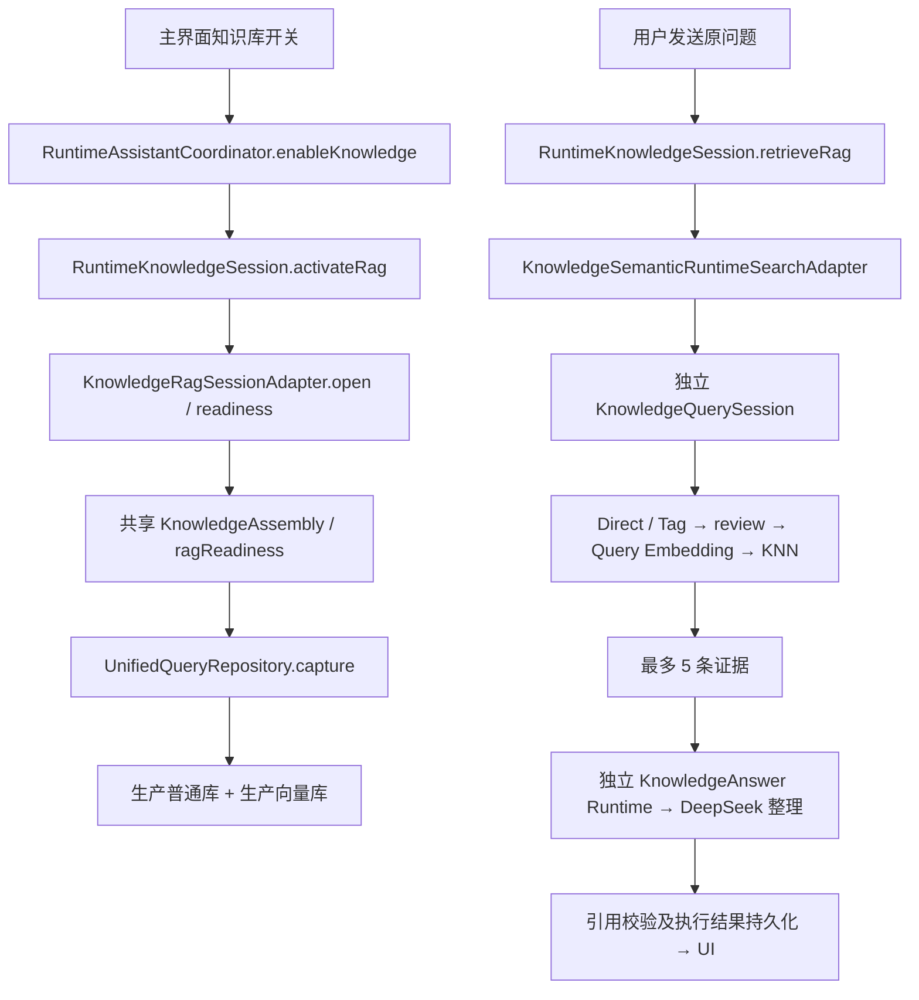

# 主对话知识库接入诊断

> 状态：2026-10-29 L1 修复已实现并部署到 `127.0.0.1:5555`，待用户人工语义检索/冷启动验收；下文静态诊断与未修复描述保留各自历史时点。
> 日期：2026-10-28（Asia/Shanghai）。分支：`dev/rag`，源码基线：`b3c584ae1beb8e3308fe26a1c1c2cc8bfc3d851a`。
> 输入：用户对 `127.0.0.1:5555` 的实测描述和本轮截图；本轮未操作模拟器、读取用户数据库或调用付费服务。
> 后续方案：[13 主对话 Agent 知识库 L2 检索增强](../../specs/13-主对话Agent知识库L2检索增强.md)，状态为待确认，不是实现完成声明。

## 0.1 2026-10-29 L1 修复实施与部署

用户批准修复 L1、测试及保数据部署，明确不实施 L0 FTS5 和 L2，不新建修复 spec，不跑完整 UI 用户流程。以下记录为实施增量，下方第 0 节是此前的诊断结论与限制。

### 实现行为

- `EmbeddingSpacePolicy` 分开处理当前请求授权绑定与持久空间兼容：仅配置/凭据修订变化不再使历史向量失去查询资格；请求发往 Provider 前的当前配置、Key 修订、费用、基线、scope 与取消校验保持严格。
- `UnifiedQueryRepository` 从持久空间注册结果选择与当前 Provider/区域/access/workspace/模型相符的历史空间，并核对维度、预处理、profile/tokenizer/参数、角色、归一化、距离度量、供应商版本及一致性约定。只有语义合同一致的空间可共用一次查询向量；合同冲突仍明确拒绝，不把任意模型的所有旧向量混算。
- 对每条正文/图片目标保留实际物理空间 ID，要求原 job 绑定与该空间原始 fingerprint 一致；继续执行 Synced、世代/annotation、epoch、输入集合 hash、元数据映射及数值行资格约束。没有改写旧任务、修改旧空间或迁移 schema。
- `UnifiedQueryService` 只生成一次当前 query embedding，分别查询各兼容物理空间，再按实际距离与稳定身份合并排序；`unifiedSemanticCards` 根据目标实际空间校验证据。L0 的字面召回实现不变，L2 路由不变。
- `VectorRdbRepository.registeredSpaces()` 不再把布局验证失败的空间作为可用空间返回。`UnifiedVectorRepository.reconcileCurrentOwners()` 会尝试恢复其余 owner 后再报告局部失败，一个坏任务不再直接中断全部旧任务恢复。

“所有历史数据”在语义检索中指**当前可见、有效且语义空间兼容的已入库内容**。归档/删除、失效世代、未完成/损坏向量与不同模型/profile/维度的数据不能绕过原有校验；这类内容仍保留，不以默认值、混用向量或后台重嵌入伪造可查。

### 验证结果与落盘证据

源码基线 `dev/rag / b3c584a` 加本轮修改；未执行 Git commit/push。部署 capture 工作区指纹为 `60c687c4e998a1c5ba90fd9ca433c0193bfa4cda94a3848da20befdf4323a179`，实际代码和制品以各目录 meta 及 artifact SHA 为准。目录日期按 UTC 为 2026-10-28，本记录日期按 Asia/Shanghai 为 2026-10-29。

| 验证 | 结果 | 证据 |
|---|---|---|
| ArkTS 独立检查 | 修改的 7 个 ETS 文件，CLI `check arkts` RC 0 | `.cache/test-logs/2026-10-28-l1-history-check-b3c584a/` |
| 统一知识库 host | 最终 219/219，requests=0；含历史正文/图片、新旧空间合并、scope 重建、身份/授权/兼容性拒绝、坏 owner 隔离 | `.cache/test-logs/2026-10-28-l1-history-host-final-b3c584a/`；前轮 218/218 为 `...-l1-history-host-b3c584a/` |
| 完整知识库 host | 310/310、0 fail，约 74.9 秒；平台/网络为替身 | `.cache/test-logs/2026-10-28-l1-history-full-host-b3c584a/`；计数原输出在 `.local/l1-history-fix/full-*.log`，公共摘要仅保留 suite exit 0 |
| 主对话 Runtime host | `run-direct-model-tests.cjs` RC 0；公共输出被隐私过滤，未从该归档推定具体数量 | `.cache/test-logs/2026-10-28-l1-history-runtime-host-b3c584a/` |
| 实际产品构建 | signed build RC 0，Hvigor BUILD SUCCESSFUL，约 20.7 秒 | `.cache/test-logs/2026-10-28-l1-history-build-deploy-b3c584a/` |
| 保数据部署与启动 | CLI run RC 0，明确 serial `127.0.0.1:5555`，应用进程存在；复用匹配签名缓存、模板字节恢复 | 同上目录 |
| 部署后只读快照与设备日志 | RUN_CMD RC 0、设备 log RC 0；9 份活动资料、153 个任务及旧绑定/空间映射仍在，配置仍为 11/3 | `.cache/test-logs/2026-10-28-l1-history-deployed-evidence-b3c584a/` |

signed HAP：`entry/build/default/outputs/default/entry-default-signed.hap`，20,752,879 字节，SHA-256 `a8fc6e38445a5333f7e7ebe7fba5a441c6b9c9cb35880a0281b7f2a000357f4f`。构建工具仅改写了 7 份原本干净 lock 文件的行尾，确认依赖内容与原版一致后恢复，未留下依赖变更。没有安装新依赖、生成新签名、卸载或清除用户数据。

本轮缺少 `arkts-grammar-standards` 技能；已向用户说明 AGENTS.md 第 7 节要求并取得“允许按现有约束与编译器继续”的明确回复，随后才修改 ETS。内置 `arkts_check/build_project/start_app` 工具不可用，使用已有 DevEco CLI 对应检查/构建/运行命令；本机 CLI 需要工作区外配置访问，获执行环境批准后运行，工具原始输出私有化，仅归档脱敏结果。

### 复现命令

以下均为本机既有工具，不安装依赖；构建部署 driver 使用现有 `dev-run-support.cjs` 的 begin/cache-apply/restore 协议，必须先构建成功才运行安装。

```powershell
$env:CAPTURE_HOST_ONLY='1'
$env:CAPTURE_SAFE_HOST='1'
$env:DEVECO_SDK_HOME='D:/Huawei-DevEco-Studio/DevEco Studio/sdk'
$env:RUN_CMD='node entry/src/test/run-host-tests.cjs --unified-only'
& 'C:/Univ/Git/bin/bash.exe' scripts/capture-test-log.sh l1-history-host-final 5m
$env:RUN_CMD='node .cache/l1-diagnosis/host-suite-summary.cjs full'
& 'C:/Univ/Git/bin/bash.exe' scripts/capture-test-log.sh l1-history-full-host 5m
$env:RUN_CMD='node entry/src/test/run-direct-model-tests.cjs'
& 'C:/Univ/Git/bin/bash.exe' scripts/capture-test-log.sh l1-history-runtime-host 5m
$env:RUN_CMD='node .cache/l1-diagnosis/verify-fix.cjs check'
& 'C:/Univ/Git/bin/bash.exe' scripts/capture-test-log.sh l1-history-check 5m
$env:RUN_CMD='node .cache/l1-diagnosis/verify-fix.cjs deploy'
& 'C:/Univ/Git/bin/bash.exe' scripts/capture-test-log.sh l1-history-build-deploy 5m 127.0.0.1:5555
$env:CAPTURE_HOST_ONLY='0'
$env:DEVECOCLI_BIN='C:/Users/Zeto/.cache/deveco/bin/devecocli.cmd'
$env:RUN_CMD='node .cache/l1-diagnosis/read-only-audit.cjs'
& 'C:/Univ/Git/bin/bash.exe' scripts/capture-test-log.sh l1-history-deployed-evidence 5m 127.0.0.1:5555
```

### 留给用户的人工验收

1. 不重新解析/重嵌入，不保存配置或 Key，打开知识库，用只出现在旧资料中的问题点击“试试语义搜索”，核对旧正文与旧图片来源。
2. 关闭并重新启动应用，再查相同问题，核对无需新入库即可命中；分别抽查较新资料，确认新旧均可用。
3. 用现有主对话知识库开关抽查同一问题；该入口受益于共用 L1 修复，仍是原固定检索后整理流程，没有实施 L2。

以上由用户执行。本轮没有 UI 全流程、真实 query embedding/LLM、真机质量或历史数值跨进程逐行读回验收；host 的 scope 重建及数值替身不能冒充这些结果。设备只读审计依旧不能通过普通 sqlite3 读取专用向量文件，该限制不解释为损坏。

## 0. 2026-10-29 补充：问题位于共享 L1，已取得设备配置绑定证据

本节更新下文 2026-10-28 静态诊断的证据状态；下文“本轮未操作模拟器”等描述保留为原轮次记录，不代表本次。用户补充确认：知识库详情显示已入库、Direct 可命中，但页面“试试语义搜索”同样只召回近期重新向量化的资料。**不再以页面 L1 正常而对话异常作为当前前提；本次问题定位于两者共用的 L1 检索资格链路。**

### 0.1 已确认的直接原因

对 `127.0.0.1:5555` 当前应用普通库进行只读聚合查询，得到：

| 项目 | 当前设备结果 |
|---|---|
| 当前 SiliconFlow 嵌入配置修订 / 凭据修订 | `11 / 3`，mutation pending 为 0 |
| 旧配置下已完成正文向量任务 | 5 个，绑定 `6 / 2` |
| 旧配置下已完成图片代理向量任务 | 59 个，绑定 `6 / 2` |
| 当前配置下已完成正文 / 图片代理向量任务 | 2 / 12 个，绑定 `11 / 3` |
| 另一个旧配置的失败图片代理任务 | 1 个，绑定 `3 / 1` |
| 旧/新任务的其他绑定字段比较 | contract、Provider、region、access、workspace、model 全部相同 |
| 普通库持久状态 | 9 份活动资料；正文 Synced 绑定 7 个、图片 Synced 绑定 71 个及 Pending 1 个；496 条向量输入元数据、78 条任务空间映射 |

这些数量是**任务/绑定/元数据数量，不是向量数值行数，也不是文档数量**。不读取或输出文档正文、标题、Key 或向量值；绑定仅输出摘要、版本和字段相等关系。旧 64 个已完成任务的空间映射指向同一旧空间，新 14 个已完成任务指向另一个当前空间（仅核对普通库映射，不冒充读取了物理向量注册表）。

代码中 `embeddingConfigBinding()` 包含配置修订和凭据修订；`UnifiedVectorRepository.space()` 又将该绑定纳入空间 fingerprint/ID。`UnifiedQueryRepository.captureLocked()` 则同时要求：

1. 空间的 `configFingerprint` 等于当前完整配置绑定；
2. 绑定对应 job 的 `configBinding` 等于当前完整配置绑定；
3. 普通库任务空间映射与选中空间一致，并通过世代/hash 等资格验证。

因此，本设备旧任务的 `6 / 2` 与当前 `11 / 3` 不一致，**即使对应数值向量完整存在，也必然在 KNN 前被排除**。这是已由当前设备元数据和实际源码共同证实的阻断条件，不再只是候选假设。

### 0.2 为什么表现得像“只认本次进程”

```text
旧资料在配置 6 / 凭据 2 下完成向量化
  → 之后持久化配置变成 11 / 3
  → 查询只接受 11 / 3 的空间及任务
  → 没有新配置的任务时，无合格空间/目标
  → 新资料按 11 / 3 入库，产生当前空间和目标
  → 新资料可查，6 / 2 的旧资料仍被过滤
```

该链条无需进程重启也能发生；重启会重新载入已保存的配置及绑定，使用户更容易在重开后观察到它。现有证据证明了持久化版本差异，**没有证明该差异是在重启瞬间产生，也没有证明用户每次重启都改了 Key**。

`EmbeddingService.initialize()/select()` 读回保存配置，不主动增加修订；`changeCredential()` 无论新增/替换/删除凭据都会增加 config.revision 与 credentialRevision，现有实现不比较输入 Key 是否与原值相同。由此可知重新保存凭据可以触发绑定变化；设备上为什么经历 `6/2 → 11/3` 的全部操作历史尚未取得，不能替用户编造修改时间或实际 Key 内容。

### 0.3 已入库状态为何没有变

`processingDocumentStatus()` 按当前文档世代/epoch 关联的任务状态判断“已入库”，不核对 job 的配置绑定是否仍等于当前查询配置。旧任务依然为 Complete，所以页面仍显示已入库；但 L1 的资格筛选已经不允许检索它们。Direct 读取当前正文，不要求向量配置匹配，因此继续可用。

结论是**语义可用性状态与已完成任务状态缺少区分，加上授权/凭据版本被纳入向量空间身份，造成旧向量资格失效后没有正确呈现和恢复路径**。不能以改一行状态文案代替解决检索资格问题。

### 0.4 对四个问题的当前判断

| 用户提出的方向 | 当前判断与边界 |
|---|---|
| 冷启动代码是否是唯一根因 | 当前已有配置绑定排除这一充分解释；未做“不改配置、同包、已知合格资料”的强制停止/重启对照，不能排除另有恢复缺陷 |
| 向量数据库是否只能供单进程使用 | 当前源码设计为持久库，close 只关闭连接并清内存注册表，open 会读持久空间注册表；没有单进程限定。不能把表现推断为平台不支持持久化 |
| 是否为向量生命周期问题 | 已确认至少存在**应用层语义资格生命周期问题**：凭据/配置修订变化令旧空间、旧任务失去资格，Complete 标签不反映此变化 |
| 第二次启动是否无法访问历史数据 | 普通库历史 job、Synced 绑定、输入元数据、空间映射可读，未全部丢失；数值向量逐行读回未验证，查询在资格阶段已可将旧数据排除 |

设备上的生产向量数据库文件仍存在。本次尝试用 `/bin/sqlite3 -readonly` 查询其注册表返回 `file is not a database`；该结果只说明这条普通 SQLite 诊断路径无法读取当前向量文件，**不能据此判定数据损坏、未落盘或数值向量完整**。需要经应用的 ArkData vector 适配器做只读 count/readback 才能证明物理行状态，本轮未部署新探针。

### 0.5 隔离复现与证据

在 `.cache/l1-diagnosis/scope-reproduction.cjs` 中加载当前真实 `UnifiedQueryRepository.capture()`，以合成正文、已完成任务、Synced 绑定和持久空间恢复结果的替身执行 4 个 case，全部符合断言：

| Case | 结果 |
|---|---|
| 当前与旧资料都为 `6 / 2` | 旧目标可入选 |
| 当前变为 `11 / 3`，只保留旧 `6 / 2` 数据 | 无当前空间、0 个目标 |
| 同时增加 `11 / 3` 新资料与新空间 | 仅新目标入选，旧目标仍被排除 |
| 新建隔离 harness，保持配置一致 | 旧目标仍可入选；不证明真实平台跨进程持久化 |

这是**真实资格筛选代码的 host 复现**，数值库、仓储数据和网络均为隔离替身；不是实际 KNN、真实服务或设备冷启动验收。未修改业务源码。

证据目录（capture 按 UTC 命名为 2026-10-28；补充报告日期按 Asia/Shanghai 为 2026-10-29）：

- `.cache/test-logs/2026-10-28-l1-readonly-audit-b3c584a/`：首轮设备只读聚合，普通库成功，向量格式读取失败如实记录。
- `.cache/test-logs/2026-10-28-l1-readonly-binding-fields-b3c584a/`：第二轮设备只读核对，确认差异仅为配置/凭据修订；未通过 sqlite3 读取数值向量。
- `.cache/test-logs/2026-10-28-l1-scope-reproduction-b3c584a/`：4/4 host case；业务源码未改，数值数据库为替身。

复现（PowerShell，已有 Node 与 SDK，不安装依赖）：

```powershell
$env:CAPTURE_HOST_ONLY='1'
$env:RUN_CMD='node .cache/l1-diagnosis/read-only-audit.cjs'
& 'C:/Univ/Git/bin/bash.exe' scripts/capture-test-log.sh l1-readonly-binding-fields 5m 127.0.0.1:5555

$env:DEVECO_SDK_HOME='D:/Huawei-DevEco-Studio/DevEco Studio/sdk'
$env:CAPTURE_SAFE_HOST='1'
$env:RUN_CMD='node .cache/l1-diagnosis/scope-reproduction.cjs'
& 'C:/Univ/Git/bin/bash.exe' scripts/capture-test-log.sh l1-scope-reproduction 5m
```

诊断驱动位于 gitignore 的 `.cache/`。设备数据审计通过 SDK `hdc` + `sqlite3 -readonly`，没有 UI、安装、重启、凭据修改或付费请求；capture 的 host.log 保存聚合快照，设备持续日志阶段因 `CAPTURE_HOST_ONLY=1` 标记 not-run，**没有伪称采集完整 hilog 或通过设备功能测试**。`devecocli device list` 本次因其本机配置初始化报 EEXIST，故只读检查使用 SDK hdc；未更改 CLI 配置。

### 0.6 后续修复方向（尚未实施）

应分离“请求授权绑定”与“向量语义空间身份”：配置/Key 修订仍撤销旧 query grant、停止未获授权的网络请求，但不应仅因凭据修订就无条件判定已保存向量语义不兼容。空间兼容仍需核对 Provider、区域/工作区、实际模型与版本/一致性证据、维度、预处理、角色和归一化等，不能只比较模型名字后直接放行旧数据。

旧空间/任务迁移需独立、保数据、只读核验后再发布资格，不修改旧任务回执来伪造重新嵌入成功。页面应区分“向量任务已完成”与“当前语义可检索”。先对真实历史数值做受控只读读回，再做不改配置的冷启动对照，才能排除并存的数值持久化/恢复故障。以上仅为诊断建议，不自动改 Key、不重嵌入、不删除旧库，不启动修复。

## 1. 结论与证据边界

1. **“主对话另建临时向量数据库”不符合当前源码接线。** 主对话通过 `KnowledgeRagSessionAdapter` 访问 `KnowledgeAssembly.forContext(context)`；知识库页面使用同一工厂，按 `context.filesDir` 复用实例。数值向量落在生产库 `shuvi_kb_vector_v1.db`，统一正文、任务和资格绑定使用 `shuvi_kb_user_v1.db`。执行记录库与向量数据源是不同用途。
2. **当前不是用户要求的 L2 Agent loop。** 应用先用原问题固定检索，成功后才把证据交给独立 PERSONAL 模型会话整理；模型不先分析问题、不生成工具参数，也不根据工具结果追加检索。已有整理回答能力，并非只显示原始分块；缺的是模型规划与工具回环。
3. **已确认两个产品行为缺口。** 开关以合格向量为硬门槛，L0 可用也不能启用；语义步骤失败后抛错，已经得到的 Direct 证据也不会进入回答。这两点能由代码直接证明。
4. **冷启动排除旧向量的具体原因尚未闭合。** 当前代码有持久化空间恢复，不能把现象直接归为内存库丢失。应定位当前 scope 的空间与 target 筛选为何排除旧资料，以及页面与对话是否真的在同一时点、同一配置和同一检索入口比较。本轮没有设备状态快照，不能声称已经唯一定位根因。

## 2. 复现输入与现象

用户报告：模拟器启动后，在知识库中未执行新的解析/向量入库时，主对话打开【知识库】提示“当前知识库还没有可用于 RAG 的完整向量数据”；资料页已有旧文件及向量，Direct 与语义搜索可用。重试一张 `0/1` 图片并成功入库后，主对话可检索，但只看到新入库图片。

截图只证明开关弹窗及文案。文件库存量、旧资料语义命中、新图限定召回属于用户实测描述；未提供对应查询、来源列表、配置版本、包身份和冷启动日志。不能把“返回 top 5 只有新图片”等同于“物理库只剩新图片”。“本机缓存”还需区分应用已发布知识内容、索引缓存、原件缓存与电脑文件；只有前者具备当前检索资格时才进入应用语料范围。

## 3. 当前调用链



关键源码位置（行号对应上述基线）：

| 位置 | 可确认事实 |
|---|---|
| `entry/src/main/ets/pages/Index.ets:534` | `toggleKnowledge()` 调用协调器；549 行按 readiness 显示截图中的弹窗 |
| `entry/src/main/ets/services/model/RuntimeAssistantCoordinator.ets:47` | 创建 `KnowledgeRagSessionAdapter(KnowledgeAssembly.forContext(context))` 并准备独立回答会话 |
| `entry/src/main/ets/knowledge/infra/KnowledgeRagSessionAdapter.ets` | 获取共享装配租约，使用 `createRagQuerySession()`，不创建数据库 |
| `entry/src/main/ets/knowledge/infra/KnowledgeAssembly.ets:214` | 按 filesDir 复用；227 行聊天会话仅将历史端口替换为 `EphemeralQueryHistory` |
| `entry/src/main/ets/knowledge/domain/KnowledgeStorageScope.ets` | 生产普通库、向量库名称固定；隔离库用于显式测试 scope |
| `entry/src/main/ets/knowledge/infra/VectorRdbRepository.ets:37` | `open()` 读 `vector_space_registry_v2` 恢复空间；不是只登记本次进程的新向量 |
| `entry/src/main/ets/services/model/RuntimeKnowledgeSession.ets:302` | 应用直接调用 `rag.search`；成功冻结证据后才提交模型回答任务 |
| `entry/src/main/ets/knowledge/application/KnowledgeSemanticRuntimeSearchAdapter.ets` | 本机查询后必须语义 Complete，否则抛错；证据最多 5 条、单条 800、总量 3200 字符 |

`EphemeralQueryHistory` 是不落盘的**检索历史**，不是临时向量库。`shuvi_knowledge_answer_v1.db` 保存回答执行记录，`shuvi_knowledge_runtime_v1.db` 属旧本机工具执行记录，也不是知识库数值向量库。

### 3.1 页面与主对话共用什么

两者共用 `runtimeQueryRepository`、`runtimeQueryEngine`、`runtimeUnifiedConfig`、`vectors`。知识库页面用 `createQuerySession()`，聊天用 `createRagQuerySession()`，查询状态和历史独立，数据源相同。

因此，**同一配置、同一 scope、同一时点、同一统一检索入口下**，页面能拿到合格旧向量而聊天 capture 完全拿不到，不能由“代码设计上使用两个库”解释。需要检查启动恢复时序、失败分支、页面是否来自旧检索/历史快照、查询是否相同。旧 PDF/Image/Docx 与统一 `upd-*` 路径并存，不能拿旧页面的“已入库”计数直接证明统一 scope 有资格。

### 3.2 当前 Direct 并不全等于 FTS5

`KnowledgeQuerySession.loadLocal()` 经 `captureLocal()` 读取统一正文，调用 `KnowledgeRetrievalPolicy.unifiedLocalDirect()`，后者遍历 chunk 并用 `unifiedDirectRanges()` 匹配。该入口不是直接执行 FTS5 MATCH。仓库另有旧关键词/倒排实现，不应据此把当前统一 Direct 路径描述成已完成的 FTS5 接口。新 spec 将 L0 定为关键词直接命中，并将统一 FTS5 接入与一致性验收列为明确任务。

## 4. 失败条件与候选根因

### 4.1 弹窗实际意味着什么

`KnowledgeAssembly.ragReadiness()` 顺序检查统一存储、固定 Provider/模型、凭据、检测结果、自动入库与费用/基线确认，再捕获 scope。截图文案来自 `VectorKnowledgeRequired`，对应以下任意条件：

- scope 不完整，或没有唯一当前空间，或 `targets.length === 0`；
- 当前空间维度与检测结果不一致；
- 空间 requested/returned model 与配置不一致。

这不是“物理向量行数为零”的查询。`UnifiedQueryRepository.captureLocked()` 在向量 open 失败时只写入 `NumericUnavailable` 的 hash 投影，继续以无空间结果返回；配置匹配空间超过一个也不给 scope.space。不同原因最终被同一文案覆盖，缺少可诊断性。

### 4.2 旧向量入选必须同时成立

`UnifiedQueryRepository.ets:41–60` 要求空间使用 `UNIFIED-KNOWLEDGE-TEXT-1` 且配置绑定相同；绑定 Synced、版本对应当前 generation/effective annotation；绑定能找到对应持久化 job；job 配置绑定相同；`vector-space:<jobId>` 与当前空间一致；正文还校验 epoch、输入集合数量及 hash，图片校验代理文本及读回集合。后续 KNN 还限定 eligible、owner、generation、epoch、inputHash。

`embeddingConfigBinding()` 包含 `config.revision` 和 `credentialRevision`。旧向量存在、数量完整，不自动代表在当前配置下合格；保存 Key 或实际改配置可能使旧空间不再匹配。新入库图片生成当前绑定的空间/任务，可能令 scope 从零目标变成只有该图片。这是**解释力较强的候选原因**，尚无本机版本对比证据。

### 4.3 排查优先级

| 候选原因 | 与现象的关系 | 证实/排除方法 |
|---|---|---|
| 旧 job/空间配置绑定与当前修订不同 | 能解释只有新图合格；纯重启不应修改修订，不能仅凭重启归因 | 对比当前配置绑定摘要、空间摘要、旧/新 job 摘要；检查期间是否保存配置或 Key |
| 向量库打开/空间恢复失败、唯一空间冲突或模型/维度不匹配 | 可使已有物理数据变成无 scope.space | 分开记录 numeric open 分类、恢复空间数、匹配数、维度/模型检查结果 |
| 旧 binding / 元数据 / owner 世代恢复失败 | 可使空间存在但 targets 为空 | 对每一排除原因累计计数；比较冷启动恢复前后及新图入库后的分布 |
| 旧格式空间与统一空间并存 | 旧页面可用不等于 `upd-*` 统一 scope 可用 | 核对页面真实 handler、预处理版本、owner namespace，排除检索历史快照 |
| 恢复流程某作业先失败，后续恢复被中断 | `reconcileCurrentOwners()` 顺序执行，单作业错误会中断后续；`ParsedDocumentLifecycle.sync()` 捕获后只显示泛化消息 | 记录首个失败分类及未处理数量，不能把新图入库成功当全部旧作业已恢复 |
| 召回/截断造成“只有新图” | 当前最终上限 5，并有 Direct 优先及标题降序；不等同于全库覆盖计数 | 比较 capture 合格目标数、KNN 候选数、合并数和最终返回数，使用只出现在旧文档中的唯一关键词 |

冷启动已经调用向量注册表恢复及统一生命周期协调，不能建议“简单补一个 open()”并宣称修复。只修改弹窗或移除向量校验也不能恢复旧资料资格。

## 5. 与 L2 的差距

旧工具 `native://shuvi/knowledge.search.local` 在 `KnowledgeTaskSupport.ets` 和 `KnowledgeRuntimeAssembly.ets` 有 Registry 接线，但当前 RAG 入口不走它；它是零费用、无网络、Direct-only 的独立任务，不能直接换成含云 Embedding 的工具而沿用其授权和预算声明。

主助手已有 `DeepSeekToolTransport` 文档工具循环，以及 `DocumentChatRuntime` 的 Registry/授权/持久化模式，可作为接入机制参考；当前知识库开关走独立 RAG 会话，不会让该循环获得知识库工具。接入 L2 需要显式声明、真实 Registry 派发、模型工具结果消息、证据绑定和循环预算，不能只改 prompt。

## 6. 下一轮设备验证方案（本轮未执行）

1. 保留全部旧数据，先记录包构建身份、提交/工作区指纹、设备与当前检索入口；用专用虚构资料 A（旧正文）、B（旧图片）、C（尚未入库图片）作为可重复夹具，不清库、不重置凭据。
2. 冷启动后不导入、不重试、不保存配置。分别记录页面 L0/L1 与主对话开关；使用同一问题和只属于 A/B 的唯一词，保留当前来源而非历史截图。
3. 采集上述 scope 分层计数/错误类别，不输出正文、Key、路径或配置原文。若当前没有只读诊断接口，先单独评审受控诊断改动；本报告不假设已存在该接口。
4. 按用户既有授权在 C 成功入库后重复同样检查，再冷启动复查；区分“入库触发恢复”“新空间限定”“仅排序变化”。发生费用的解析/Embedding/回答仍按应用内许可执行，不为诊断自动重发未知请求。
5. 每次测试通过 `scripts/capture-test-log.sh <scope> 5m 127.0.0.1:5555` 捕获，准确填写 `DEVECOCLI_BIN`，设备与命令同时归档；将实际生成目录写回记录。建议 scope 为 `rag-cold-before`、`rag-after-new-image`、`rag-cold-again`，不得预写通过。

现有 `run-direct-model-tests.cjs` 的 `realRagStack` 覆盖真实会话组合，但其装配/范围就绪等仍有替身；已有通过记录不能证明生产 RDB 的跨进程资格恢复。后续必须补真实仓储组合的关闭/重建与设备冷启动对照。

## 7. 本轮交付和未执行项

本轮只新增诊断与待确认 spec，并在主 spec 增加导航说明。没有实现修复、改权限/依赖/模型配置、修改签名或执行 Git 写操作；没有运行构建、host 测试、模拟器或真机测试。按 `docs/01` 第 7 节，普通文档修改不要求构建。当前结论是**接线与失败条件已确认，冷启动旧数据被排除的设备根因待取证**。
