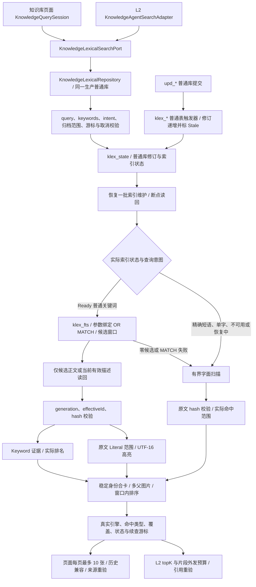
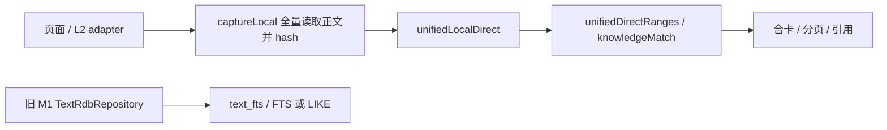
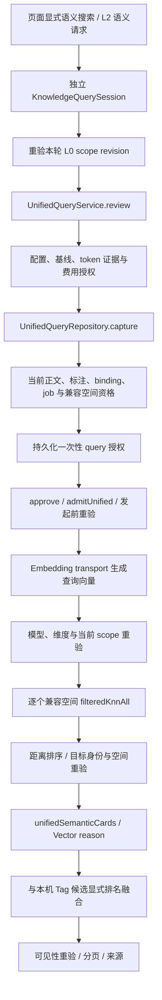
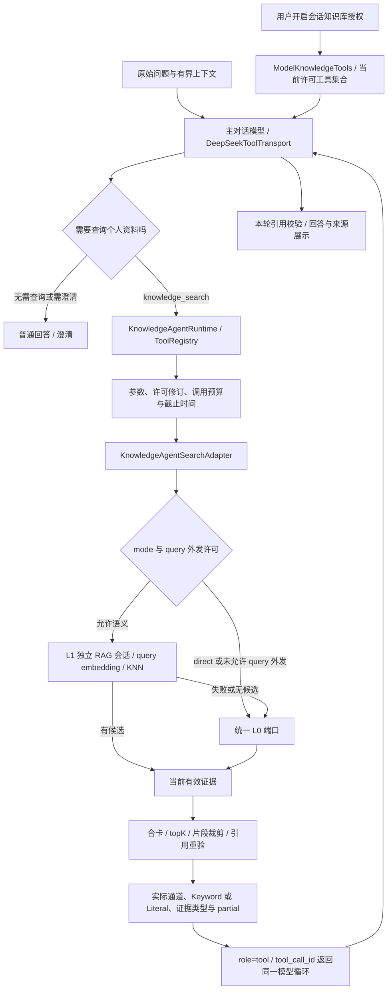

# 知识库 L0 / L1 / L2 链路架构

> 状态：2026-10-29 已实现待验收；描述本轮工作区实现，尚未提交。
> 基线：`dev/rag` / `89fe2e21bedaa9f58e3159e1b3658e1a4c178d80`。开工时已核对远端同一提交。
> 契约：[spec 02](../specs/02-个人知识库问答.md)、[spec 13](../specs/13-主对话Agent知识库L2检索增强.md)、[spec 14](../specs/14-统一知识库L0关键词检索与FTS5接入.md)。
> 验证与限制：[L0 重构验证记录](知识库L0重构验证记录.md)。图中的实现接线不等于设备验收通过。

## 1. L0：统一关键词检索

2026-10-29 修复增量：`upd_asset` 触发器只跟踪当前图片 occurrence 引用的资产，历史快照写入不再改变语料 revision，避免搜索自身保存历史后误撤销 L1 review。真实正文/归档/图片变化的失效检查保留，详见验证记录新增修复章节。

生产装配由 `KnowledgeAssembly` 创建一个 `KnowledgeLexicalRepository`，注入页面会话、独立 RAG 会话和 L2 adapter。正常路径不再先调用全量 `captureLocal`；读取文档/图片/标注元数据后，只读回 FTS 候选的正文。L0 不打开向量库、不发模型请求，也不受 Embedding Key 就绪与否限制。

正文、OCR、公式按原 chunk 的 evidence 返回；有效图片描述经 `unifiedProxyText(description,tags)` 的 hash 校验后检索，实际证据只取 description。标题与 tags 不拼入正文、不单独作为事实证据；既有 tags 相关结果仍保留。OCR 图片与描述通过图 hash、有效标注和父来源合卡。

请求规范版本为 `UNIFIED-LEXICAL-1`。普通词项 OR 召回，FTS 表达式由应用转义并绑定。引号短语选择字面模式，单字符显式走短词补检。FTS 返回 Keyword 时不要求完整问题连续出现；有原文范围时标 Literal，并合并重叠区间，保持代理对边界。历史 codec 可读取旧记录缺失的新增字段。

正常查询维护完成后使用 FTS；未完成时明确恢复/部分范围状态。维护和扫描每批最多 256 行，应用处理预算 2 MiB / 1 秒；不是数据库调用可被抢占的硬超时。每批保存 phase/cursor，取消或后台使下一检查点停止，重新打开后由新的本机查询继续。维护由能力检查初始化、查询推进，不在后台静默遍历全库；大库首次恢复可能需要多个请求/续查。

FTS 以实际排名取候选窗口；窗口内按字面命中、可核命中词覆盖、FTS 排名与稳定 ID 排序。分页追加已计算的卡，不承诺跨窗口全局重排。字面扫描游标绑定 query、词项、intent、归档范围和 scope revision，续查不重复消费已扫描块；scope 变化要求新查询。扫描尚有范围时返回 partial，页面不显示全库无命中。

### 旧 L0 对照（重构前）

旧 `text_fts` 仅服务 `text_*`；本轮没有将统一语料重新导入 M1，没有删除旧表、原件、向量或历史。旧 Runtime local v1 adapter 的独立字面契约保留；主对话 L2 和统一页面使用新的统一端口。

## 2. L1：查询向量与合格空间语义检索

本轮 L1 的模型、向量维度、空间与入库授权规则保持现有实现。显式启动语义查询时，原有全量语义资格捕获仍保留；其成本不能算作 L0 正常检索成本。Embedding 失败保留已取得的 L0 原文。

这里的 L1 指语义检索，不等于 spec 02 历史称作 L1 的“在线生成回答”。L0 重构不证明冷启动旧向量资格缺陷已修复。

## 3. L2：主对话 Agent 工具循环

L2 通过 Registry 使用知识库应用端口；本机模式直接调用统一 L0，不再先全量读取正文或在 adapter 逐个关键词扫描。语义路径使用独立会话与临时历史，不复用页面全局查询状态。

L2 保持最多 5 条来源、单片段最多 800 字符和本次总片段 3200 字符限制。L0 首窗不足时最多续查一次，仍有范围时保留 partial/hasMore；不能把预算内未找到当成全库 empty。查询外发、片段外发与本机读取仍由宿主分别约束；模型不能传入数据库路径、SQL 或归档范围。

工具结果携带实际 engine、matchKind、evidenceType；模型侧不再把所有本机结果强制标为 Literal。关闭授权撤销工具与未完成任务；回答失败保留已取得来源。图示只说明实现链路，不证明模型检索决策和事实质量已验收。

## 4. 实现入口

| 责任 | 源码路径（仓库根目录起） |
|---|---|
| 统一端口与结果 | `entry/src/main/ets/knowledge/domain/KnowledgeLexicalPorts.ets` |
| 查询规范与原文范围 | `entry/src/main/ets/knowledge/pipeline/KnowledgeLexicalPolicy.ets` |
| FTS、修订、恢复、扫描与读回 | `entry/src/main/ets/knowledge/infra/KnowledgeLexicalRepository.ets` |
| 装配 | `entry/src/main/ets/knowledge/infra/KnowledgeAssembly.ets` |
| 页面与语义会话 | `entry/src/main/ets/knowledge/application/KnowledgeQuerySession.ets` |
| L1 资格与执行 | `entry/src/main/ets/knowledge/infra/UnifiedQueryRepository.ets`、`application/UnifiedQueryService.ets` |
| L2 检索适配 | `entry/src/main/ets/knowledge/application/KnowledgeAgentSearchAdapter.ets` |
| 主对话授权与模型结果 | `entry/src/main/ets/services/model/ModelKnowledgeTools.ets` |
| Registry Runtime | `entry/src/main/ets/services/model/KnowledgeAgentRuntime.ets` |

验证详情、DDL 取舍、性能数据与未验收项见[验证记录](知识库L0重构验证记录.md)。
