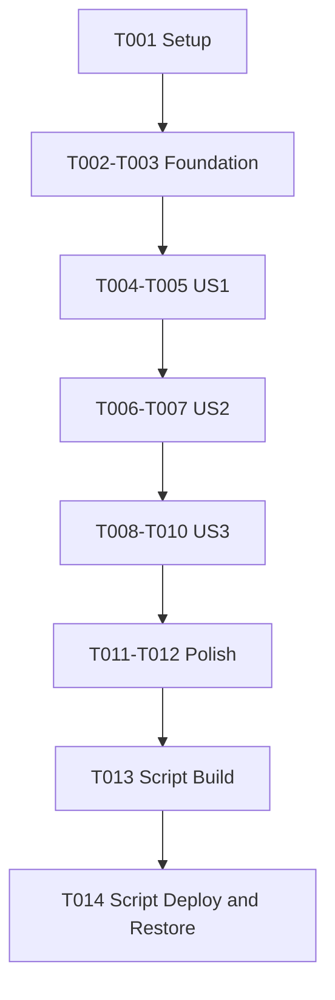

# Tasks: dev-run 跨平台可用性

**Input**：`/Users/zane/DevecostudioProjects/Shuvi-agent/spec/dev-run-portability/` 内已批准spec/plan。
**Prerequisites**：阶段1/2已审核，用户阶段3选择Run verification；只有build/deploy，无UI。
**Tests**：隔离回归先行；Bash3.2/5.3、Windows入口/后缀/路径合同，Windows实机待复验。

## Format

任务连续T001–T014；US标签映射3故事，全部P1。没有[P]写任务，共享脚本/测试顺序修改；只读查询可并行。每任务验收附路径。

## Path Conventions

PROJECT_ROOT `/Users/zane/DevecostudioProjects/Shuvi-agent`。只改scripts、AGENTS第六节及本执行文档，不改应用代码/权限/依赖/SDK、旧M1规格或原测试语料。脚本.sh LF，.cmd ASCII/CRLF。私有签名数据不进代码/公共证据。

## Phase 1: Setup

- [X] T001 核对源码/两套Bash/Node/CLI/行尾及工作区，登记无应用修改、目标只Mate90Pro、秘密和存量资料保护，目标 /Users/zane/DevecostudioProjects/Shuvi-agent/spec/dev-run-portability/implementation-report.md

## Phase 2: Foundational

- [X] T002 建立隔离临时项目、假CLI/无秘密模板、命令调用与副作用观测测试框架，准备可复现错误用例，不触真实.local/设备/账号，目标 /Users/zane/DevecostudioProjects/Shuvi-agent/scripts/tests/dev-run.test.cjs
- [X] T003 新增小型Node辅助的结构化目标/输出/退出校验和跨平台工具/摘要/公共模板检查边界，不输出敏感内容、不安装依赖，目标 /Users/zane/DevecostudioProjects/Shuvi-agent/scripts/dev-run-support.cjs

T002依赖T001，T003依赖T002，基础完成才能故事实现。

## Phase 3: User Story 1 — 目标锁定（P1）

**Independent Test**：空/唯一/多设备、default首模拟器、带空格/Unicode名、显式优先、双参一致冲突、错误/畸形清单、启动失败/timeout/no-emulator。

- [X] T004 [US1] 先补目标选择/查询错误/启动/名称空格和显式参数回归，并保存修复前真实失败，目标 /Users/zane/DevecostudioProjects/Shuvi-agent/scripts/tests/dev-run.test.cjs
- [X] T005 [US1] 用JSON校验与状态重新查询修复默认/显式目标、双参映射、有界等待，run固定唯一serial/目标不回退其他设备，目标 /Users/zane/DevecostudioProjects/Shuvi-agent/scripts/dev-run.sh

T004依赖T003，T005依赖T004。不会把Phone26映射到Mate90Pro，真实使用严格用户获准名称。

## Phase 4: User Story 2 — 签名模板与安全恢复（P1）

**Independent Test**：实际模板/product cache、dirty/indexdirty、锁/并发、既有bak、INT/TERM/恢复失败、构建失败不run、签名错误脱敏、无git写/无uninstall。

- [X] T006 [US2] 先补缓存/产品/模板用户修改/并发/中断/恢复失败、auth/license与签名输出安全回归，不用真实签名fixture，目标 /Users/zane/DevecostudioProjects/Shuvi-agent/scripts/tests/dev-run.test.cjs
- [X] T007 [US2] 实现模板实际摘要/product对齐、独占锁/本次备份、核验后恢复和失败留备份；取消gitconfig/checkout，私有输出隔离，产品贯穿、错误有限停止，目标 /Users/zane/DevecostudioProjects/Shuvi-agent/scripts/dev-run.sh

T006依赖T005，T007依赖T006。旧default缓存如不能证明匹配则正常生成，不擅自读取内容或强签。

## Phase 5: User Story 3 — 两端入口与日志（P1）

**Independent Test**：两套Bash、Windowscmd/exe和空格路径参数、入口GitBash不WSL、LF/ASCII-CRLF、hostonly/无设备/GNU摘要缺失、目录不覆盖/命令与日志错误。

- [X] T008 [US3] 先补Bash3.2/Windows后缀/入口/特殊参数/行尾及capture命令日志退出回归，目标 /Users/zane/DevecostudioProjects/Shuvi-agent/scripts/tests/dev-run.test.cjs
- [X] T009 [US3] 修复Windows入口引用/参数/退出码，继续明确定位Git Bash、不依赖PATH的WSL bash，保持ASCII/CRLF，目标 /Users/zane/DevecostudioProjects/Shuvi-agent/scripts/dev-run.cmd
- [X] T010 [US3] 修复跨平台摘要和空数组、独占日志目录、先命令后设备日志、hostonly及失败真实传播，不把capture退出0当成功，目标 /Users/zane/DevecostudioProjects/Shuvi-agent/scripts/capture-test-log.sh

T008依赖T007，T009依赖T008，T010依赖T009；辅助必要变化仍限T003既定文件，不新平台工具。

## Phase 6: Polish

- [X] T011 在/Bin Bash3.2与Homebrew Bash5.3运行全部隔离回归/语法检查，记录red/green、脚本SHA/平台/工具/退出和不泄密/无配置修改自审；Windows实机明示未测，目标 /Users/zane/DevecostudioProjects/Shuvi-agent/spec/dev-run-portability/implementation-report.md
- [X] T012 更新AGENTS第六节和两端使用/默认/失败/缓存恢复/日志/钩子人工设置/Windows复验说明，不扩大应用或平台基线，目标 /Users/zane/DevecostudioProjects/Shuvi-agent/scripts/README.md

T011依赖T010，T012依赖T011；AGENTS仅 `/Users/zane/DevecostudioProjects/Shuvi-agent/AGENTS.md` 第六节。不Git提交推送，不实际build/run；后者专属下阶段。

## Phase 7: Verification

<!-- verification_scope: build-only -->

**一次委派**：仅spec-verify执行，范围build/deploy无UI。本轮是新脚本验证，不重新调用先前M1验证任务。验证用户命令必须经仓库脚本，脚本内部build/run输出分段记录；不先裸build代替脚本可用性。

**本轮结案（2026-10-13）**：`[X]` 只表示一次验证委派及结果记录结束，不表示构建/部署成功。实际脚本调用1次，Mate90Pro就绪等待240秒超时、RC1，签名/build/run均未进入（实际build0次）；模板字节一致、本次锁已清理、Git配置不变。限定修复调试变量污染JSON后，两套Bash各78/78回归通过；Windows原生未实测。最终 **INCOMPLETE**，详见verification-report.md。

- [X] T013 使用修复后的仓库dev-run.sh显式Mate90Pro/productdefault，验证其内部 `devecocli build --product default` 构建/常规签名拼装与产物，最多10次构建尝试、范围内修复；不运行IDE菜单、不强签/登录/接受许可/卸载，目标 /Users/zane/DevecostudioProjects/Shuvi-agent/spec/dev-run-portability/verification-report.md
- [X] T014 在同一获准脚本执行中验证内部 `devecocli run --skip-build --product default --device <已锁定目标>` 的安装启动及目标状态；核对模板字节恢复、锁/备份及秘密输出、运行后日志、Windows实机未覆盖；条件不足如实INCOMPLETE，目标 /Users/zane/DevecostudioProjects/Shuvi-agent/spec/dev-run-portability/verification-report.md

T013依赖T012，T014依赖T013内部build成功；实际一次脚本同时承载这两任务，记录分别是否通过，不能因脚本退出0单独证明signed产物/启动。没有verify_ui任务，不操作M1知识库资料。脚本限定修复后再隔离回归；不扩大为.ets业务修复。

## Dependencies & Execution Order

T001→T002→T003→US1(T004–005)→US2(T006–007)→US3(T008–010)→Polish(T011–012)→Verification(T013–014)。前12项由spec-implementation，最后2项由一次spec-verify。所有写按顺序。

## 📊 Dependency Graph

## ⚡ Parallel Execution Guide

| Phase | Tasks | Required Files | Execution Notes |
|---|---|---|---|
| Setup/Foundation | T001–003 | 本轮报告/测试/Node辅助 | 准备安全隔离后才跑用例 |
| US1/US2 | T004–007 | 共享dev-run和测试 | 先失败证据后修复，顺序 |
| US3 | T008–010 | cmd/capture/测试/辅助 | 入口/行尾按目标OS核验，回归非实机 |
| Polish | T011–012 | 报告/AGENTS6/README | 不执行实际签名或启动 |
| Verification | T013–014 | dev-run/产物/获准设备/报告 | 一次委派，脚本内build成功才deploy |

## Parallel Example

可并行只读查CLI帮助与行尾/场景资料；没有并行源写任务。测试依实现分阶段运行，每阶段保存退出与无秘密公共日志。

## Implementation Strategy

先US1修正确目标，再US2安全拼装与恢复，最后US3两端/日志；全部隔离回归通过后才Mac真实使用。实际认证/签名/许可前置不足停止，不自动越界修复。Windows使用命令/测试入口与未验证点清楚交付，不谎称cmd.exe已执行。

## Summary Report

共14项：Setup1、Foundational2、US1 2、US2 2、US3 3、Polish2、Verification2。全部P1，checkbox连续唯一且路径明确，US任务标故事，其余无故事；marker build-only无UI。MVP是US1正确目标，但本轮全部三个故事都必需，不能只修空格遗漏安全/两端验证。

## Notes

脚本LF、cmdASCII-CRLF；用apply_patch/manual edits，格式化可机械处理行尾。真实私有配置不进入read/grep/截图/上下文，脚本内部使用不等读取秘密到AI。无Git配置checkout/commit/push，无清数据/卸载/自动协议登录/强签，构建异常范围外问题只报告。
