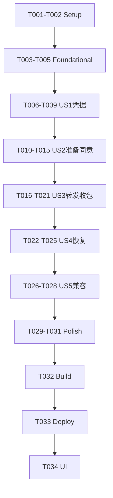

# Tasks: M2-A MinerU 安全配置与复杂文件转发

**Input**：`/Users/zane/DevecostudioProjects/Shuvi-agent/spec/knowledge-document-pipeline/spec.md` 与 plan.md 已分别通过阶段1/2审核。
**Prerequisites**：现有M1保持；本轮仅固定MinerU配置与四格式转发，不解压/索引未知结果。
**Tests**：需求明确要求host策略/故障/协议/预算和M1旧96回归；真实Token/样本缺失时不做未授权外发。
**Verification choice**：用户选择 `Run verification + UI verification (UI verification takes significantly longer)`，后续按marker确定build+ui，不再询问。

## Format

T001–T034连续任务；P1为核心安全/机制，US5为P2但本轮包含。故事阶段携带[USx]，其余无story标签。测试先业务失败后修复，失败保留证据，不删难例或用转译失败代业务红灯。无[P]源写任务，同服务/适配器/视图跨故事顺序增补。

## Path Conventions

PROJECT_ROOT=/Users/zane/DevecostudioProjects/Shuvi-agent，Confirmed_Feature_Dir为根下spec/knowledge-document-pipeline。任务采用绝对路径。M2文件和库独立，资源归entry/src/main/resources。原fixtures/golden/M1库wire均不改，不Git提交/推送。

## Phase 1: Setup (P1)

- [X] T001 核对已批准契约、提交/原工作区、SDK/官方重载与M1/探针保护基线，登记原fixtures、源码、模板/脚本摘要与证据方案，不读Token/签名材料，目标 /Users/zane/DevecostudioProjects/Shuvi-agent/spec/knowledge-document-pipeline/plan.md
- [X] T002 冻结本轮控制协议fixture与安全负例/预算/状态期望清单，明确它们不是实际云产物或真实Office语料，不下载/生成冒称真实样本，目标 /Users/zane/DevecostudioProjects/Shuvi-agent/spec/knowledge-document-pipeline/test-contract.md

T002依赖T001。工程已存在，不scaffold或安装依赖；若执行时工程真不存在才按父工作流先devecocli create，不手写项目配置。

## Phase 2: Foundational (P1)

- [X] T003 创建具名格式/原件/同意/门禁/任务/占用/租约引用/包/错误/视图模型和批准预算；无Kit/any/unknown/as，不含公共Token或签名地址，目标 /Users/zane/DevecostudioProjects/Shuvi-agent/entry/src/main/ets/knowledge/domain/DocumentParseModels.ets
- [X] T004 创建选择/原件预检/存储/凭据操作/服务任务/结果接收的具名端口及取消错误契约；秘密只在私有平台边界，无生产假端口，目标 /Users/zane/DevecostudioProjects/Shuvi-agent/entry/src/main/ets/knowledge/domain/DocumentParsePorts.ets
- [X] T005 扩展host纯逻辑源/测试注册和源码指纹，保留六fixtures/golden及原96项，阶段测试先失败再修复，不跑真实网络或读取密钥，目标 /Users/zane/DevecostudioProjects/Shuvi-agent/entry/src/test/run-host-tests.cjs

T003依赖T002，T004→T005顺序。基础只模型/边界，不把未完成功能用默认成功实现。

## Phase 3: User Story 1 — Token 本机安全配置 (P1)

**Independent Test**：具名测试端口覆盖配置CRUD/拒绝/不泄漏；真实AssetStoreKit状态在验证阶段检查，用户真实凭据不能被测试覆盖或截图。

- [X] T006 [US1] 先写真实应用服务配置状态、保存/更新/删除、错误/锁定及秘密不进视图/日志的测试，假凭据仅测试值不进生产，目标 /Users/zane/DevecostudioProjects/Shuvi-agent/entry/src/test/DocumentParseServiceCases.ets
- [X] T007 [US1] 实现AssetStoreKit专用Token/32字节本地加密键、属性状态查询/CRUD、DEVICE_UNLOCKED/NEVER、非持久/非群组，AES-GCM租约保密与认证失败；不明文降级或让页面取SECRET，目标 /Users/zane/DevecostudioProjects/Shuvi-agent/entry/src/main/ets/knowledge/infra/MineruCredentialStore.ets
- [X] T008 [US1] 实现设置操作/默认关闭/凭据revision变更及输入退出保护，仅转交密码不保存在公共state，错误去敏、保存成功才已配置，目标 /Users/zane/DevecostudioProjects/Shuvi-agent/entry/src/main/ets/knowledge/application/DocumentParseService.ets
- [X] T009 [US1] 实现固定MinerU+密码输入CRUD/配置状态V1视图，不预填/回显/复制Token，无自动连接检查；先可安全独立展示并运行配置host用例留证据，目标 /Users/zane/DevecostudioProjects/Shuvi-agent/entry/src/main/ets/knowledge/ui/DocumentParseView.ets

T006依赖T005，T007→T008→T009顺序。真实配置是否存在不证明Token有效/免费或任何文件已授权。

## Phase 4: User Story 2 — 保真准备与逐件同意 (P1)

**Independent Test**：拒绝/无同意/未配置/超限零请求，类型与原字节预算明确；无真实二进制样本则平台预检未覆盖，不能造成功原件。

- [X] T010 [US2] 先补同意绑定/免费声明/普通资料阻止、原件/页数/批次/占用/总量边界测试，构造签名只标单元用例不真实语料，目标 /Users/zane/DevecostudioProjects/Shuvi-agent/entry/src/test/DocumentParseCases.ets
- [X] T011 [US2] 实现纯策略：Grant哈希/版本/接收方/用途/凭据revision、默认关闭与未决门禁、预算/状态/免费声明有效性；任何不满足零外发，目标 /Users/zane/DevecostudioProjects/Shuvi-agent/entry/src/main/ets/knowledge/pipeline/DocumentParsePolicy.ets
- [X] T012 [US2] 实现PDF/DOCX/PPTX/XLSX系统选择器、类型容器身份、原字节分段保存/SHA核对、安全路径/计量与fd关闭，M1 fileadapter/预算不更改，目标 /Users/zane/DevecostudioProjects/Shuvi-agent/entry/src/main/ets/knowledge/infra/DocumentFileAdapter.ets
- [X] T013 [US2] 实现独立并发PDFKit页数/加密/加载预检与释放；1–50页才允许外发，能力未知/不可用保留原件且阻止，不改PDF或借估计绕上限，目标 /Users/zane/DevecostudioProjects/Shuvi-agent/entry/src/main/ets/knowledge/infra/DocumentPdfPreflight.ets
- [X] T014 [US2] 实现独立S3解析准备库的显式版本布局/原件/Grant/偏好/checkpoint/资产计量/清理基础，未知版本拒绝M2不迁移/清理M1，目标 /Users/zane/DevecostudioProjects/Shuvi-agent/entry/src/main/ets/knowledge/infra/DocumentParseRepository.ets
- [X] T015 [US2] 接通应用层本地准备/判重/逐件确认及视图Toggle/Checkbox/只保存/提交可用性理由，完整文件与未知隐私/免费资格说明准确，执行拒绝零网络host留证据，目标 /Users/zane/DevecostudioProjects/Shuvi-agent/entry/src/main/ets/knowledge/application/DocumentParseService.ets

T010依赖T009，T011→T012→T013→T014→T015顺序；T015联动仅既定DocumentParseView。PDF预检线程payload不传Context/Token/数据库，Office本轮只包身份不称原生结构支持。

## Phase 5: User Story 3 — 精准异步任务与隔离收包 (P1)

**Independent Test**：官方公开控制响应仅协议fixture；完整编排host fake transport不是真API，真实联调等待获准文件和用户Token。

- [X] T016 [US3] 先补控制JSON字段重复/深度/大小/安全整数/数组数量/ID匹配/未知状态、目的地主机混淆/重定向与流式超限负例，目标 /Users/zane/DevecostudioProjects/Shuvi-agent/entry/src/test/DocumentParseCases.ets
- [X] T017 [US3] 实现有界标准JSON读写与已知控制层具名DTO/白名单状态/关联校验/角色目的地政策，禁止as/any/dynamicobject或Regex整JSON；不解析ZIP内schema，目标 /Users/zane/DevecostudioProjects/Shuvi-agent/entry/src/main/ets/knowledge/pipeline/MineruProtocolCodec.ets
- [X] T018 [US3] 实现rcp固定API与文件面分离、单文件批次申请/原字节PUT/状态Query、TLS/无自动redirect/cache/cookies/trace、单次120秒/有界轮询/取消与Token只API，目标 /Users/zane/DevecostudioProjects/Shuvi-agent/entry/src/main/ets/knowledge/infra/MineruTransportAdapter.ets
- [X] T019 [US3] 实现结果流式写前实字节/epoch/磁盘上限、完整结束/实长/hash/ZIP外层签名校验与隔离提交，≤30MiB且结果总量有界、不解压或建索引，目标 /Users/zane/DevecostudioProjects/Shuvi-agent/entry/src/main/ets/knowledge/infra/DocumentFileAdapter.ets
- [X] T020 [US3] 实现申请前检查点、批次/租约先落盘后PUT、远端真实状态/15分钟等待/90次上限/逐动作Grant、下载UNVALIDATED结果记录及错误，目标 /Users/zane/DevecostudioProjects/Shuvi-agent/entry/src/main/ets/knowledge/application/DocumentParseService.ets
- [X] T021 [US3] 实现复杂原件/任务列表/阶段进度/结果待结构校验详情，不显示签名链接/响应原文/索引就绪；执行编排与超限host留证据，目标 /Users/zane/DevecostudioProjects/Shuvi-agent/entry/src/main/ets/knowledge/ui/DocumentParseView.ets

T016依赖T015，T017→T018→T019→T020→T021顺序。必要只增既定parseRepository结果/任务字段；不运行无授权真实API“检查连接”，不拼猜官方新host。

## Phase 6: User Story 4 — 暂停恢复与安全清理 (P1)

**Independent Test**：未知提交不重提、单远端占用不因pause/delete消失、真实checkpoint恢复、Token变更/关闭/删除隔离晚到，安全清理不越范围。

- [X] T022 [US4] 先补submit响应不确定/上传结果未知/expiredlease/429/鉴权/取消/远端未决slot/删除迟到/清理失败与恢复幂等测试，目标 /Users/zane/DevecostudioProjects/Shuvi-agent/entry/src/test/DocumentParseServiceCases.ets
- [X] T023 [US4] 实现task/remote_slot及最小tombstone持久化/终态确认才释放、加密租约引用/安全对账/删除后cleanup、布局校验/计量，Token/地址不明文存，目标 /Users/zane/DevecostudioProjects/Shuvi-agent/entry/src/main/ets/knowledge/infra/DocumentParseRepository.ets
- [X] T024 [US4] 完成既有身份优先查询/用户继续下载、未知申请停核对/不重提、取消/关闭解析/凭据revision变化/删除epoch保护与去敏反馈，目标 /Users/zane/DevecostudioProjects/Shuvi-agent/entry/src/main/ets/knowledge/application/DocumentParseService.ets
- [X] T025 [US4] 完成M2Assembly前后台/关闭清秘密及网络、输入退出清理、UI暂停继续/未决占用与本地删除说明，并运行恢复host留证据，目标 /Users/zane/DevecostudioProjects/Shuvi-agent/entry/src/main/ets/knowledge/infra/DocumentParseAssembly.ets

T022依赖T021，T023→T024→T025顺序。联动既定DocumentParseView及EntryAbility最小生命周期桥，不能自动后台续跑/假云端删除，普通M1服务不被桥清理。

## Phase 7: User Story 5 — M1 保留与取证交接 (P2)

**Independent Test**：旧96/golden及格式拒绝保持，新的导航/任务不能修改旧wire/资料；空入口不读取用户PDF。

- [X] T026 [US5] 先补M2原件/结果不传TextNormalizer/不进M1索引/任务隔离、已有查询状态保持与能力分层测试，目标 /Users/zane/DevecostudioProjects/Shuvi-agent/entry/src/test/DocumentParseServiceCases.ets
- [X] T027 [US5] 完成Index/“我的”设置入口/知识库解析准备导航、V1整体快照/二级返回/各Assembly独立与失败隔离，不改日程/其他功能或M1schema/预算，目标 /Users/zane/DevecostudioProjects/Shuvi-agent/entry/src/main/ets/pages/Index.ets
- [X] T028 [US5] 在批准.cache父目录核验后建立空m2-input/user-pdf入口，不扫描已有用户文件；写明后续样本许可/逐件同意/免费额度/用户拖入设备与M2-B门禁，目标 /Users/zane/DevecostudioProjects/Shuvi-agent/spec/knowledge-document-pipeline/input-guide.md

T026依赖T025，T027→T028顺序；T027仅联动既定FeaturePages.ets/TextKnowledgeView.ets/Assembly，不把其假支持标记成4格式检索可用。

## Phase 8: Polish (P1/P2)

- [X] T029 仅增加解析INTERNET、选择性M2文件/库/缓存备份排除，保留M1备份/其他权限/SDK依赖/签名模板，核对安全输入/日志生命周期，目标 /Users/zane/DevecostudioProjects/Shuvi-agent/entry/src/main/module.json5
- [X] T030 执行全套host/原96/协议/预算/安全故障回归，检查无真实凭据/API外发、无伪样本/新依赖/未授权权限、M1fixtureSHA/golden不变；记录源码/题集/工作区/工具/日志并修范围内问题，目标 /Users/zane/DevecostudioProjects/Shuvi-agent/entry/src/test/run-host-tests.cjs
- [X] T031 增量回写总spec的M2-A转发边界、测试例外/批准预算、host真实结果和缺样本/Token的联网未覆盖，保留旧M1及人工反馈，写实施报告，目标 /Users/zane/DevecostudioProjects/Shuvi-agent/specs/02-个人知识库问答.md

T029依赖T028，T030→T031顺序；备份配置只 `/Users/zane/DevecostudioProjects/Shuvi-agent/entry/src/main/resources/base/profile/backup_config.json`。阶段4报告 `/Users/zane/DevecostudioProjects/Shuvi-agent/spec/knowledge-document-pipeline/implementation-report.md`；不改启动/签名/日志脚本、上游README、原fixture或其他feature文档。

## Phase 9: Verification

<!-- verification_scope: build+ui -->

仅阶段5spec-verify执行T032–T034，一次委派、自主build/deploy/UI/fix，不重问范围。初build最多10次（1+9），每故事最多3verification attempts，故事loop有源码修改则最终ALLstory各1次无fix复验，没有story源码改跳最终。

**本轮结案（2026-10-14，INCOMPLETE）**：以下[X]仅表示一次验证委派及结果记录已结束，不代表全部成功。实际初构建4次，当前unsigned/signed构建通过，修复后host148/148；已通过macOS脚本正常缓存签名安装启动到Mate90Pro。UI工具因未配置多模态模型初始化失败，US1两次工具调用但实际UI验证0次，US2–US5未执行；真实Token、获准复杂原件和MinerU公网解析/ZIP联调均未执行。以verification-report.md分层结果为准，不标四格式已支持或功能已验收。

- [X] T032 完成.ets静态检查后当前 `devecocli build`，失败按错误修复直接重build、初构建最多10次；记录模板/产物/工具/源码指纹及日志，无密钥/签名原文，目标 /Users/zane/DevecostudioProjects/Shuvi-agent/spec/knowledge-document-pipeline/verification-report.md
- [X] T033 构建成功且唯一授权目标明确后通过既有 `scripts/dev-run-mac.sh` 正常缓存签名/部署当前产物，捕获公开阶段与template恢复摘要；不强签/清库/卸载/自动登录或同意协议、不HDC写文件，目标 /Users/zane/DevecostudioProjects/Shuvi-agent/spec/knowledge-document-pipeline/verification-report.md
- [X] T034 按US1–US5每故事一条复合UI verification用例顺序校验安全可执行流程/拒绝及M1兼容，限定修复并host重验；真实Token输入和缺少获准样本的云上传不得代填/伪造，逐story如实未覆盖，最终结果和总spec证据留档，目标 /Users/zane/DevecostudioProjects/Shuvi-agent/spec/knowledge-document-pipeline/verification-report.md

T032依赖T031，T033→T034顺序。每轮修改完成checker后build；failedbuild到retry之间不再arkts_check。signedrun脚本若同时build/run计入真实调用，不能把unsigned/SignHap任务名冒signed成功。设备/签名不足INCOMPLETE不question/清数据/读私有缓存。UI不得覆盖用户真实Token或拍密码输入；仅非secret专用测试alias，实际真实网络/格式无样本时不执行且不改scope为build-only。

## Dependencies & Execution Order

Setup T001–T002 → Foundational T003–T005 → US1 T006–T009 → US2 T010–T015 → US3 T016–T021 → US4 T022–T025 → US5 T026–T028 → Polish T029–T031 → Verification T032–T034。

各故事独立测试；共享应用服务/网络/视图按序完成，不同故事不得并发写同文件。阶段4仅前31项/host，后3项交阶段5，不提前build或UI。

## 📊 Dependency Graph

## ⚡ Parallel Execution Guide

| Phase | Tasks | Required Files | Execution Notes |
|---|---|---|---|
| Setup/Foundation | T001–T005 | 本执行文档、Models/Ports、runner | 基线/预期冻结后才写纯逻辑，无并行写 |
| US1–US4 | T006–T025 | 既定Credential/Files/Pdf/Protocol/Policy/Repository/Service/View/Assembly | 共享文件多，逐故事测试先行；无真实API或凭据读取 |
| US5/Polish | T026–T031 | Index/入口/空目录指南/module/backup/host/总spec | M1不迁移，保留旧96与字节；只批量只读审计可并行 |
| Verification | T032–T034 | 产物、mac启动脚本、UI工具、本轮报告 | build成功再部署，5story顺序验证，真实缺项不造成功 |

## Parallel Example

本轮无[P]源写任务。可同时只读查官方Asset/rcp重载与测试期望，但不存在跨故事并发修改Service/View或后台自动API请求。对范围内不同文件的独立研究不构成实现授权扩展。

## Implementation Strategy

T009是安全配置MVP，T015是原件/确认准备，T021是转发/收包编排，T025是恢复闭环；均不代表真实联调PASS。继续至T031交付全部批准本机实现与host，再验证当前产物/UI。无Token/样本不人为卡住代码交付，也不将官方/假响应当实际结果；真实在线测试等用户在应用填Token并明确样本后单独记录。

## Summary Report

总计34项：Setup2、Foundational3、US1四项、US2六项、US3六项、US4四项、US5三项、Polish3、Verification3。US1–4 P1、US5 P2且本轮必须；无P源写，优先顺序与依赖见上。格式自检T001–034连续唯一，各checkbox有具体路径，story标签只在故事阶段，末节marker build+ui。

## Notes

- 首.ets前载入ArkTS/ArkUI规范及对应组件重载；用apply_patch，禁止any/unknown/as、匿名类型/dynamicobject字段/装饰器混用及未经核验API。
- 用户PDF目录只创建空入口及说明，不读取未指定原文件；不下载官方示例、不抓公网PDF、不试HDC写入、不碰.local签名私有配置。
- Token真实值不进对话/日志/截图/源码/Git/同步，任何假值仅明确单元/平台非秘密测试且不送公网。
- 单远端未知占用、逐件Grant、真实字节上限、M1完全保留和UNVALIDATED结果是硬门槛，不能为了测试通过删约束。
- 不commit/push/merge/rebase/gitconfig，不卸载/清数据/接受协议/自动login/强签。
