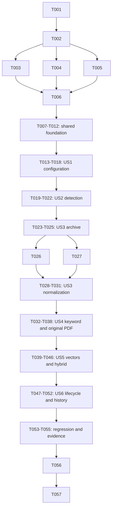

# Tasks: M2-B PDF 知识入库与多提供商嵌入配置

**日期**：2026-10-16。
**状态**：阶段 1/2/3 与全部 57 项任务已获用户批准；阶段 4 部分交付（PARTIAL），实际状态见 implementation-report.md；阶段 5 已唯一执行，T056/T057 已处理且构建/部署各 PASS，整体 INCOMPLETE，权威见 verification-report.md，18 项实施缺口保持未完成。
**Confirmed_Feature_Dir**：/Users/zane/DevecostudioProjects/Shuvi-agent/spec/knowledge-pdf-ingestion。
**Input**：/Users/zane/DevecostudioProjects/Shuvi-agent/spec/knowledge-pdf-ingestion/spec.md；/Users/zane/DevecostudioProjects/Shuvi-agent/spec/knowledge-pdf-ingestion/plan.md。
**PROJECT_ROOT**：/Users/zane/DevecostudioProjects/Shuvi-agent。
**CONFIG_ROOT**：/Users/zane/.local/share/deveco。
**验证选择**：用户选择 Run verification；仅构建与部署，不增加自动 UI 验证。
**模板适配**：用户已批准省略模板“每任务提交”建议；禁止自动 commit/push 及其他未授权 Git 写操作。表情标题省略，保留要求的 Mermaid 依赖图和并行表。

## Format

- 每项格式为 checkbox + Txxx + 可选 [P] + 故事任务必有 [USx] + 描述/验收/依赖 + 精确绝对目标路径。
- 优先级由阶段标题继承；[P] 只表示同一批准批次内不同文件、无未完成依赖的机会，不允许并发改同一文件。默认按 ID 顺序执行。
- T001–T055 由 spec-implementation 执行；T056–T057 仅由一次 spec-verify 执行。主 agent 不编写应用代码。阶段 4 不运行 checker/build/deploy/UI；host/纯逻辑/已授权ZIP离线结构对照属于已批准实现测试。
- 原 217 host、六 fixtures/golden、原件/ZIP/历史与 M2-A Token/任务/占用保持。不移除难例、不改 golden 迎合结果、不重发 MinerU、不引依赖/权限/SDK升级、不用 PseudoEmbedding。
- 不读 Key/签名/项目其他 .local 文件，不要求用户把 Key 发到对话；只有既有指定 ZIP 可离线消费。真实 Key 由用户后续在应用填，本轮没有 Key 不发 embedding。不得执行用户粘贴脚本或恢复已禁止的 HDC 文件写入绕过。
- 若工作区存在有效 build-profile.json5/oh-package.json5（当前已确认），沿用既有工程，禁止重新 scaffold；仅当实际项目文件均缺失时，首 Setup 动作加载 deveco-cli skill 并运行 devecocli create，不手工创建工程配置。
- 源编辑使用 apply_patch；首个 .ets 前加载 hmos-arkui-develop-skill，官方 API 先 devecocli docs search/read，不凭记忆编造。无可用旧名语法 skill 时使用已提供同类 skill，不为“加载成功”添加依赖或改工具配置。
- 每次实际测试使用现有 capture-test-log.sh 留独占证据/提交+工作区指纹，签名/Key/认证 raw 流不得进入公共 RUN_CMD 或普通日志；工具受限则报告实际未测，不能补假证据。
- 任务的“完成”只代表其代码/契约/指定测试确实交付；模型/平台/定位门禁仍可未通过，不能把 [X] 等同全部用户故事已验收。阻塞点须记报告、保留旧数据并实现批准的 fail-closed/关键词降级。

## Path Conventions

所有任务目标使用项目根 /Users/zane/DevecostudioProjects/Shuvi-agent 下的绝对路径；源目录为 entry/src/main/ets/knowledge，测试为 entry/src/test，资源为 entry/src/main/resources。文件是既有或已批准的阶段4目标，不表示阶段3已经创建源文件。指定ZIP仅在既有ignored缓存消费，不复制到测试fixtures/Git；文档在 Confirmed_Feature_Dir，总契约在 specs，二者职责不混用。

## Phase 1: Setup（P1）

**目标**：固定授权范围、存量基线和测试入口，不改用户数据/工具链。

- [X] T001 核对基线和工作区，登记已获批 spec/plan、M1/M2-A 资产与既有未跟踪工作保护、无 Key/定位/Token 上界门禁；验收：报告区分历史证据与本轮动作，禁止操作清单明确；无依赖；目标 /Users/zane/DevecostudioProjects/Shuvi-agent/spec/knowledge-pdf-ingestion/implementation-report.md
- [X] T002 复用并扩展现 host harness 的新增测试套件注册、纯逻辑与平台注入边界及元数据指纹输出；验收：原六 fixtures/golden 与217历史测试不删除，真实SDK执行不由host替代；依赖T001；目标 /Users/zane/DevecostudioProjects/Shuvi-agent/entry/src/test/run-host-tests.cjs

## Phase 2: Foundational（P1，阻塞全部故事）

**目标**：共享模型/端口、普通库安全扩展、M1兼容与M2-A资产引用保护。

- [X] T003 [P] 定义PDF原件结果绑定、manifest、规范化结构/表格/图像、覆盖/审批、具名PDF定位/映射证据及版本状态；验收：不复用M1 UTF-16 locator、不伪默认坐标/质量；依赖T002；目标 /Users/zane/DevecostudioProjects/Shuvi-agent/entry/src/main/ets/knowledge/domain/PdfKnowledgeModels.ets
- [X] T004 [P] 定义四提供商配置、地域/接入、能力/模型来源、检测、Token资格证据、独立grant、空间与向量任务/覆盖模型；验收：领域对象无Key、未报告版本明确，配置/凭据修订分开；依赖T002；目标 /Users/zane/DevecostudioProjects/Shuvi-agent/entry/src/main/ets/knowledge/domain/EmbeddingModels.ets
- [X] T005 [P] 定义统一文档/命中/通道/来源、文本与PDF具名locator、历史快照/游标/引用状态及预算模型；验收：M1/PDF命名空间不冲突，分数不当概率；依赖T002；目标 /Users/zane/DevecostudioProjects/Shuvi-agent/entry/src/main/ets/knowledge/domain/KnowledgeSearchModels.ets
- [X] T006 定义ZIP受控读取、规范化/映射、PDF仓储、凭据/传输/向量、无副作用候选召回及pin/发布清理端口；验收：页面/核心不引用具体适配器，取消与错误有明确边界；依赖T003–T005；目标 /Users/zane/DevecostudioProjects/Shuvi-agent/entry/src/main/ets/knowledge/domain/KnowledgePorts.ets
- [X] T007 建立普通用户库共享host/写队列/会话租约，冻结M1先bootstrap再kb扩展、M1Ready/扩展Ready独立及中断迁移处理；验收：空库/已有M1/扩展失败/重开不清库且不关闭其他会话；依赖T006；目标 /Users/zane/DevecostudioProjects/Shuvi-agent/entry/src/main/ets/knowledge/infra/KnowledgeStoreHost.ets
- [X] T008 将M1仓储/装配接入共享host并新增最多20候选召回契约；验收：旧search仍top5、旧TEXT_LAYOUT/wire/行/ID/历史/QueryPreparation行为保持，异常不切空库；依赖T007；目标 /Users/zane/DevecostudioProjects/Shuvi-agent/entry/src/main/ets/knowledge/domain/TextKnowledgePorts.ets；/Users/zane/DevecostudioProjects/Shuvi-agent/entry/src/main/ets/knowledge/infra/TextRdbRepository.ets；/Users/zane/DevecostudioProjects/Shuvi-agent/entry/src/main/ets/knowledge/infra/TextKnowledgeAssembly.ets
- [X] T009 增量建立KB-PDF-EXT-1普通关系布局、扩展元标识、job/pin/cleanup/世代/幂等记录基础与有界行校验；验收：不改解析库v3表、不改M1旧布局，扩展事务失败隔离，未知残留保留阻断；依赖T008；目标 /Users/zane/DevecostudioProjects/Shuvi-agent/entry/src/main/ets/knowledge/infra/PdfKnowledgeRepository.ets
- [X] T010 建立跨阶段生命周期协调器的持久pin-owner原子登记、源资产互斥/读租约与fail-closed保护端口；验收：Preparing/Checkpoint/Active有可恢复owner，未知状态不允许删除；依赖T009；目标 /Users/zane/DevecostudioProjects/Shuvi-agent/entry/src/main/ets/knowledge/application/KnowledgeLifecycleService.ets
- [X] T011 将M2-A删除与每次cleanup接入同一保护端口；验收：活跃/准备/检查点pin阻止逻辑与物理误删，保护不可用只阻止破坏性动作，原远端任务/占用/传输行为保持；依赖T010；目标 /Users/zane/DevecostudioProjects/Shuvi-agent/entry/src/main/ets/knowledge/application/DocumentParseService.ets；/Users/zane/DevecostudioProjects/Shuvi-agent/entry/src/main/ets/knowledge/infra/DocumentParseAssembly.ets
- [X] T012 建立M1/M2-A/PDF/嵌入共享会话装配与隔离失败状态，保留现有装配调用兼容；验收：同一原件保护实例/普通库host唯一，close只释放自身租约，未就绪能力不能冒可用；依赖T011；目标 /Users/zane/DevecostudioProjects/Shuvi-agent/entry/src/main/ets/knowledge/infra/KnowledgeAssembly.ets

**Checkpoint**：原M1/M2-A契约可回归，新增能力失败不破坏存量；全部故事从此基础继续。

## Phase 3: US1 多提供商嵌入配置与能力发现（P1）

**Independent Test**：注入安全存储/网络验证四提供商切换、地域/Workspace、Key状态、真实模型来源与禁用状态；不上传PDF、不调用聊天、不需要真实Key。真实发现成功仍待用户Key取证。

- [X] T013 [US1] 先编写Key用途/提供商隔离、地域默认未选、配置修订、保存不联网、列表来源/未核能力/去敏失败的注入用例；验收：覆盖未知免费资格NoRequest与MinerU别名不变；依赖T012；目标 /Users/zane/DevecostudioProjects/Shuvi-agent/entry/src/test/EmbeddingCases.ets
- [X] T014 [US1] 实现embedding专用Asset Store凭据CRUD/属性状态/短时认证和失效意图；验收：provider/百炼接入身份隔离，DEVICE_UNLOCKED/SyncType.NEVER、无IS_PERSISTENT/明文降级/回填，失败可定位不泄密；依赖T013；目标 /Users/zane/DevecostudioProjects/Shuvi-agent/entry/src/main/ets/knowledge/infra/EmbeddingCredentialStore.ets
- [X] T015 [US1] 固定提供商能力/profile及封闭官方接入选择、模型来源/ID与配置校验；验收：百炼Workspace不能变任意Host，硅基enum矛盾保留，Gemini/OpenAI网络禁用，静态profile不冒远端结果；依赖T014；目标 /Users/zane/DevecostudioProjects/Shuvi-agent/entry/src/main/ets/knowledge/pipeline/EmbeddingPolicy.ets
- [X] T016 [US1] 实现硅基当前Key的sub_type=embedding模型发现传输、认证目的/重定向/响应上限/取消与去敏错误；验收：百炼仅手填、另两家NoRequest，免费未知不发，不猜分页或聊天过滤；依赖T015；目标 /Users/zane/DevecostudioProjects/Shuvi-agent/entry/src/main/ets/knowledge/infra/EmbeddingTransportAdapter.ets
- [X] T017 [US1] 实现配置保存/切换/删除、能力发现与结果来源状态编排及普通库非秘密元数据持久化；验收：Key或接入修订使检测/grant失效，保存/进入页不联网，不暗改其他provider；依赖T016；目标 /Users/zane/DevecostudioProjects/Shuvi-agent/entry/src/main/ets/knowledge/application/EmbeddingService.ets；/Users/zane/DevecostudioProjects/Shuvi-agent/entry/src/main/ets/knowledge/infra/PdfKnowledgeRepository.ets
- [X] T018 [US1] 建立我的嵌入设置入口及四家配置/密码输入/地域接入/模型选择或手填/来源与禁用原因；验收：V1/现四入口不变，密码不预填/切出清空，不使用Key截图；依赖T017；目标 /Users/zane/DevecostudioProjects/Shuvi-agent/entry/src/main/ets/knowledge/ui/EmbeddingSettingsView.ets；/Users/zane/DevecostudioProjects/Shuvi-agent/entry/src/main/ets/components/FeaturePages.ets；/Users/zane/DevecostudioProjects/Shuvi-agent/entry/src/main/ets/pages/Index.ets

## Phase 4: US2 显式最小真实嵌入检测（P1）

**Independent Test**：用受控传输验证一次固定短句、合法/乱序/缺失/NaN/零范数/维度异常及配置变更失效；注入通过不代表真实提供商检测通过。

- [X] T019 [US2] 先增加固定短句仅一个请求、无资料/问题/聊天、响应非法不成功及免费未知/取消/限频错误用例；验收：列表/保存不隐式检测，注入与真实证据分开；依赖T018；目标 /Users/zane/DevecostudioProjects/Shuvi-agent/entry/src/test/EmbeddingCases.ets
- [X] T020 [US2] 实现硅基和百炼已核embedding请求/响应校验、单字符串float格式、各家字段差异和Float32有限/范数检查；验收：不对bge发送Qwen专属dimensions，不向百炼兼容接口传DashScope字段，total_tokens-only合法，零自动重试/切付费；依赖T019；目标 /Users/zane/DevecostudioProjects/Shuvi-agent/entry/src/main/ets/knowledge/infra/EmbeddingTransportAdapter.ets；/Users/zane/DevecostudioProjects/Shuvi-agent/entry/src/main/ets/knowledge/pipeline/EmbeddingPolicy.ets
- [X] T021 [US2] 编排显式固定句检测、免费确认、检测指纹/实际维度/耗时/可选usage持久化及配置漂移拒绝；验收：结果仅绑定当前修订、不证明质量/余额，后台/取消迟到不写Passed；依赖T020；目标 /Users/zane/DevecostudioProjects/Shuvi-agent/entry/src/main/ets/knowledge/application/EmbeddingService.ets；/Users/zane/DevecostudioProjects/Shuvi-agent/entry/src/main/ets/knowledge/infra/PdfKnowledgeRepository.ets
- [X] T022 [US2] 接入检测按钮/独立确认/忙闲/成功维度与去敏失败，明确列表成功不等检测；验收：未核provider禁用、Key空输入不回显、缺真实Key状态不冒检测通过；依赖T021；目标 /Users/zane/DevecostudioProjects/Shuvi-agent/entry/src/main/ets/knowledge/ui/EmbeddingSettingsView.ets

## Phase 5: US3 既有ZIP安全规范化与覆盖审查（P1）

**Independent Test**：指定ZIP离线结构/资产/计数与恶意边界、漂移协议、空块/末页/跨页报告；不重新解析、不需要embeddingKey。host解压替身不能代表设备zlib验证。

- [ ] T023 [US3] 先编写ZIP路径/重叠/CRC/截断/炸弹/不支持格式、JSON重复key/UTF-8/预算、表格跨度/活动内容和规范化覆盖固定用例，并准备可接真实平台端口的zlib多缓冲/CRC/释放/取消能力用例；验收：边界失败保留原件/ZIP/旧索引、未知原页不通过；本轮只执行host，设备用例准备不运行；依赖T022；目标 /Users/zane/DevecostudioProjects/Shuvi-agent/entry/src/test/PdfArchiveCases.ets；/Users/zane/DevecostudioProjects/Shuvi-agent/entry/src/test/PdfStructureCases.ets
- [X] T024 [US3] 实现ZIP中央/本地元数据一致、EOCD/成员范围/安全逻辑路径/冲突与ZIP-PDF-SAFE-1限额规则；验收：不从成员名派生落盘路径、不硬编码UUID，拒绝未知扩展/链接/加密/ZIP64/数据描述符；依赖T023；目标 /Users/zane/DevecostudioProjects/Shuvi-agent/entry/src/main/ets/knowledge/pipeline/SafeZipPolicy.ets
- [X] T025 [US3] 实现受控只读范围与系统raw-DEFLATE/STORED逐成员适配、实际字节/CRC/SHA、固定缓冲/超时取消/释放；验收：精确消费且真实结束、逐段预算，SDK行为不明fail closed，不手写DEFLATE或无界解包；依赖T024；目标 /Users/zane/DevecostudioProjects/Shuvi-agent/entry/src/main/ets/knowledge/infra/PdfArchiveAdapter.ets
- [ ] T026 [P] [US3] 实现独立有界typed JSON读入/词法结构校验与分配前预算；验收：8MiB/深度64/单串256KiB/对象256key/token100万、重复解码key/有限数/完整语法严格，M2-A控制codec不放大；依赖T025；目标 /Users/zane/DevecostudioProjects/Shuvi-agent/entry/src/main/ets/knowledge/pipeline/BoundedDocumentJson.ets
- [X] T027 [P] [US3] 实现惰性表格allowlist、单次实体解码、源cells/展开占位预算与跨度网格；验收：无WebView/脚本/公式执行、无猜测表头/原生cell框，未知/冲突结构明确隔离；依赖T025；目标 /Users/zane/DevecostudioProjects/Shuvi-agent/entry/src/main/ets/knowledge/pipeline/PdfTableDecoder.ets
- [X] T028 [US3] 实现3.4.4特征profile和v2唯一规范化、v1/layout审计及公式/表格/图注/64资产关系与覆盖报告；验收：340内联/46独立公式保留，多JSON不重复，空块/末页/跨页风险不静默丢失；依赖T026/T027；目标 /Users/zane/DevecostudioProjects/Shuvi-agent/entry/src/main/ets/knowledge/pipeline/MineruPdfNormalizer.ets
- [ ] T029 [US3] 实现PDF独占暂存、受控ID图像/快照分片/manifest原子落盘、实际hash/像素/500MiB账本和清理边界；验收：不把图片名当hash，保留原件及包内PDF派生身份，不越树覆盖；依赖T028；目标 /Users/zane/DevecostudioProjects/Shuvi-agent/entry/src/main/ets/knowledge/infra/PdfAssetAdapter.ets
- [X] T030 [US3] 编排既有task/original/结果hash绑定、pin先于读取、安全校验/规范化检查点和报告绑定审批；验收：硬校验失败不可确认绕过，配置/重开/迟到不误发布，不调用MinerU；依赖T029；目标 /Users/zane/DevecostudioProjects/Shuvi-agent/entry/src/main/ets/knowledge/application/PdfIngestionService.ets
- [ ] T031 [US3] 接入已收PDF“校验并准备入库”、覆盖报告/明确部分可用确认/失败与恢复状态；验收：Office仍转发态，未知末页/定位限制可见，原M2-A切页传输行为保持；依赖T030；目标 /Users/zane/DevecostudioProjects/Shuvi-agent/entry/src/main/ets/knowledge/ui/PdfIngestionView.ets；/Users/zane/DevecostudioProjects/Shuvi-agent/entry/src/main/ets/knowledge/ui/DocumentParseView.ets

## Phase 6: US4 PDF入库、关键词与原件核对（P1）

**Independent Test**：无需Key，固定结构/正负关键词/部分发布/取消/重建和原件核对状态；保留真正PDF，未核页/区域不能准确跳页/高亮。

- [ ] T032 [US4] 先补结构分块/Unicode/前缀计量、默认过滤/显式reference-aside、发布幂等/旧索引、证据等级与多区域定位用例，并准备PDFKit真正原件页框/旋转/裁剪/多区域的可复现平台用例；验收：无表头/cell框/跨页关系伪造，缺证据无高亮；缺映射金标准标待核、本轮不运行设备用例；依赖T031；目标 /Users/zane/DevecostudioProjects/Shuvi-agent/entry/src/test/PdfStructureCases.ets；/Users/zane/DevecostudioProjects/Shuvi-agent/entry/src/test/KnowledgeIntegrationCases.ets
- [X] T033 [US4] 实现PDF-CHUNK-1结构分块/检索及嵌入投影、公式/表格行组/图注与来源覆盖；验收：目标384/上限512代码点及2048 UTF-8字节含前缀，无法无损分块明确排除，单PDF2000/总PDF1万块限额；依赖T032；目标 /Users/zane/DevecostudioProjects/Shuvi-agent/entry/src/main/ets/knowledge/pipeline/PdfStructureChunker.ets
- [X] T034 [US4] 实现PDF关键词staging/FTS或实际LIKE、覆盖校验/活动内容世代事务激活与本机幂等；验收：激活匹配job/epoch/hash/审批/旧指针且无cleanupClaim，失败不替旧索引、不发云；依赖T033；目标 /Users/zane/DevecostudioProjects/Shuvi-agent/entry/src/main/ets/knowledge/infra/PdfKnowledgeRepository.ets
- [ ] T035 [US4] 实现PDFKit真正原件只读几何/页预览适配与页/区域证据分级/变换校验；验收：不save/加持久批注、不把服务PDF替原件，3.4.4未知合同不假缩放，通过范围才给对应页/区域；依赖T034；目标 /Users/zane/DevecostudioProjects/Shuvi-agent/entry/src/main/ets/knowledge/infra/PdfPageAdapter.ets
- [ ] T036 [US4] 建立真正PDF核对视图、结构/图像/公式/表格核对和已证多区域高亮；验收：未证页只候选说明和手动翻页，已证页无区域只跳页，密码/外链/脚本不参与；依赖T035；目标 /Users/zane/DevecostudioProjects/Shuvi-agent/entry/src/main/ets/knowledge/ui/PdfSourceView.ets
- [ ] T037 [US4] 完成关键词发布/重建/暂停/恢复与覆盖审批绑定；验收：相同处理键复用发布、重建不重新解析、失败旧可查、空可发布集不报成功，状态区分关键词/向量/定位；依赖T036；目标 /Users/zane/DevecostudioProjects/Shuvi-agent/entry/src/main/ets/knowledge/application/PdfIngestionService.ets；/Users/zane/DevecostudioProjects/Shuvi-agent/entry/src/main/ets/knowledge/ui/PdfIngestionView.ets
- [X] T038 [US4] 建立统一入口的M1/PDF关键词候选/查询与来源打开基础；验收：QueryPreparation原行为不变、原文UTF-16与PDF locator分开、reference/aside可显式包含、一次查询不重复旧service历史写入；依赖T037；目标 /Users/zane/DevecostudioProjects/Shuvi-agent/entry/src/main/ets/knowledge/application/KnowledgeSearchService.ets；/Users/zane/DevecostudioProjects/Shuvi-agent/entry/src/main/ets/knowledge/ui/KnowledgeView.ets

## Phase 7: US5 独立云向量化与真实语义召回（P1）

**Independent Test**：注入协议/向量库测试只证明安全机制；真实Key、免费资格、Token输入上界和平台能力均满足后才允许真实PDF块/问题外发。无条件时必须关键词降级且语义未验，不可用伪向量代替。

- [ ] T039 [US5] 先补corpus/query独立grant、Token未知NoRequest、乱序/缺向量/NaN/错维/读回不符/漂移、超时取消与旧空间保护用例；准备固定改述/否定/无答案题集与keyword/vector/hybrid的Recall@5/MRR/来源正确率评估、真实vector写读/KNN/跨库恢复用例；验收：金标准/阈值缺失标待核不编造，不自动发送M1/图片/原件，注入向量不入生产或冒语义证据，本轮不运行设备/真实服务质量用例；依赖T038；目标 /Users/zane/DevecostudioProjects/Shuvi-agent/entry/src/test/EmbeddingCases.ets；/Users/zane/DevecostudioProjects/Shuvi-agent/entry/src/test/KnowledgeIntegrationCases.ets
- [X] T040 [US5] 核对并登记目标模型的完整document/query profile与TokenEligibilityEvidence，实施输入/角色/维度/版本资格策略；验收：能证明的模型才启用corpus/query；无法建立保守Token上界则InputLimitUnverified禁发并记门禁，不能以字符/字节或事后usage假证明、不增加计数请求/依赖；依赖T039；目标 /Users/zane/DevecostudioProjects/Shuvi-agent/entry/src/main/ets/knowledge/pipeline/EmbeddingPolicy.ets；/Users/zane/DevecostudioProjects/Shuvi-agent/spec/knowledge-pdf-ingestion/implementation-report.md
- [ ] T041 [US5] 实现独立S3 ArkData vector store、固定FLOATVECTOR(N)空间表、安全登记ID、读回/余弦KNN/派生清理及受控能力测试入口；验收：不改M1 vector:false、不建ANN、不混维/空间，设备未验证标未可用，结构测试向量与生产隔离；依赖T040；目标 /Users/zane/DevecostudioProjects/Shuvi-agent/entry/src/main/ets/knowledge/infra/VectorRdbRepository.ets
- [ ] T042 [US5] 持久化文档/查询grant、空间指纹/检测证据、输入hash覆盖、向量generation和活动指针/跨库eligibility；验收：未知生产版本明确，普通库为权威、无假跨库原子，未全覆盖不标SemanticReady；依赖T041；目标 /Users/zane/DevecostudioProjects/Shuvi-agent/entry/src/main/ets/knowledge/infra/PdfKnowledgeRepository.ets
- [ ] T043 [US5] 实现串行单文档真实向量任务、完整输入核验、一次请求120秒/窗口15分钟、Float32读回/覆盖验证后激活与恢复；验收：无Key/同意/免费/输入资格不发，取消/后台/额度/429暂停且零自动重试，晚到不复活/不混空间；依赖T042；目标 /Users/zane/DevecostudioProjects/Shuvi-agent/entry/src/main/ets/knowledge/application/EmbeddingService.ets
- [X] T044 [US5] 实现单keyword候选列表+同空间vector候选的RRF(k60)/稳定去重和权威可见性规则；验收：各取20/最终5、M1不获伪向量票、距离/字面分不直接混算、不冒事实概率；依赖T043；目标 /Users/zane/DevecostudioProjects/Shuvi-agent/entry/src/main/ets/knowledge/pipeline/KnowledgeRetrievalPolicy.ets
- [ ] T045 [US5] 接入显式会话查询同意、真实query embedding/KNN/融合与总10秒超时的统一搜索；验收：仅兼容活动空间、无新授权不切旧模型，向量失败明确仅关键词，迟到不覆盖/追加历史，全部失败不同于零召回；依赖T044；目标 /Users/zane/DevecostudioProjects/Shuvi-agent/entry/src/main/ets/knowledge/application/KnowledgeSearchService.ets
- [ ] T046 [US5] 接入文档块外发/查询外发分离确认、免费资格、向量覆盖/重建/暂停和真实keyword/vector/hybrid通道呈现；验收：未完成向量不标语义就绪、模型/Token门禁原因可见，L0不冒聊天回答；依赖T045；目标 /Users/zane/DevecostudioProjects/Shuvi-agent/entry/src/main/ets/knowledge/ui/PdfIngestionView.ets；/Users/zane/DevecostudioProjects/Shuvi-agent/entry/src/main/ets/knowledge/ui/KnowledgeView.ets；/Users/zane/DevecostudioProjects/Shuvi-agent/entry/src/main/ets/knowledge/ui/EmbeddingSettingsView.ets

## Phase 8: US6 统一知识库、历史与资产生命周期（P2）

**Independent Test**：M1存量/golden、统一历史一次保存/双源分页、归档/删除/重建/重开、pin与cleanupClaim竞态和晚到拒绝；不清库、不卸载、不触碰远端数据。

- [ ] T047 [US6] 先补M1空库/已有库/扩展中断、历史旧版/删除、双源分页、发布后未确认幂等重放、pin-owner/放弃/清理竞争/迟到恢复用例，并准备真实普通库迁移/关闭重开/跨库恢复的可复现平台用例；验收：每个提交边界可复现，无按年龄自动unpin或旧索引误清，host与平台端口证据分开，本轮不运行设备用例；依赖T046；目标 /Users/zane/DevecostudioProjects/Shuvi-agent/entry/src/test/KnowledgeIntegrationCases.ets
- [ ] T048 [US6] 完成PDF归档/恢复/逻辑删除/检查点显式放弃、pin转移/ReleasePending、cleanupClaim与读租约恢复/持久清理；验收：先失效epoch/隐藏再清文件、失败不回滚已提交删除，不自动删M2-A原件/ZIP，保护未知fail closed；依赖T047；目标 /Users/zane/DevecostudioProjects/Shuvi-agent/entry/src/main/ets/knowledge/application/KnowledgeLifecycleService.ets；/Users/zane/DevecostudioProjects/Shuvi-agent/entry/src/main/ets/knowledge/infra/PdfKnowledgeRepository.ets
- [X] T049 [US6] 完成统一查询/证据快照持久化、旧M1历史只读桥接/双源稳定游标及引用有效性；验收：完整问题不丢、一次查询一次历史、旧wire/表不重写，PDF不塞TextRange，归档有效/旧版标旧/删除仅快照禁跳；依赖T048；目标 /Users/zane/DevecostudioProjects/Shuvi-agent/entry/src/main/ets/knowledge/infra/PdfKnowledgeRepository.ets；/Users/zane/DevecostudioProjects/Shuvi-agent/entry/src/main/ets/knowledge/infra/TextRdbRepository.ets；/Users/zane/DevecostudioProjects/Shuvi-agent/entry/src/main/ets/knowledge/application/KnowledgeSearchService.ets
- [ ] T050 [US6] 完成同一入口的混合文档列表/查询/历史/管理与M1导入/原文详情委托；验收：所有原M1能力可达，删除范围/历史保留说明明确，PDF引用用真正原件，长文/模型ID与可访问布局不遮挡；依赖T049；目标 /Users/zane/DevecostudioProjects/Shuvi-agent/entry/src/main/ets/knowledge/ui/KnowledgeView.ets；/Users/zane/DevecostudioProjects/Shuvi-agent/entry/src/main/ets/knowledge/ui/TextKnowledgeView.ets
- [X] T051 [US6] 完成装配/四入口二级返回和后台/销毁暂停，密码清空与会话资源租约释放；验收：前台切页不暂停既有M2-A、不新建Entry/路由体系，进程重开不自动云续跑，关闭一服务不关其他仓储；依赖T050；目标 /Users/zane/DevecostudioProjects/Shuvi-agent/entry/src/main/ets/knowledge/infra/KnowledgeAssembly.ets；/Users/zane/DevecostudioProjects/Shuvi-agent/entry/src/main/ets/pages/Index.ets；/Users/zane/DevecostudioProjects/Shuvi-agent/entry/src/main/ets/entryability/EntryAbility.ets
- [ ] T052 [US6] 完成全阶段预算/临时与待清理计量、已登记子树启动对账及新增派生/临时备份排除；验收：500MiB包含完整/暂存/失活待清理，资产缺失不清库修复、不自动开同步，现有排除项保留；依赖T051；目标 /Users/zane/DevecostudioProjects/Shuvi-agent/entry/src/main/ets/knowledge/infra/PdfAssetAdapter.ets；/Users/zane/DevecostudioProjects/Shuvi-agent/entry/src/main/ets/knowledge/application/KnowledgeLifecycleService.ets；/Users/zane/DevecostudioProjects/Shuvi-agent/entry/src/main/resources/base/profile/backup_config.json

## Phase 9: Polish & Cross-Cutting（P1）

- [X] T053 执行原host回归/新增风险测试与指定ZIP离线结构对照，修复批准范围内失败并落盘证据；验收：原217/六fixtures/golden保留、成员/CRC/hash/346块/340inline/46公式/7表248cells/64图计数和告警逐项报告，不输出私料正文，不冒设备zlib/内容质量通过；依赖T052；目标 /Users/zane/DevecostudioProjects/Shuvi-agent/entry/src/test/run-host-tests.cjs；/Users/zane/DevecostudioProjects/Shuvi-agent/spec/knowledge-pdf-ingestion/implementation-report.md
- [X] T054 对所有新增边界做安全/契约/FR覆盖审查并限定修复：认证目的/重定向/去敏、Token资格、ZIP分配前预算、原件映射、M1迁移、激活/cleanupClaim/pin及超时恢复；验收：未满足平台/服务门禁明确禁用或关键词降级，不删难例/偷偷扩依赖权限，审查证据落报告；依赖T053；目标 /Users/zane/DevecostudioProjects/Shuvi-agent/spec/knowledge-pdf-ingestion/implementation-report.md
- [X] T055 增量回写总契约、实施报告/进度记忆和任务实际状态，准备后续平台/真实Key/定位/质量核对清单；验收：区分源码/host/构建/模拟器/真机/服务/质量、保留失败历史引用、无Key不宣称US5真实完成；依赖T054；目标 /Users/zane/DevecostudioProjects/Shuvi-agent/specs/02-个人知识库问答.md；/Users/zane/DevecostudioProjects/Shuvi-agent/spec/knowledge-pdf-ingestion/implementation-report.md；/Users/zane/DevecostudioProjects/Shuvi-agent/spec/knowledge-pdf-ingestion/context-memory.md；/Users/zane/DevecostudioProjects/Shuvi-agent/spec/knowledge-pdf-ingestion/tasks.md

**阶段4最终实况**：37项[X]，18项仍有实现缺口（T023、T026、T029、T031–T032、T035–T037、T039、T041–T043、T045–T048、T050、T052）；见 implementation-report.md。Polish的实际审查/回写完成不代表这些上游依赖已满足。设备case部分仅准备清单，不能冒可运行平台断言；US5实现和真实服务均未完成。

## Phase 10: Verification（P1，仅build/deploy）

<!-- verification_scope: build-only -->

**执行者**：只调用一次spec-verify，读取本节确定范围；不再询问UI范围。以下只有构建/部署两项，不执行自动UI、真实embedding或重新MinerU解析。

- [X] T056 对修改.ets先arkts_check紧接devecocli build，执行限定修复→重build并保存日志/构建产物状态；验收：checker不代构建，失败后与重build之间不再重复checker，首轮构建修复最多10次build，正常缓存签名/模板不扩权不泄密；无法完成如实FAIL/INCOMPLETE；依赖T055；目标 /Users/zane/DevecostudioProjects/Shuvi-agent/spec/knowledge-pdf-ingestion/verification-report.md。实际：已处理/PASS，44 文件 checker 一次 clean，实际 build 3/10（1 失败、2 成功，含缓存 signed）；三处类型修复后 host250/250。代理预检失败未 build，signed wrapper RC125 为阻止提前部署的 guard 结果，不冒 build 失败或额外 run。
- [X] T057 仅在构建成功后核对唯一已授权目标，通过devecocli run --skip-build执行保留数据的增量部署并落盘报告；验收：不卸载/reset/强签、不HDC写文件绕过，目标/签名/设备阻塞不盲重试，记录部署RC及未执行UI/服务/质量边界；依赖T056；目标 /Users/zane/DevecostudioProjects/Shuvi-agent/spec/knowledge-pdf-ingestion/verification-report.md。实际：已处理/PASS，唯一 Mate 90 Pro/127.0.0.1:5555，独立 no-build 部署一次，CLI run RC0，模板字节恢复；无 UI/设备 runtime probe/真实服务/质量测试。仅构建部署通过，整体仍 INCOMPLETE/PARTIAL。

构建与签名材料只使用现有安全入口/缓存；测试留档沿用现capture脚本，禁止把私有签名/认证原始流放进公共日志。若正常脚本组合包含构建，必须统计实际build次数，不把包装脚本调用当零次。T056失败则T057未执行，状态/原因权威写入报告；最终checkbox表示验证任务已处理，不能替代报告PASS/FAIL/INCOMPLETE。

## Dependency Graph

## Parallel Execution Guide

| Phase | Tasks | Required Files | Execution Notes |
|---|---|---|---|
| Foundation | T003/T004/T005 | 三个独立domain模型文件 | 同依赖T002，三任务无交叉写；T006等待三者完成 |
| US3 | T026/T027 | BoundedDocumentJson.ets / PdfTableDecoder.ets | 两个独立纯逻辑边界，同依赖T025；T028等待两者完成 |
| 其他 | 未标[P] | 以每项绝对路径为准 | 默认顺序；同一测试/仓储/服务/UI文件多次增量修改不能并行 |
| Verification | T056 → T057 | verification-report.md | 只能一次spec-verify顺序执行，构建成功才部署 |

表中Required Files的简称只为可读性；任务各行给出完整绝对路径，执行以任务为准。[P]机会不是批准新增agent/仓库并发写入或绕过阶段门禁。

## Dependencies & Execution Order

1. Setup → Foundation是全部故事共同前置。先保护M1和M2-A资产，再引入新生产入口。
2. US1 → US2与US3/US4在功能上可独立验收：配置/固定句不依赖PDF；PDF关键词不依赖Key。本任务表为同一仓储/装配安全，选择按ID串行交付，不代表PDF必须成功调用云才可入库。
3. US3 → US4是内容依赖：必须安全规范化并经覆盖审查，才分块/发布；US5需要US1/2配置能力和US4已验证块。
4. US6补齐跨故事统一管理/历史/删除恢复；前面的Foundation已先封住误删边界，不能等US6才开始保护原件。
5. 测试任务先于其故事实现；记录实际红/绿结果，原回归失败优先修兼容。不得根据未执行意图勾选任务。
6. Polish后自动进入一次Verification；无Phase4→5确认门禁。阶段3审核前所有应用任务均未执行。

## Parallel Example

T002完成后可将T003、T004、T005分给不同执行单元，各自只写一个模型文件，T006等待三者；T025完成后可并行T026/T027，T028等待两者。默认由同一实施subagent顺序执行，不需要人为并行来满足验收。

## Implementation Strategy

| 分组 | IDs | 数量 | 优先级 |
|---|---|---:|---|
| Setup | T001–T002 | 2 | P1 |
| Foundation | T003–T012 | 10 | P1 |
| US1配置 | T013–T018 | 6 | P1 |
| US2固定检测 | T019–T022 | 4 | P1 |
| US3安全规范化 | T023–T031 | 9 | P1 |
| US4关键词/原件 | T032–T038 | 7 | P1 |
| US5真实向量 | T039–T046 | 8 | P1 |
| US6统一生命周期 | T047–T052 | 6 | P2 |
| Polish | T053–T055 | 3 | P1 |
| Verification | T056–T057 | 2 | P1 |
| **总计** | **T001–T057** | **57** | **P1 51 / P2 6** |

- 实施55项、验证2项；全部初始未完成。故事任务40项，其余17项。
- 可并行2组/5项：T003–T005、T026–T027；默认执行仍按ID。
- 最小可演示增量：Foundation后US1/2提供诚实的配置/检测入口；US3/4提供不依赖云Key的安全PDF关键词闭环。不是批准删除US5/6或宣称全功能已完成。
- US5实际真实服务/质量与原件准确定位门禁保留；没有Key/Token上界/平台证据时可完成契约/代码/注入测试，但报告必须列真实闭环未验/未完成项。
- 验证选择build-only：只构建和部署，不做自动UI；不以部署成功推定zlib、RDB、原页或语义质量通过。后续真实资料人工核对需要独立证据。

**格式自检**：57个唯一顺序ID；US阶段全部有[USx]，Setup/Foundation/Polish/Verification无[USx]；各任务有绝对目标路径、依赖与验收；[P]只给独立文件批次；验证标记为build-only、无UI任务；范围与已批准spec/plan一致。

## Notes

设备/真实服务用例的准备不授权本轮执行，build-only只构建部署。架构中输入Token、zlib、向量库、原页映射和真实Key门禁仍有效，不能以任务checkbox替代质量/设备证据。阶段3审核后才委派实施，不自动提交代码。
