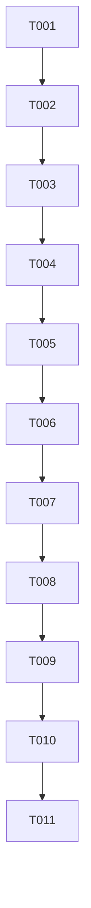

# Tasks: PDF 原页标注、词条高亮与相似结果最小增量

**日期**：2026-10-17。  
**状态**：T001–T009完成（源码/host）；当前增量阶段5已唯一处理，T010构建PASS、T011部署PASS，仅build-only。最终authority为result-pages-verification.md；页面/生产页登记/真实similar未验，不重委派。  
**Confirmed_Feature_Dir**：/Users/zane/DevecostudioProjects/Shuvi-agent/spec/knowledge-pdf-ingestion。  
**Input**：同目录spec.md当前C1–C3/FR-033–FR-041及plan.md。  
**验证选择**：用户明确选择 `Run verification`，build-only。本轮验证阶段只构建/部署，不跑UI/模型请求，不声称页面闭环已验。  
**历史保护**：原57项任务完整移存 /Users/zane/DevecostudioProjects/Shuvi-agent/spec/knowledge-pdf-ingestion/initial-tasks-20261016.md；ROUND2任务/报告、冻结gold原件及摘要均不改。当前T编号仅属于此增量，不冒旧任务状态。

## Format

所有当前任务P1，默认顺序，无并行写入。US1=C1真实原页；US2=C2直接命中/高亮；US3=C3明确相似。T001–T009只委派spec-implementation，T010–T011只委派一次spec-verify，主agent不实现源码。实施只做源码/host与只读原页对齐，不build/run/UI。源使用apply_patch、严格ArkTS/V1、实际SDK文档先核。

继续用户已批准的模板适配：不执行每任务commit/push；当前有效工程不scaffold。没有实际Key/云外发/真机/容量范围新增授权；不读.local/Key/签名/raw日志/用户paste，不清库/卸载/reset/强签/HDCfilewrite。全部原件/ZIP/343向量/旧M1/历史及回归golden保持。

## Path Conventions

项目根 /Users/zane/DevecostudioProjects/Shuvi-agent。源层为entry/src/main/ets/knowledge，沿用domain/pipeline/application/infra/ui。候选原页对照可在已获准的本机cache/应用只读资产内核对；不能编造parsed内容或把providerpage+1当证据。当前原PDF路径 /Users/zane/DevecostudioProjects/Shuvi-agent/.cache/m2-input/user-pdf/02_第02章_模型评估与选择.pdf，SHA7f959de85fdab10b15e2aada044d9f1fbd75dbc90b2fabfca79eb9ecb4b3df3a。指定ZIP同既有授权缓存，不重解析。

## Phase 1: Setup（P1）

- [X] T001 固定当前343块/向量身份、原件/ZIP/快照/旧M1与历史保护基线，登记当前范围及build-only边界；验收：不重传/重嵌入、不复用旧请求授权；无依赖；目标 /Users/zane/DevecostudioProjects/Shuvi-agent/spec/knowledge-pdf-ingestion/result-pages-implementation.md

## Phase 2: Foundational（P1）

- [X] T002 定义片段内命中范围/Direct-Similar分类、真实原页集合/完整性、页身份证据和只读端口；新增严格版本化侧表/迁移及展示历史关联契约；验收：不改chunk/snapshot/inputHash/space/vgen，旧页区域模型与M1wire保持；依赖T001；目标 /Users/zane/DevecostudioProjects/Shuvi-agent/entry/src/main/ets/knowledge/domain/KnowledgeSearchModels.ets；/Users/zane/DevecostudioProjects/Shuvi-agent/entry/src/main/ets/knowledge/domain/PdfLocalModels.ets；/Users/zane/DevecostudioProjects/Shuvi-agent/entry/src/main/ets/knowledge/domain/KnowledgePorts.ets；/Users/zane/DevecostudioProjects/Shuvi-agent/entry/src/main/ets/knowledge/infra/PdfKnowledgeRepository.ets

## Phase 3: US1 真实原页依据对齐（P1）

**Independent Test**：不查排名、不联网，将原PDF逐页特异内容/结构与现snapshot节点对照；只保存绑定身份、完整覆盖范围的证据，未核/冲突/跨页不完整有明确状态。

- [X] T003 [US1] 先补页证据身份漂移/冲突/多节点跨页/未覆盖测试；有界只读核对原件与既有解析逐页内容及chunkSources，形成受审node/fragment对照清单；验收：不能只凭同页数/几何/印刷页码连续/provideridx+1授予原页，不反向用top5挑gold；依赖T002；目标 /Users/zane/DevecostudioProjects/Shuvi-agent/entry/src/test/KnowledgeResultCases.ets；/Users/zane/DevecostudioProjects/Shuvi-agent/spec/knowledge-pdf-ingestion/pdf-page-alignment.md
- [X] T004 [US1] 实现独立PAGE-IDENTITY-1证据登记/读取及块全部关联节点的原页集合解析，装配只读页码服务；验收：冲突不取首条、unknown不冒原页、跨页保留多页/部分未核；若实际源无法读取明确缺何只读入口，不伪数据；依赖T003；目标 /Users/zane/DevecostudioProjects/Shuvi-agent/entry/src/main/ets/knowledge/application/PdfPageReferenceService.ets；/Users/zane/DevecostudioProjects/Shuvi-agent/entry/src/main/ets/knowledge/infra/PdfKnowledgeRepository.ets；/Users/zane/DevecostudioProjects/Shuvi-agent/entry/src/main/ets/knowledge/infra/KnowledgeAssembly.ets

## Phase 4: US2 直接词条与片段高亮（P1）

**Independent Test**：正文命中/只有前缀/重复重叠/ASCII大小写/中文和代理对，以及词条变化/旧历史兼容均纯逻辑或注入测试；不调用embedding。

- [X] T005 [US2] 先写纯匹配与截断边界用例，再实现LITERAL-ASCII-FOLD-1命中范围、合并和正文direct候选端口；验收：top20截断前按evidence正文判定，前缀不能挤掉真实direct，旧M1 search/candidates兼容且不改旧wire；依赖T004；目标 /Users/zane/DevecostudioProjects/Shuvi-agent/entry/src/test/KnowledgeResultCases.ets；/Users/zane/DevecostudioProjects/Shuvi-agent/entry/src/main/ets/knowledge/pipeline/KnowledgeMatchPolicy.ets；/Users/zane/DevecostudioProjects/Shuvi-agent/entry/src/main/ets/knowledge/domain/TextKnowledgePorts.ets；/Users/zane/DevecostudioProjects/Shuvi-agent/entry/src/main/ets/knowledge/infra/TextRdbRepository.ets；/Users/zane/DevecostudioProjects/Shuvi-agent/entry/src/main/ets/knowledge/infra/PdfKnowledgeRepository.ets
- [X] T006 [US2] 实现Text+Span复用结果卡片、当前/历史高亮与原页展示、展示元数据保存及旧记录兼容重建；验收：绑定result.actualInput和hit.text而非后来编辑的输入，ranges不拆代理对、不改原串，旧版/删除引用正确；依赖T005；目标 /Users/zane/DevecostudioProjects/Shuvi-agent/entry/src/main/ets/knowledge/ui/KnowledgeResultCard.ets；/Users/zane/DevecostudioProjects/Shuvi-agent/entry/src/main/ets/knowledge/ui/KnowledgeView.ets；/Users/zane/DevecostudioProjects/Shuvi-agent/entry/src/main/ets/knowledge/infra/PdfKnowledgeRepository.ets

## Phase 5: US3 相似结果与路由（P1）

**Independent Test**：注入semantic端口核direct存在零调用、完整零direct+typed授权才调用、未授权/失败/部分keyword失败/截止各自提示；相似必须vector实际来源、无伪range。

- [X] T007 [US3] 修改统一查询为direct优先、只有确无direct且独立授权时才semantic，补Direct/Similar标签及历史分类；验收：旧typed授权/免费/配置/输入/space/10秒/历史pending语义保持，前缀候选不冒Similar，结果同当前活动版本过滤；依赖T006；目标 /Users/zane/DevecostudioProjects/Shuvi-agent/entry/src/main/ets/knowledge/application/KnowledgeSearchService.ets；/Users/zane/DevecostudioProjects/Shuvi-agent/entry/src/main/ets/knowledge/pipeline/KnowledgeRetrievalPolicy.ets；/Users/zane/DevecostudioProjects/Shuvi-agent/entry/src/main/ets/knowledge/ui/KnowledgeResultCard.ets；/Users/zane/DevecostudioProjects/Shuvi-agent/entry/src/main/ets/knowledge/ui/KnowledgeView.ets；/Users/zane/DevecostudioProjects/Shuvi-agent/entry/src/test/KnowledgeResultCases.ets

## Phase 6: Polish（P1）

- [X] T008 接入并执行现有host回归/新增匹配来源与路由测试，按现安全capture留独占证据；验收：旧257及counter/golden保持，新增case可实际执行，不删难例，host不能冒页面/实际语义通过；依赖T007；目标 /Users/zane/DevecostudioProjects/Shuvi-agent/entry/src/test/run-host-tests.cjs；/Users/zane/DevecostudioProjects/Shuvi-agent/entry/src/test/KnowledgeResultCases.ets；/Users/zane/DevecostudioProjects/Shuvi-agent/spec/knowledge-pdf-ingestion/result-pages-implementation.md
- [X] T009 安全与范围审查、限定修复及总spec/进度/报告增量；验收：原页对齐实际已证范围明确，源码仅必需变化、生产内容/向量身份不变、无新provider请求；缺少页面/真实相似验证如实记未执行，不把build-only冒闭环全验；依赖T008；目标 /Users/zane/DevecostudioProjects/Shuvi-agent/spec/knowledge-pdf-ingestion/result-pages-implementation.md；/Users/zane/DevecostudioProjects/Shuvi-agent/spec/knowledge-pdf-ingestion/context-memory.md；/Users/zane/DevecostudioProjects/Shuvi-agent/specs/02-个人知识库问答.md

## Phase 7: Verification（P1）

<!-- verification_scope: build-only -->

仅构建与部署，不含UI/新模型请求。原页只读研究/host测试不代替UI或实际相似请求；用户选择build-only不改变最终验收需求，但本轮报告只能给出已做范围。

- [X] T010 已处理，**PASS（仅构建）**：17ets checker一次clean紧接build；实际build2/10（直接1＋正常缓存signed脚本内部1），均RC0，无源码修复/失败重试；证据result-pages-phase5-build-01与signed-deploy-02；依赖T009；最终authority /Users/zane/DevecostudioProjects/Shuvi-agent/spec/knowledge-pdf-ingestion/result-pages-verification.md
- [X] T011 已处理，**PASS（仅CLI部署）**：重新核唯一Mate90Pro/127.0.0.1:5555，正常既有缓存签名＋模板SHA恢复，实际run --skip-build一次RC0，无重建/重试/卸载/reset/强签；signed HAP SHA8b6d2605…ffd3；无UI/runtime/生产页导入/查询/provider；依赖T010；最终authority /Users/zane/DevecostudioProjects/Shuvi-agent/spec/knowledge-pdf-ingestion/result-pages-verification.md

勾选只表示本次验证任务已处理且上述限定结果通过，不表示SC-007–SC-010页面/真实similar或生产页登记验收通过。当前唯一Phase5已结束，不再重委派，不重跑旧guard/journal。

## Dependency Graph

## Parallel Execution Guide

| Phase | Tasks | Required Files | Execution Notes |
|---|---|---|---|
| 全部 | 顺序T001–T011 | 多任务共享repository/service/model | 不标[P]，避免同文件并发写；先来源后展示 |
| Verification | T010→T011 | result-pages-verification.md | 一次spec-verify内完成；成功build才deploy，无UI |

## Parallel Example

当前不安排并行实施；可读研究已经完成，源码共享接缝按顺序推进。

## Dependencies & Execution Order

先T001保护基线及T002模型/迁移，再T003–T004原页对齐与服务；T005–T006完成片段direct/高亮和历史，T007接相似路由。T008–T009为实施回归/报告，T010–T011仅独立验证。不得因页对齐资料不全就伪造页号，不得在实施阶段提前运行本轮构建/部署或新增模型请求。

## Implementation Strategy

最小增量是US1原页服务＋US2卡片；US3只复用既有semantic，不重建索引。实施后自动交独立验证，无阶段4→5问询。当前没有任何新云授权，旧guard/journal不改、不删除绕过。若在实施中遇到与已确认spec不同的新要求，应回到需求确认，不默默扩scope。

## Notes

总11项：Setup1、Foundation1、US1两项、US2两项、US3一项、Polish2、Verification2；实施9项，验证2项，全P1。格式自检：T001–T011唯一顺序、故事任务均有[USx]、每项有绝对目标/依赖/验收、build-only无UI任务。未重新跑旧M2-A或完整ROUND2，将已有闭环证据与本次展示源变更分开。
