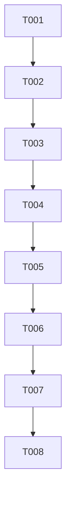

# Tasks: 新 PDF OCR=false 入库兼容与后台错误最小修复

**日期**：2026-10-18。
**状态**：阶段1/2/3已确认；阶段4 T001–T006完成，host299/299、counter32/32；阶段5仅一次处理T007/T008，T007构建PASS、T008部署INCOMPLETE，最终build-only **INCOMPLETE**。真实平台Review/线程边界未验，权威ocr-profile-fix-verification.md，不再次reinvoke。
**Confirmed_Feature_Dir**：/Users/zane/DevecostudioProjects/Shuvi-agent/spec/knowledge-pdf-ingestion。
**Input**：同目录spec.md当前B1–B2/FR-042–FR-048、plan.md当前F1–F4/F-K1–3。
**验证选择**：用户明确选择`Run verification`，仅build/deploy，不UI/实际恢复/新provider请求。真实新包到Review与真实TaskPool错误边界仍需另获执行范围，不以host或安装冒成功。
**历史保留**：原11项原页增量已完成任务完整移存 /Users/zane/DevecostudioProjects/Shuvi-agent/spec/knowledge-pdf-ingestion/result-pages-tasks-20261017.md。initial/ROUND2/result-pages旧报告与冻结gold均不覆盖。

**补充部署（2026-10-18）**：原T008登录预检INCOMPLETE保留为历史。用户之后明确授权使用已登录的StudioCLI1.3.5/Node24.14.1重新构建安装，现实际build1/run1均RC0、缓存签名复用、模板恢复，已交付修复版到同一模拟器；独立记录见ocr-profile-fix-studio-deployment.md。没有重委派旧Phase5、不改其失败报告或guard；Review/发布仍待用户手动验收，不补成自动功能PASS。

## Format

所有任务P1、默认顺序、无[P]并发写。US1=B1兼容恢复，US2=B2错误可见。T001–T006只由spec-implementation执行，不build/checker/deploy/UI；T007–T008由一次spec-verify处理。主agent不实现源码。用户已批准不自动commit模板适配仍生效；当前有效工程不scaffold。

源编辑apply_patch，首次.ets前加载hmos-arkui-develop-skill/deveco-cli；SDK先docs，不编API/noany/unknown/as/dynamicobject。保留V1/现架构，无新依赖/权限/SDK。不读.local/Key/签名/raw/paste；不清库/卸载/reset/强签/HDCfilewrite/删除候选或旧guard，不自动commit/push。只复用现有ZIP，所有旧云授权仍已用完，不发MinerU/embedding/list/probe/query。

## Path Conventions

PROJECT_ROOT=/Users/zane/DevecostudioProjects/Shuvi-agent；CONFIG_ROOT=/Users/zane/.local/share/deveco。
新包本机路径 /Users/zane/DevecostudioProjects/Shuvi-agent/.cache/new-pdf-ingestion-diagnosis/result-m2-6fe6c44120d215e2ec1a852235fb97a0.zip（实施前核实际文件名、size/hash，不猜；诊断摘要记录授权范围），SHA256 ba0e9e429650a88730924f5827adeb13cd836d0427a21f7475b7fe810d716ebb；原件33页/6181688B/hash1ed80b011c6a0f98288d617dd776fafe3ec34d317c8875e9d157937568776794。
纯元数据诊断见 /Users/zane/DevecostudioProjects/Shuvi-agent/.cache/new-pdf-ingestion-diagnosis/阶段1诊断摘要.md。新包/正文/完整JSON不复制入Git/公开日志，测试用合成最小fixture覆盖差异，真实包仅ignored缓存消费。

## Phase 1: Setup（P1）

- [X] T001 固定HEAD a9092f0及新包52CRC/falseprofile/3个Failed候选身份、旧343保护基线，记录批准范围与零网络/build-only边界；验收：不把host确定性错误冒设备三次底层错误已采，不改原件/ZIP或旧报告；无依赖；目标 /Users/zane/DevecostudioProjects/Shuvi-agent/spec/knowledge-pdf-ingestion/ocr-profile-fix-implementation.md

## Phase 2: Foundational（P1）

- [X] T002 定义具名PDF-WORKER-RESULT-1成功/失败合同及纯白名单校验策略，先补版本/操作/分支/字段/过长/非法数值/敏感原始消息拒绝测试；验收：只传受控category/stage/可选数字码，未知异常无rawmessage，无原型依赖或宽类型逃逸；依赖T001；目标 /Users/zane/DevecostudioProjects/Shuvi-agent/entry/src/main/ets/knowledge/domain/PdfWorkerModels.ets；/Users/zane/DevecostudioProjects/Shuvi-agent/entry/src/main/ets/knowledge/pipeline/PdfWorkerPolicy.ets；/Users/zane/DevecostudioProjects/Shuvi-agent/entry/src/test/PdfWorkerCases.ets

## Phase 3: US1 显式兼容false变体（P1）

**Independent Test**：原true、当前false与缺/非法OCR、未知version/backend/effort负例；旧true完整快照SHA回归不变，新false不篡改包/预算，页脚仍排除。

- [X] T003 [US1] 实现同3.4.4/hybrid/medium严格boolean分支和false独立profile，同未发布job检查点记录实际profile、既有processingKey不改；补新旧profile/非法类型/CRC预算/页脚排除和恢复幂等测试；验收：true序列化与冻结SHA不变、不更新Published/Retained/旧343，不新增第四attempt，false原标志可追溯；依赖T002；目标 /Users/zane/DevecostudioProjects/Shuvi-agent/entry/src/main/ets/knowledge/pipeline/MineruPdfNormalizer.ets；/Users/zane/DevecostudioProjects/Shuvi-agent/entry/src/main/ets/knowledge/application/PdfIngestionService.ets；/Users/zane/DevecostudioProjects/Shuvi-agent/entry/src/main/ets/knowledge/infra/PdfKnowledgeRepository.ets；/Users/zane/DevecostudioProjects/Shuvi-agent/entry/src/test/PdfStructureCases.ets

## Phase 4: US2 后台错误具体可见（P1）

**Independent Test**：后台操作返回经纯策略校验，领域/未知/取消/超时/非法信封均明确；真实TaskPool仅准备对应case不在本次build-only运行。

- [X] T004 [US2] 将PDF normalize/chunks/seal/verify/encode/hydrate节点和header七个入口接同一信封，主线程校验与安全重建并使准备/恢复失败记录显示具体操作阶段；保留TaskPool系统reject去敏及资源finally；验收：不跨线程依赖instanceof、不输出正文/URL/认证/rawmessage，不因信封丢取消/超时语义；补host及准备平台case，平台未执行明示；依赖T003；目标 /Users/zane/DevecostudioProjects/Shuvi-agent/entry/src/main/ets/knowledge/infra/PdfProcessingAdapter.ets；/Users/zane/DevecostudioProjects/Shuvi-agent/entry/src/main/ets/knowledge/infra/PdfSnapshotWorker.ets；/Users/zane/DevecostudioProjects/Shuvi-agent/entry/src/main/ets/knowledge/infra/PdfWorkerSupport.ets；/Users/zane/DevecostudioProjects/Shuvi-agent/entry/src/main/ets/knowledge/infra/PdfAssetAdapter.ets；/Users/zane/DevecostudioProjects/Shuvi-agent/entry/src/main/ets/knowledge/application/PdfIngestionService.ets；/Users/zane/DevecostudioProjects/Shuvi-agent/entry/src/test/PdfWorkerCases.ets

## Phase 5: Polish（P1）

- [X] T005 执行原host278/counter32及新增profile/信封/恢复回归，使用当前新包有界离线规范化/codec和页脚计数对照；验收：保留旧golden及30页冻结SHA，当前新包不再被falseprofile拒绝、33页脚排除可核，host不冒ImageKit/TaskPool或真实审查通过，每次capture独占指纹证据；依赖T004；目标 /Users/zane/DevecostudioProjects/Shuvi-agent/entry/src/test/run-host-tests.cjs；/Users/zane/DevecostudioProjects/Shuvi-agent/entry/src/test/run-host-summary.cjs；/Users/zane/DevecostudioProjects/Shuvi-agent/entry/src/test/PdfWorkerCases.ets；/Users/zane/DevecostudioProjects/Shuvi-agent/spec/knowledge-pdf-ingestion/ocr-profile-fix-implementation.md
- [X] T006 范围/去敏/旧数据安全审查及限定修复，增量更新实施报告、进度和总spec；验收：说明exacterror前后、新profile、页脚及平台未验、无自动发布/云请求，列精确修改ets供验证，现任务只勾实际完成；依赖T005；目标 /Users/zane/DevecostudioProjects/Shuvi-agent/spec/knowledge-pdf-ingestion/ocr-profile-fix-implementation.md；/Users/zane/DevecostudioProjects/Shuvi-agent/spec/knowledge-pdf-ingestion/context-memory.md；/Users/zane/DevecostudioProjects/Shuvi-agent/specs/02-个人知识库问答.md

## Phase 6: Verification（P1）

<!-- verification_scope: build-only -->

本次只构建与保数据增量部署，不点击恢复、不执行UI/真实后台探针、不发布/向量化/其他服务请求；安装启动不当已到Review。仅新一轮独立验证，不重跑旧guard/journal或多次调用spec-verify。

- [X] T007 修改ets先arkts_check紧接devecocli build，首轮最多10次实际build（含签名脚本内部），失败修后直接build不再插checker，记录实际制品/失败与限定修复；验收：当前源码真正构建成功、未削弱安全规则；依赖T006；目标 /Users/zane/DevecostudioProjects/Shuvi-agent/spec/knowledge-pdf-ingestion/ocr-profile-fix-verification.md。实际结果：**PASS**，14ets checker一次clean、实际build1/10 RC0，无源码修复；unsigned HAP4174557B/SHA8e6443dc…21000。
- [X] T008 构建成功后重新核唯一获准模拟器，正常缓存签名/模板恢复并devecocli run --skip-build保数据增量部署；验收：不卸载/reset/强签/readKey/签名/private，记录部署RC和未验新包Review/真实TaskPool边界，真实失败明示FAIL/INCOMPLETE；依赖T007；目标 /Users/zane/DevecostudioProjects/Shuvi-agent/spec/knowledge-pdf-ingestion/ocr-profile-fix-verification.md。实际结果：**已处理，INCOMPLETE，非部署通过**；两次只读清单/view核唯一Mate90Pro/127.0.0.1:5555，原缓存签名脚本一次RC1停于登录预检，内部build0/run0/signed制品无；不login/新签/卸载绕过，模板SHA不变/diff0，Review/真实TaskPool仍未验。本次唯一结案，不重委派。

## Dependency Graph

## Parallel Execution Guide

| Phase | Tasks | Required Files | Execution Notes |
|---|---|---|---|
| Implementation | T001–T006 | model/policy/normalizer/worker/adapter/tests/report | 无[P]，共享入口按序修改，源码首轮完成后统一交验证 |
| Verification | T007→T008 | ocr-profile-fix-verification.md | 一次spec-verify，成功build才deploy，build-only不扩UI |

## Parallel Example

不安排并行写入；本次两项最小修复共用worker与profile身份，顺序实施减少冲突。

## Dependencies & Execution Order

先错误模型/测试，再profile兼容与检查点身份，再接后台入口/错误展示；随后host和安全审查。仅验证阶段checker/build/run，当前阶段不重试设备。新候选页脚/未知定位留待实际覆盖报告用户确认，不扩正文功能。

## Implementation Strategy

8项全P1：Setup1、Foundation1、US1一项、US2一项、Polish2、Verification2；实施6项、验证2项。当前编号仅属OCRprofile修复，不与历史T混同；每项有绝对目标/依赖/验收，故事任务带[USx]，build-only标记无UI任务。

## Notes

完成最低交付是代码修复＋host新旧回归＋成功构建部署。由于本次选择build-only，不能宣称用户新PDF已在模拟器恢复到Review；用户后续可在同失败任务恢复，不需重新上传/解析/输入Key。如实际出现不同失败保留原件ZIP及具体新错误，不自动删除旧候选或放宽格式/预算。
