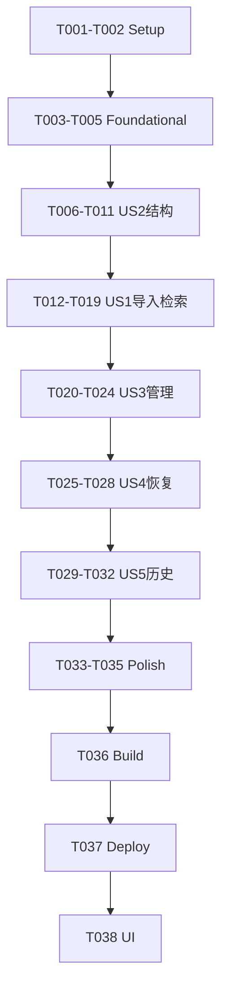

# Tasks: M1 文本知识库 L0 全链路

**Input**：`/Users/zane/DevecostudioProjects/Shuvi-agent/spec/knowledge-text-pipeline/` 中已批准的 spec.md、plan.md。
**Prerequisites**：spec.md、plan.md 已审核；权威总契约是 `/Users/zane/DevecostudioProjects/Shuvi-agent/specs/02-个人知识库问答.md`。
**Tests**：用户要求优先复用现有六份fixtures，包含host与固定金标准、故障/预算测试，保留原测试和失败用例。
**Scope**：只实现M1五故事，不进入真实语义/L1/MinerU/图片/同步，不新增权限/依赖/HAR。
**Verification**：用户于2026-10-12选择构建、部署及UI验证，范围由末节marker固定，阶段5不再提问。

## Format

连续任务ID按依赖顺序；`[USx]`映射规格故事，优先级由阶段标题注明。`[P]`只可用于无未完成依赖且不同文件任务；本轮共享服务/视图多，**无P写任务**。源文件内容只在阶段4由spec-implementation实现，阶段5由spec-verify验证/限定修复。

## Path Conventions

PROJECT_ROOT为 `/Users/zane/DevecostudioProjects/Shuvi-agent`。任务路径全部绝对，新增生产代码归现有 `entry/src/main/ets/knowledge/`，测试归 `entry/src/test/`；资源若必要归 `entry/src/main/resources/`，不将fixtures打包HAP。执行目录在项目根`spec/knowledge-text-pipeline`，总契约继续在`specs/`。

## Phase 1: Setup (P1)

- [X] T001 核对工程/SDK工具、批准文档与现有改动，登记旧探针库目录保护和日志/新增文件指纹方案；不读密钥、不改平台/签名模板、不Git写入，记录到 /Users/zane/DevecostudioProjects/Shuvi-agent/spec/knowledge-text-pipeline/plan.md
- [X] T002 实现前冻结六份fixtures SHA、正负问题/期望原文及位置/结构金标准；不改原件、不打包HAP/上传，不从实际输出倒推期望，目标 /Users/zane/DevecostudioProjects/Shuvi-agent/entry/src/test/eval/text-m1-golden.json

T002依赖T001。当前工程有效，不重scaffold/安装依赖；若执行时确实无有效工程文件则按父工作流先devecocli create，不能手写工程配置。

## Phase 2: Foundational (P1)

- [X] T003 定义具名原件/结构/表格/locator/任务/索引世代/历史/视图模型及批准预算，无Kit/any/unknown/as，原文单位与活动版本明确，目标 /Users/zane/DevecostudioProjects/Shuvi-agent/entry/src/main/ets/knowledge/domain/TextKnowledgeModels.ets
- [X] T004 定义选择/资产/CPU处理/Repository端口，成功/取消/失败分开、具名可注入契约，生产不依赖假端口，目标 /Users/zane/DevecostudioProjects/Shuvi-agent/entry/src/main/ets/knowledge/domain/TextKnowledgePorts.ets
- [X] T005 扩展host纯逻辑源/用例/golden加载与fixture SHA/工具结果记录，保留Mock/Chunker/Corpus；新测试先真实失败再修复，目标 /Users/zane/DevecostudioProjects/Shuvi-agent/entry/src/test/run-host-tests.cjs

T003依赖T002，T004依赖T003，T005依赖T004；基础完成才能实施故事。

## Phase 3: User Story 2 — 结构与字符安全 (P1)

**Goal**：先让真实文本处理可测，再接文件/RDB/UI。US编号不变，按数据依赖先US2。
**Independent Test**：六份原fixture与构造编码/换行/Unicode/结构边界，不需设备或模型。

- [X] T006 [US2] 先补严格UTF-8/BOM/CRLF映射、结构表格/定位、标题与正文关联及无外部访问测试，留失败证据，目标 /Users/zane/DevecostudioProjects/Shuvi-agent/entry/src/test/TextPipelineCases.ets
- [X] T007 [US2] 先增强旧切片回归并修复Unicode代理对/空白偏移/标题块尾缺陷，保留原签名/覆盖不变量/语料失败用例，目标 /Users/zane/DevecostudioProjects/Shuvi-agent/entry/src/main/ets/knowledge/pipeline/Chunker.ets
- [X] T008 [US2] 实现有界UTF-8原文解码/BOM与换行规范化、原始UTF-16/行号映射；非法编码不替换填假内容，目标 /Users/zane/DevecostudioProjects/Shuvi-agent/entry/src/main/ets/knowledge/pipeline/TextNormalizer.ets
- [X] T009 [US2] 实现Markdown常见节点/层级、列表/围栏、表头/单元格、图片引用位置；未知内容保留原文标限制、不渲染或取外部资源，目标 /Users/zane/DevecostudioProjects/Shuvi-agent/entry/src/main/ets/knowledge/pipeline/MarkdownStructure.ets
- [X] T010 [US2] 实现结构优先有界知识块，标题/表头计入完整输入、来源范围列表及Unicode安全，超长结构保留完整快照，目标 /Users/zane/DevecostudioProjects/Shuvi-agent/entry/src/main/ets/knowledge/pipeline/StructuredChunker.ets
- [X] T011 [US2] 增加六份fixture结构/golden检查并执行host回归，保留原标题失败/原语料SHA，按capture规则留命令/结果/工作区新增文件证据，目标 /Users/zane/DevecostudioProjects/Shuvi-agent/entry/src/test/CorpusCases.ets

T006依赖T005；T007–T010依赖T006且顺序；T011依赖T007–T010。必要测试更新仅 `/Users/zane/DevecostudioProjects/Shuvi-agent/entry/src/test/ChunkerCases.ets`；结构块新增来源断言不能削弱旧切片断言。

## Phase 4: User Story 1 — 真实导入与L0检索 (P1)

**Goal**：真实URI→保真原件→已验证结构/块→本机关键词→原文核对。
**Independent Test**：系统选择器导入专用副本，固定词句查询/详情定位/重复/取消/非法输入；host假端口不作设备/RDB证据。

- [X] T012 [US1] 先建立具名测试端口和真实应用服务导入/查询/golden/预算错误测试，假端口仅host、不得用户装配，目标 /Users/zane/DevecostudioProjects/Shuvi-agent/entry/src/test/TextServiceCases.ets
- [X] T013 [US1] 实现完整问题保存、时间/范围/否定保留、有界Unicode/UTF-8检索输入和丢弃提示、字面关键词/安全查询规则，目标 /Users/zane/DevecostudioProjects/Shuvi-agent/entry/src/main/ets/knowledge/pipeline/QueryPreparation.ets
- [X] T014 [US1] 实现DocumentViewPicker、URI元信息、原字节异步读取/安全拷贝/核验/SHA256、fd关闭，仅写新子树、选择取消无副作用，目标 /Users/zane/DevecostudioProjects/Shuvi-agent/entry/src/main/ets/knowledge/infra/TextFileAdapter.ets
- [X] T015 [US1] 实现CPU处理调度/取消或结果失效保护、有界执行、具名跨线程DTO验证，不传Context/RdbStore/桶进任务，目标 /Users/zane/DevecostudioProjects/Shuvi-agent/entry/src/main/ets/knowledge/infra/TextProcessingAdapter.ets
- [X] T016 [US1] 实现独立S3非向量用户库、schema/世代/任务基础、FTS真实写查询验证及LIKE异常降级、活动过滤/参数/结果集关闭，不切空库或启伪向量，目标 /Users/zane/DevecostudioProjects/Shuvi-agent/entry/src/main/ets/knowledge/infra/TextRdbRepository.ets
- [X] T017 [US1] 实现应用服务原件判重/预算、规范化/索引准备与校验发布、真实查询/通道/详情错误语义，目标 /Users/zane/DevecostudioProjects/Shuvi-agent/entry/src/main/ets/knowledge/application/TextKnowledgeService.ets
- [X] T018 [US1] 实现单Context/会话服务装配、资源生命周期与去敏日志边界，页面不直接平台业务，目标 /Users/zane/DevecostudioProjects/Shuvi-agent/entry/src/main/ets/knowledge/infra/TextKnowledgeAssembly.ets
- [X] T019 [US1] 实现V1列表/导入/查询/原文详情并替换tab2自检装配，保持切页输入/二级返回，不改日程/其他一级功能，目标 /Users/zane/DevecostudioProjects/Shuvi-agent/entry/src/main/ets/knowledge/ui/TextKnowledgeView.ets

T012依赖T011；T013–T016依赖T012且顺序；T017依赖T013–T016；T018→T019顺序。联动只在 `/Users/zane/DevecostudioProjects/Shuvi-agent/entry/src/main/ets/pages/Index.ets`，无新路由/入口页。用户片段/原件须来自选中文件，不能内置样例代真实路径。

## Phase 5: User Story 3 — 管理与安全重建 (P1)

**Independent Test**：重命名、判重、归档/恢复、旧活动索引保持、删除/清空/清理失败与保护探针。

- [X] T020 [US3] 先補管理、归档过滤、重建旧索引可查、删除/清空确认范围及事务/文件故障测试，目标 /Users/zane/DevecostudioProjects/Shuvi-agent/entry/src/test/TextServiceCases.ets
- [X] T021 [US3] 实现RDB重命名/独立归档、活动世代切换/失败保持、逻辑删除与持久化清理/存在性过滤，目标 /Users/zane/DevecostudioProjects/Shuvi-agent/entry/src/main/ets/knowledge/infra/TextRdbRepository.ets
- [X] T022 [US3] 完成应用层重建/归档恢复、单篇/批量/清空与清理协调；重命名不改原件、文件失败不回滚已提交删除，目标 /Users/zane/DevecostudioProjects/Shuvi-agent/entry/src/main/ets/knowledge/application/TextKnowledgeService.ets
- [X] T023 [US3] 完成新用户子树安全清理/失败报告，不删外部原件/探针目录，用后关闭资源，目标 /Users/zane/DevecostudioProjects/Shuvi-agent/entry/src/main/ets/knowledge/infra/TextFileAdapter.ets
- [X] T024 [US3] 添加多选管理/重命名/重建/归档过滤/确认删除清空，范围与部分失败准确；运行host管理用例留证据，目标 /Users/zane/DevecostudioProjects/Shuvi-agent/entry/src/main/ets/knowledge/ui/TextKnowledgeView.ets

T020依赖T019；T021→T022→T023→T024顺序。显式删除仅新用户库选中文档。

## Phase 6: User Story 4 — 中断与资料保留 (P1)

**Independent Test**：故障/取消/超时/晚到/重开，完成资料和旧活动世代保留，对账不清库。

- [X] T025 [US4] 先补保存/规范化/索引/发布/清理检查点故障、取消/超时、删除后晚到和恢复幂等测试，目标 /Users/zane/DevecostudioProjects/Shuvi-agent/entry/src/test/TextServiceCases.ets
- [X] T026 [US4] 实现阶段记录、暂停恢复/启动对账、失活世代与安全清理重试；未完成不假就绪、不破坏旧活动索引，目标 /Users/zane/DevecostudioProjects/Shuvi-agent/entry/src/main/ets/knowledge/infra/TextRdbRepository.ets
- [X] T027 [US4] 完成生命周期/世代取消/60秒处理与10秒查询上限、切页/重启语义，取消删除阻止晚到发布，目标 /Users/zane/DevecostudioProjects/Shuvi-agent/entry/src/main/ets/knowledge/application/TextKnowledgeService.ets
- [X] T028 [US4] 添加阶段/取消/继续/失败操作与切页状态，核对入口无清库/模型自检并运行恢复host留证据，目标 /Users/zane/DevecostudioProjects/Shuvi-agent/entry/src/main/ets/knowledge/ui/TextKnowledgeView.ets

T025依赖T024，T026→T027→T028顺序。必要装配生命周期调整限定既定文件，不能运行旧KnowledgeLab验证用户资料。

## Phase 7: User Story 5 — L0历史与快照 (P2)

**Independent Test**：真实查询落库/重启读取、旧版/删除快照失效、归档引用有效，不能跳新原件冒旧证据。

- [X] T029 [US5] 先补完整问题/实际输入通道/命中版本定位保存与分页、来源旧版/删除/归档状态测试，目标 /Users/zane/DevecostudioProjects/Shuvi-agent/entry/src/test/TextServiceCases.ets
- [X] T030 [US5] 实现L0查询/命中快照持久化、分页、版本可达性，单行有界、无假L1、不重读已删原件补快照，目标 /Users/zane/DevecostudioProjects/Shuvi-agent/entry/src/main/ets/knowledge/infra/TextRdbRepository.ets
- [X] T031 [US5] 实现历史/引用详情、完整问题与实际输入分开、保存失败/旧版失效可见，目标 /Users/zane/DevecostudioProjects/Shuvi-agent/entry/src/main/ets/knowledge/application/TextKnowledgeService.ets
- [X] T032 [US5] 添加历史列表/详情/快照与删除确认保留说明，执行host历史回归留证据，目标 /Users/zane/DevecostudioProjects/Shuvi-agent/entry/src/main/ets/knowledge/ui/TextKnowledgeView.ets

T029依赖T028，T030→T031→T032顺序；不新增原文编辑器或外发。

## Phase 8: Polish (P1/P2)

- [X] T033 完成手机/平板知识库布局、二级返回、长文本/错误/确认可访问性与切页输入/任务保持；只改知识库tab约束，目标 /Users/zane/DevecostudioProjects/Shuvi-agent/entry/src/main/ets/pages/Index.ets
- [X] T034 执行全部host/golden/预算/故障回归，核对Kit分层/去敏/无伪向量网络权限依赖/原fixture SHA；限定修复并落盘命令/结果/新源码语料指纹，目标 /Users/zane/DevecostudioProjects/Shuvi-agent/entry/src/test/run-host-tests.cjs
- [X] T035 回写总spec的M1范围/预算/本地门禁与真实host证据、后续缺项/来源/实现报告；保留S1/56-1历史，不宣称构建设备通过，目标 /Users/zane/DevecostudioProjects/Shuvi-agent/specs/02-个人知识库问答.md

T033依赖T032，T034→T035顺序。来源说明仅 `/Users/zane/DevecostudioProjects/Shuvi-agent/entry/src/test/fixtures/SOURCES.md`，实现报告 `/Users/zane/DevecostudioProjects/Shuvi-agent/spec/knowledge-text-pipeline/implementation-report.md`。不改上游README/平台/脚本配置/签名。

## Phase 9: Verification

<!-- verification_scope: build+ui -->

**专属执行者**：阶段5只调用一次spec-verify，本节不由实现agent执行。初次构建最多10次build；每故事顺序初验→修复→再验共最多3次。故事循环有代码修改才最后全故事无修复复验，否则跳过最终复验。FAIL/INCOMPLETE真实交付不再调用验证agent。

**本轮结案结果（2026-10-12）**：以下 `[X]` 仅表示一次验证委派与结果记录已结束，不表示每项成功。T036 unsigned build PASS（2次构建），修复后 host 96/96；T037 部署尝试被 `DEVICE_SELECTION_REQUIRED` 阻塞，未复制设备语料、未安装且无 signed 产物；T038 五故事 UI 调用0次，均 INCOMPLETE。最终权威状态 **INCOMPLETE**，证据与未覆盖以 verification-report.md 为准，M1 尚未设备验收。

- [X] T036 一轮.ets静态检查后执行 `devecocli build`，失败修复直接重build，初次构建阶段最多10次，留产物/命令/工具/工作区及新源码指纹/日志，目标 /Users/zane/DevecostudioProjects/Shuvi-agent/spec/knowledge-text-pipeline/verification-report.md
- [X] T037 构建成功且唯一目标明确后添加不覆盖的专用txt/md副本，执行 `devecocli run --skip-build` 并捕获部署日志；不卸载/清数据/强签/读密钥，条件阻塞记INCOMPLETE，目标 /Users/zane/DevecostudioProjects/Shuvi-agent/spec/knowledge-text-pipeline/verification-report.md
- [X] T038 按US1–US5每故事一条核心复合用例执行 UI verification（verify_ui），顺序限定修复再验/最终复验，留UI与真实URI/RDB行为证据及未覆盖，回写总spec真实结果，目标 /Users/zane/DevecostudioProjects/Shuvi-agent/spec/knowledge-text-pipeline/verification-report.md

本节只负责构建/部署/已选UI，host在实施阶段。模拟器通过不算手机/平板真机质量通过。设备/签名/协议条件不足不能清数据、卸载、自动接受协议/登录或任意选择多目标；没有安全签名路径如实报告。每次测试按仓库日志规则，构建失败到重试之间不再arkts_check。

## Dependencies & Execution Order

Setup T001–002 → Foundational T003–005 → US2 T006–011 → US1 T012–019 → US3 T020–024 → US4 T025–028 → US5 T029–032 → Polish T033–035 → Verification T036–038。

结构先行不改变P1优先级；各故事独立可测试，但共享文件不能并发写。阶段4仅前35项，构建部署UI全部归阶段5。

## 📊 Dependency Graph

## ⚡ Parallel Execution Guide

| Phase | Tasks | Required Files | Execution Notes |
|---|---|---|---|
| Setup/Foundation | T001–005 | 各任务绝对路径 | 顺序冻结golden/模型/端口/runner，无P |
| US2 | T006–011 | pipeline及用例 | 先写真实失败用例，保持旧不变量 |
| US1–US5 | T012–032 | 服务/Repository/视图共享文件 | 全部顺序，不同agent不并发写同文件 |
| Polish | T033–035 | Index/runner/总spec与报告 | 先回归，再写真实证据 |
| Verification | T036–038 | 产物/设备副本/报告 | 仅spec-verify，build成功再deploy，故事顺序verify/fix |

## Parallel Example

本轮不启动并行源写任务。可并行只读核对官方重载与固定语料期望；任何代码或测试写入仍由同一实现agent依上述顺序执行，测试/源码依赖完成后才运行，不能用并行掩盖未完成基础。

## Implementation Strategy

MVP检查点T019：结构基础已通过后，真实txt/md导入→关键词→原文核对；这是增量节点，不是本轮全部交付。继续完成管理、恢复和历史，每故事执行相应host回归留证据，再完成Polish。实现agent自主完成T001–035，不中途询问、不Git写入、不进入Verification；结束报告文件/结果/未完成及安全阻塞。父agent之后从marker取build+ui范围，只委派一次验证。

## Summary Report

**总计38项**：Setup2、Foundational3、US2六项、US1八项、US3五项、US4四项、US5四项、Polish3、Verification3。US1–4及安全为P1，US5历史为P2但本轮必须完成。无P源写任务；五个独立测试见各故事。自检：编号T001–038连续唯一，所有checkbox有具体路径，故事任务有US标签，其余无US标签，验证marker为build+ui。

## Notes

- 写.ets前加载ArkTS/ArkUI skill并查SDK真实重载，用apply_patch；禁止any/unknown/as、匿名类型与V1/V2混用，不从记忆发明平台API。
- 测试先业务失败→修复→通过；类型/转译失败不算业务失败证据，不删难例/更换golden迎合错误。
- 只编辑既定应用/测试/执行文档及总spec范围证据，原fixtures字节、旧探针库、设备既有资料保留。
- 不Git提交/推送/配置，不读签名秘密，不新增云能力，不将host/模拟器/构建当真机质量。
