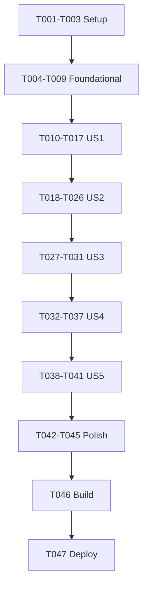

# Tasks: 统一 ParsedDocument 与图片知识检索

**版本/状态**：v0.1，待阶段3任务评审，全部未执行。  
**输入**：本目录spec.md v0.1、plan.md v0.1，需求/设计均已批准。  
**总数**：47项；实施T001–T045，Verification T046–T047。  
**验证选择**：用户选择`Run verification`，build-only，无自动UI验证任务。  
**本轮真实业务请求**：0；设置级自动产品能力不等于Agent本轮已获准发送资料。

**实施 checkpoint（2026-10-21）**：按最新指令本次只收口 T001–T009，均已完成并勾选；T010–T045 保持未完成，T046–T047 未执行。文件头 v0.1 状态为生成时点，实际证据见 implementation-report.md，限定 host 最终 37/37，不代表平台/构建通过。

**US1 checkpoint（同日续派）**：T010–T017 已完成并逐阶段勾选，累计 T001–T017 完成；T018–T045 未完成，T046–T047 未执行。限定 host 最终57/57（37基础+20 US1），8轮含失败历史，详见 implementation-report.md 末尾；无 checker/build/UI/业务请求/生产迁移。

**US2 checkpoint（同日续派）**：T018–T026 已实现并即时勾选，累计26/45；T027–T045未完成，T046–T047未执行。最终限定host84/84（新增US2 27），本组12轮含公共过滤隐藏/失败历史；63 ETS清单/默认关闭费用设置/实际队列范围见implementation-report.md末尾。业务请求/生产迁移0，未checker/build/device/UI。

**US3 checkpoint（同日续派）**：T027–T031已实际完成并阶段即时勾选，累计31/45；T032–T045未完成，T046–T047未执行。最终限定host104/104（US3新增20），本组8轮含前2轮86/2失败史；72 ETS累积清单/旧wirehash/LocalMigration0作业与显式历史升级受控证据见implementation-report末尾。无真实业务/生产迁移/Key/设备/checker/build/UI。

**US4 checkpoint（同日续派）**：T032–T037已实现并Phase6即时勾选，累计37/45；T038–T045未完成，T046–T047未执行。最终限定host127/127（US4新增23），本组13轮含setup/108-16失败史；89 ETS累计清单/持久Query guard/一次问题双组分页/全局图卡/新历史证据见implementation-report末尾。真实业务/生产迁移/Key0，未checker/build/device/UI/deploy。

**最终实施 checkpoint（同日 US5 / Polish）**：T038–T041在Phase7结束立即勾选，T042–T045在Phase8文档收口后独立勾选，累计**T001–T045全部完成，45/45**。最终限定host**150/150**（既有127＋生命周期/Polish23），US5五轮、Polish八轮，feature累计60轮capture含完整失败史。最终日志`.cache/test-logs/2026-10-21-knowledge-unified-polish-host-c78d798-8/`，源码时点指纹`8c2563c62ba452c63cd5a37bc77f0cd001ef76ba4e2a55f7af8c3329bbc66b55`。105文件/90 ETS唯一累计清单、loader/hash/入口/未验见implementation-report末尾和handoff；旧头部/各checkpoint保原时点。**T046–T047未执行**，checker/build/deploy/device/UI/平台suite/真实业务/生产迁移均0，非已验收。

## Format

任务采用连续ID、可选[P]、故事标签及P0/P1优先级。P0为身份/兼容/基本正确性，P1为必要功能，均不可默认省略。[P]仅不同文件、依赖完成后允许并行；模型/迁移/生命周期/装配公共文件单owner顺序。源码仅阶段4委派实施，不在本任务单生成实现代码或伪代码。

## Path Conventions

PROJECT_ROOT=`/Users/zane/DevecostudioProjects/Shuvi-agent`，以下目标均相对此根。当前feature为`spec/knowledge-unified-parsing/`；原M1–M4报告及已修改/未跟踪代码保留，不覆盖批准史或重置工作区。新职责允许按plan合并相邻文件，但统一消费端不能重新分派四套格式仓储。

### 操作与数据边界

- 范围限TXT/MD、PDF、独立图片、DOCX；PPTX/XLSX只登记未来接合同，不实现新格式。来源、图片/公式占位和实际解析身份不能在统一时丢失。
- 产品设置级视觉/嵌入同意明确可能费用，旧free字段不伪设true；全量处理不强制前三块或逐图确认。DeepSeek固定用户指定deepseek-flash图片任务，OCR复用现解析，不附全文/图注/聊天，不额外OCR/图像向量/回答。
- 本轮仅自制合成/审阅的公开fixture与隔离仓储；不读取实际Key、生产库、用户原件/ZIP或旧私PDF/ZIP调查现状。真实DeepSeek/解析/嵌入/query/models/probe/balance/质量请求全部0，不继承历史额度。
- 不实际执行生产迁移/历史升级，不在启动时自动发送历史内容。LocalMigration与Import/ExplicitUpgrade端口和持久来源隔离；默认新视觉/自动嵌入设置未启用，已有旧设置不自动转换成付费/自动许可。
- 所有旧wire/hash/向量空间/历史/任务/许可计数只读兼容；不补默认字段重封，不清库改名重建，不批量回收旧图或包制造空间。
- 保现权限/依赖/SDK/Native/服务边界，DeepSeek仅用户明确选定的新接收方；无新依赖权限，无新签/强签/卸载reset/清资料/Git写。
- 禁读修改执行`scripts/paste-to-emulator.sh`、`spec/knowledge-emulator-e2e/`及秘密/.local/signing/private/raw；精确允许路径搜索，不工作区宽搜。正常部署脚本内部复用签名缓存，不向AI返回材料。
- 每次实际测试capture落盘，公共输出只非敏感摘要/阶段/计数/指纹，不解除保守日志过滤或读取隐藏私有原始流。host、构建、平台、服务、质量、UI、真机结论分开。

## Phase 1: Setup

- [X] T001 P0 固定批准范围、当前HEAD/既有改动归属、旧wire/hash/数据库名/许可及历史保护清单，目标 spec/knowledge-unified-parsing/implementation-report.md
- [X] T002 P1 准备四类自制解析输出、PDF分片图片、DOCX混合图公式/重复文字、无字图/多父/编辑标注与分页独立gold，登记零外发及实际待验项，目标 spec/knowledge-unified-parsing/evidence-register.md
- [X] T003 P0 新增独立精确allowlist合成host入口，只注入内存SDK/文件/SQLite/网络端口、不加载旧私料runner，目标 entry/src/test/unified-host-entry.cjs 与 entry/src/test/run-host-tests.cjs

依赖T001→T002→T003。已有有效工程不scaffold；若根确无有效build-profile.json5或oh-package.json5，首Setup动作载deveco-cli并devecocli create，不手造工程。ets前加载可用ArkTS/ArkUI技能；新增平台API先官方docs与真实SDK核对。

## Phase 2: Foundational

- [X] T004 P0 定义六核心字段及具名顺序block/inline、图字节资产/occurrence、来源级别/覆盖/公式表示和统一版本，公共端口无格式内部模型，目标 entry/src/main/ets/knowledge/domain/ParsedDocumentModels.ets 与 entry/src/main/ets/knowledge/domain/ParsedDocumentPorts.ets
- [X] T005 P0 定义设置级费用同意、Import/LocalMigration/ExplicitUpgrade、有效标注版本/统一输入资格及双组会话合同，保旧free/grant语义，目标 entry/src/main/ets/knowledge/domain/UnifiedKnowledgeModels.ets 与 entry/src/main/ets/knowledge/domain/VisionModels.ets
- [X] T006 P0 实现UPD-STORE-1精确upd表族/Committed、统一活动路由与旧身份映射、幂等作业/引用事实/标注/历史账本，不改变旧DDL或塞第五legacy reader，目标 entry/src/main/ets/knowledge/infra/ParsedDocumentStoreLayout.ets 与 entry/src/main/ets/knowledge/infra/ParsedDocumentRepository.ets
- [X] T007 P0 实现新统一根文件写入账本/预留、临时写fsync/hash读回/原子发布、asset_dir运行期解析及持久引用/lease，目标 entry/src/main/ets/knowledge/infra/ParsedDocumentAssets.ets
- [X] T008 P0 先建立新引用保护再允许旧M1/parse/PDF/Image/Docx清理，接共享500MiB物理账/新根与upd预留/备份排除，保旧普通库备份语义，目标 entry/src/main/ets/knowledge/infra/KnowledgeStoreHost.ets、entry/src/main/ets/knowledge/infra/KnowledgeDerivedBudget.ets、entry/src/main/ets/knowledge/application/TextKnowledgeService.ets、entry/src/main/ets/knowledge/application/KnowledgeLifecycleService.ets 与 entry/src/main/resources/base/profile/backup_config.json
- [X] T009 P0 验证新旧布局共存/事务失败/重开、旧codec字节与空间身份保留、写入rename恢复/引用保护/共享预算，不访问生产数据，目标 entry/src/test/unified-store-host-cases.cjs

依赖Setup→T004→T005→T006→T007→T008→T009。公共迁移/生命周期单owner。失败仅新扩展降级，原件/旧active不清；引用保护不能等新UI打开才生效。预算实际文件与未物化预留不重复计，迁移产生旧新副本则均计。

## Phase 3: User Story 1 统一解析与图资产（P1）

**独立验收**：四类受控产物进同一消费端；可用正文不经旧Docx对应硬筛；实际图文件读回hash一致、公式/图片/未知对象保序或占位，不依赖真实模型。

- [X] T010 [P] [US1] P1 先补四producer同合同、缺blocks文字投影、正文不因原生对应失败丢弃、纯图纯公式/未知对象保序和缺图占位测试，目标 entry/src/test/unified-parsing-host-cases.cjs
- [X] T011 [US1] P0 实现UNIFIED-PARSED-DOCUMENT-1具名codec/manifest与payload确定摘要、可选locator可信度和覆盖校验，本机绝对目录不入内容hash，目标 entry/src/main/ets/knowledge/pipeline/ParsedDocumentCodec.ets
- [X] T012 [US1] P1 在旧profile/对应/人工覆盖/旧分块前接四类解析生产输出；保持已证Markdown/content_list typed分支、原生仅来源增强，不把格式内部模型泄漏下游，目标 entry/src/main/ets/knowledge/infra/ParsedDocumentAdapters.ets、entry/src/main/ets/knowledge/application/PdfIngestionService.ets、entry/src/main/ets/knowledge/infra/DocxProcessingAdapter.ets、entry/src/main/ets/knowledge/infra/DocxResultReader.ets 与 entry/src/main/ets/knowledge/application/ImageIngestionService.ets
- [X] T013 [US1] P0 PDF旧V1/V2核manifest与分片后导出完整JPEG payload、DOCX原件media与结果images分别提取、独立图保真资产登记，字节共享但occurrence/provenance独立，目标 entry/src/main/ets/knowledge/infra/PdfAssetAdapter.ets、entry/src/main/ets/knowledge/infra/ParsedDocumentAdapters.ets 与 entry/src/main/ets/knowledge/infra/ParsedDocumentAssets.ets
- [X] T014 [US1] P1 保图片/公式/表格及未知对象inline阅读顺序，实际可用文字/LaTeX/图像表示和未支持原因分别保存，纯对象段落不省略、不猜公式转换，目标 entry/src/main/ets/knowledge/pipeline/DocxNativeReader.ets 与 entry/src/main/ets/knowledge/infra/ParsedDocumentAdapters.ets
- [X] T015 [US1] P1 实现公共文字/OCR/实际公式文字投影分块与范围映射，容器/叶节点不重复索引，占位不造文本向量；实际输入hash包含所有实际前缀，目标 entry/src/main/ets/knowledge/pipeline/ParsedDocumentChunker.ets
- [X] T016 [US1] P1 基本产物校验后统一自动发布正文/OCR关键词、独立增强状态，不再人工coverage关卡；统一下游无Pdf/Docx/Image分支，目标 entry/src/main/ets/knowledge/application/ParsedDocumentIngestionService.ets 与 entry/src/main/ets/knowledge/infra/ParsedDocumentRepository.ets
- [X] T017 [US1] P1 统一内容任务/文字图公式预览/可见来源级别/缺资产状态与恢复入口，旧格式选择仍可用且后续进入同一公共流程，目标 entry/src/main/ets/knowledge/ui/ParsedDocumentView.ets 与 entry/src/main/ets/pages/Index.ets

T010先测试→T011→T012→T013→T014→T015→T016→T017。TXT/MD未获准读取的图片外链只保未解析引用；PDF派生图不冒原生嵌图，DOCX同名media不强配位置。图恢复失败可以保正文和明确Partial，不假图已Ready或恢复旧逐字gate。

## Phase 4: User Story 2 自动视觉与全量入库（P1）

**独立验收**：受控视觉/嵌入端口验证一次设置后自动处理、独立OCR/描述tags、无字图、多于3块全量读回、缓存和编辑失效；真实DeepSeek/费用质量另验。

- [X] T018 [P] [US2] P1 先补视觉请求不夹带上下文、JSON/finish/usage边界、设置关闭/费用修订、cache/Unknown/编辑保用户覆盖及大于3块全量测试，目标 entry/src/test/unified-automation-host-cases.cjs
- [X] T019 [US2] P0 实现用户指定DeepSeek deepseek-flash单图JSON描述/tags请求与typed响应校验，非stream/关闭thinking/detail original、固定客户端资源上限，未知/截断不修补冒成功，目标 entry/src/main/ets/knowledge/pipeline/VisionPolicy.ets
- [X] T020 [US2] P0 独立视觉AssetStore alias、内部认证RCP/base64真实图字节发送与费用/当前配置准入，状态查询仅attributes、无保存即probe/list/balance，目标 entry/src/main/ets/knowledge/infra/VisionCredentialStore.ets 与 entry/src/main/ets/knowledge/infra/VisionTransportAdapter.ets
- [X] T021 [US2] P1 独立视觉设置、设置级自动处理/接收方/输入类别/可能费用确认，文本嵌入新增统一自动全量模式，旧设置不自动转付费许可，目标 entry/src/main/ets/knowledge/ui/VisionSettingsView.ets 与 entry/src/main/ets/knowledge/ui/EmbeddingSettingsView.ets
- [X] T022 [US2] P1 自动标注/cache及Auto/UserOverlay/Effective/tombstone、中文描述自由tags/本机tag索引，OCR/图注独立，编辑只撤代理向量不动正文，目标 entry/src/main/ets/knowledge/application/ImageKnowledgeService.ets 与 entry/src/main/ets/knowledge/infra/ParsedDocumentRepository.ets
- [X] T023 [US2] P0 可恢复Import自动队列/当前设置费用及输入版本准入、请求前attempt、前台派发/暂停/Unknown不盲重发，LocalMigration永不被自动发送，目标 entry/src/main/ets/knowledge/application/UnifiedProcessingQueue.ets
- [X] T024 [US2] P0 新统一文本输入/owner域/UNIFIED-KNOWLEDGE-TEXT-1空间、policy相关baseline/计数/完整读回和Pending→Synced，不混旧向量或关闭旧owner资格，目标 entry/src/main/ets/knowledge/infra/UnifiedVectorRepository.ets、entry/src/main/ets/knowledge/infra/VectorRdbRepository.ets、entry/src/main/ets/knowledge/infra/EmbeddingTokenAdapter.ets 与 entry/src/main/ets/knowledge/pipeline/EmbeddingBasisPolicy.ets
- [X] T025 [US2] P1 设置级费用同意下自动处理全部合格正文/OCR和description+tags文本，移除新流程前三块/人工dryReview关卡，保固定expected/输入hash/预算/暂停恢复与实际进度，目标 entry/src/main/ets/knowledge/application/UnifiedEmbeddingService.ets 与 entry/src/main/ets/knowledge/domain/EmbeddingModels.ets
- [X] T026 [US2] P1 图详情实际资产预览、多父来源、OCR/图注/自动结果/用户修正分栏、编辑删除和失败重试可用，0字图不伪造OCR locator，目标 entry/src/main/ets/knowledge/ui/ImageKnowledgeView.ets 与 entry/src/main/ets/pages/Index.ets

T018先测试→T019→T020→T021→T022→T023→T024→T025→T026。设置一次启用不是本轮真实请求批准；真实传输实现只受控测。描述2000字符/tags20×64/输出2048tokens和32MiB请求体为客户端默认不冒官方上限。增强失败保图/正文/tags已有有效版本，自动标注不覆盖人工修正。

## Phase 5: User Story 3 本机迁移与历史升级（P1）

**独立验收**：隔离旧四类快照/包与图片，迁移/重跑/缺缓存/中断均0网络、旧wire/hash不变；显式升级只接被冻结批次。

- [X] T027 [P] [US3] P1 先补旧codec/hash/活动资料保留、四类批量清单/中断恢复/缺包Partial、设置开启及迁移重开仍0外发测试，目标 entry/src/test/unified-migration-host-cases.cjs
- [X] T028 [US3] P0 旧四类readers与图payload导出、本机统一投影和精确legacy identity链接，不重封旧内容/复用旧向量冒新space，不调用旧publish，目标 entry/src/main/ets/knowledge/infra/LegacyParsedDocumentReader.ets
- [X] T029 [US3] P0 冻结迁移batch分母、来源持有/读回/逐文档CAS切统一路由、幂等阶段恢复与失败清单；构造无远程/凭据端口，缺包不重解析，目标 entry/src/main/ets/knowledge/application/ParsedDocumentMigrationService.ets
- [X] T030 [US3] P1 显式历史批量升级冻结范围、当前视觉/嵌入设置费用版本与进度/暂停，和本机迁移严格分origin；旧语义可读、新space覆盖如实显示，目标 entry/src/main/ets/knowledge/application/UnifiedProcessingQueue.ets 与 entry/src/main/ets/knowledge/infra/UnifiedVectorRepository.ets
- [X] T031 [US3] P1 本机迁移与云升级分栏UI、固定清单/缺资产/费用范围/进度/重试，默认不发送历史资料，不执行本次生产全集迁移，目标 entry/src/main/ets/knowledge/ui/KnowledgeMigrationView.ets 与 entry/src/main/ets/pages/Index.ets

T027先测→T028→T029→T030→T031，依赖US1/US2公共合同。旧ID不按原件hash合并，副本物理共账。自动新导入许可不得因开设置/浏览历史/迁移Complete变历史许可；未升级提示不阻当前新space已合格候选，也不能混旧距离。

## Phase 6: User Story 4 一次查询/双组/合卡（P1）

**独立验收**：预置正文/OCR/tag及统一空间受控向量，验证Direct先显示、tag不等语义、有Direct仍可语义、分页仅一次query、失败不撤本机、跨组跨页同图合卡及原因/父来源。

- [X] T032 [P] [US4] P1 先补双组独立延迟/失败/分页、同次query≤1、Direct后页图归属、重复/失效补页、标注分叉和取消迟到测试，目标 entry/src/test/unified-search-host-cases.cjs
- [X] T033 [US4] P0 实现统一Query新策略、持久撤销/费用/配置/候选资格及当前epoch的单次发送前准入，替代Direct排他但不恒置旧noDirect或绕Query guard，目标 entry/src/main/ets/knowledge/application/QueryConsentSession.ets、entry/src/main/ets/knowledge/infra/KnowledgeSourceRegistry.ets 与 entry/src/main/ets/knowledge/infra/EmbeddingTransportAdapter.ets
- [X] T034 [US4] P0 一次问题embedding Promise/成功vector或候选快照、两组独立状态/游标、会话撤销及分页幂等，获准语义不受Direct有无排他，目标 entry/src/main/ets/knowledge/application/KnowledgeQuerySession.ets 与 entry/src/main/ets/knowledge/application/KnowledgeSearchService.ets
- [X] T035 [US4] P1 新space资格前过滤精确KNN可续页/稳定并列顺序、tag+vector按卡身份每路一票、已展示前缀稳定/新卡补页、全范围OCRDirect图片归组及迟到upsert，目标 entry/src/main/ets/knowledge/infra/VectorRdbRepository.ets 与 entry/src/main/ets/knowledge/pipeline/KnowledgeRetrievalPolicy.ets
- [X] T036 [US4] P0 新双组card/多reason/多父/页revision和UNIFIED-KNOWLEDGE-HISTORY-1固定record追加，旧RESULT1/2/3及TXT历史只读桥接；保存失败不锁查询，目标 entry/src/main/ets/knowledge/domain/KnowledgeSearchModels.ets、entry/src/main/ets/knowledge/pipeline/KnowledgeMatchPolicy.ets 与 entry/src/main/ets/knowledge/infra/UnifiedKnowledgeHistoryRepository.ets
- [X] T037 [US4] P1 正式双组UI及各自加载/错误/翻页、同图单卡多原因来源、纯图详情/正文来源分派，不让embedding全局busy阻本机检索，不输出回答，目标 entry/src/main/ets/knowledge/ui/KnowledgeView.ets、entry/src/main/ets/knowledge/ui/KnowledgeResultCard.ets 与 entry/src/main/ets/pages/Index.ets

T032先测→T033→T034→T035→T036→T037。query是一次当前用户允许的语义动作，分页不续发，失败/Unknown不自动重试；旧trial不继承。第一组只有正文/OCR Direct，描述/tag不冒原文，第二组正文与图代理共一vector路。已显示图key/imageHash/effectiveAnnotation严格同版本，父来源全保。

## Phase 7: User Story 5 统一生命周期（P1）

**独立验收**：隔离共享图多父/有效标注与在途作业，验证删除一父仍可用、最后引用清理、未知释放/晚到/归档换版以及历史失效。

- [X] T038 [US5] P1 先补共享图跨父删除/标注分叉、最后引用/lease释放、换版/归档/晚到、历史追加重试及旧wire兼容测试，目标 entry/src/test/unified-lifecycle-host-cases.cjs
- [X] T039 [US5] P0 文档tombstone/epoch与正文/代理资格独立撤销、引用事实/任务holder/lease/cleanup owner协调，未知文件不删/资源Unknown留回执，目标 entry/src/main/ets/knowledge/infra/ParsedDocumentRepository.ets、entry/src/main/ets/knowledge/infra/ParsedDocumentAssets.ets 与 entry/src/main/ets/knowledge/application/KnowledgeLifecycleService.ets
- [X] T040 [US5] P1 新查询/队列/来源接装配/后台保存/关闭顺序，基础可用不被可选视觉/向量初始化失败撤销；重开不自动升级历史，目标 entry/src/main/ets/knowledge/infra/KnowledgeAssembly.ets、entry/src/main/ets/knowledge/application/DocumentParseService.ets 与 entry/src/main/ets/entryability/EntryAbility.ets
- [X] T041 [US5] P1 正式入口当前版本/旧版/已删来源、暂停恢复/归档/删除确认及清理重试，编辑/删除不清未变OCR Direct或复活已删tag，不代用户执行生产资料操作，目标 entry/src/main/ets/knowledge/ui/ParsedDocumentView.ets、entry/src/main/ets/knowledge/ui/ImageKnowledgeView.ets 与 entry/src/main/ets/pages/Index.ets

T038→T039→T040→T041，依赖前述对应功能。删除一父仅释放其引用，人工overlay不随解析generation覆盖；本机取消不等云取消，不保未声明历史像素副本。旧owner清理保护必须覆盖原件及其一起清理的结果ZIP，而非只核一张图。

## Phase 8: Polish

- [X] T042 P1 接自制四格式/混合图公式/无字/多父/历史集合的完整受控闭环，保证正式producer/服务/仓储/双组状态都可调用，无空parser/假成功替代页，目标 entry/src/test/unified-host-entry.cjs 与 spec/knowledge-unified-parsing/evidence-register.md
- [X] T043 P1 capture执行限定统一套件及审阅的旧公开兼容回归，记录失败历史/准确scope/源码hash/计数；不跑原私料全量或实际生产迁移，目标 entry/src/test/unified-host-entry.cjs 与 spec/knowledge-unified-parsing/implementation-report.md
- [X] T044 P0 复核新producer无旧格式发布门槛/统一消费无旧模型、图payload真实落盘/新旧共账/旧清理引用、0测试请求及无泄密/新增权限依赖/无关改写，目标 spec/knowledge-unified-parsing/implementation-report.md
- [X] T045 P1 写完整实际任务状态/精确文件与ETS检查清单、用户设置/导入/迁移/双组检索步骤、后续真实样本/费用次数待批、平台服务UI质量未验及旧契约替代增量，目标 spec/knowledge-unified-parsing/implementation-report.md、spec/knowledge-unified-parsing/handoff.md 与 specs/02-个人知识库问答.md

全部故事→T042→T043→T044→T045。实施只到T045含获准合成host，不checker/build/deploy/device/UI/真实业务。完整交付要包含正式入口handler和状态刷新，不只函数存在或枚举扩充；未完成具体标partial，不说“只差Key/授权”。真实服务未知字段明确限制而非造schema，无访问用户全集补证。

## Phase 9: Verification

<!-- verification_scope: build-only -->

本节只有构建和部署，无自动UI验证、平台suite、生产迁移、文件传输或真实模型任务。父代理仅一次spec-verify，按此scope执行，不再询问UI。实际测试每次capture；初始step1实际build总数最多10（含正常签名缓存脚本内部），失败修后直接重build，不在failed与retry间再checker。成功build才能安装。

- [X] T046 P0 对实施报告精确ETS清单执行arkts_check后紧接devecocli build并有限修复，必要限定host复跑，准确记录每轮工具/指纹/制品/失败与真实计数，目标 entry/build/default/outputs/default/ 与 spec/knowledge-unified-parsing/verification-report.md
- [X] T047 P0 正常缓存签名/模板恢复路径devecocli run --skip-build保数据部署到实时唯一活动模拟器，记录安装启动/HAP及模板字节；不新签强签/login/卸载清库、不启用视觉/自动嵌入、不运行迁移或点业务按钮，目标 scripts/dev-run-mac.sh 与 spec/knowledge-unified-parsing/verification-report.md

无安全目标/登录/缓存/工具能力按具体INCOMPLETE，不能绕上级工具规则或读秘密。普通run只证明安装启动，不冒Cold或新UI可用。验证checkbox按已处理记录，PASS/FAIL/INCOMPLETE以唯一报告为准；build-only不关闭原生平台、视觉质量、迁移全集、双组UI或真实自动入库验收。本轮业务网络0，旧配置不得被安装解释为新自动费用同意。

2026-10-21 验证已处理并收口为 **INCOMPLETE**，以上勾选不表示成功验收。T046：完整 90 ETS checker 一次通过；实际 build 1/10、RC 1，公共诊断被既有过滤隐藏，无有依据的修复或重试。T047：未成功构建且实时活动设备为 0，安装启动未执行；未启动停止态模拟器。父代理已审阅唯一 `verification-report.md` 与公共 build meta/log，不重复委派。无本轮新制品、源码修复或真实业务请求。

## Dependencies & Execution Order

Setup→基础→US1统一产物→US2自动图片知识→US3迁移→US4双组检索→US5生命周期→Polish→构建部署。US1可用四类固定输出独立测试；US2可注入已落盘图，US3可注入旧四类集合，US4可预置统一内容/标注/受控向量，US5可注入引用/在途任务，因此故事各有独立验收，不依真实模型。

最小可演示增量是基础+US1，但本次任务范围为45项完整实现，不得以MVP替代自动处理/迁移/查询/生命周期或接口stub。公共模型、存储、生命周期和Index单owner顺序；独立policy/测试可在合同稳定后并行准备。

## 📊 Dependency Graph

## ⚡ Parallel Execution Guide

| Phase | Tasks | Required Files | Execution Notes |
|---|---|---|---|
| US1 | T010 | unified-parsing-host-cases.cjs | 基础稳定后独立测试先行，无共享编辑。 |
| US2 | T018 | unified-automation-host-cases.cjs | 可在固定模型/队列合同后独立准备，不跑真实DeepSeek。 |
| US3 | T027 | unified-migration-host-cases.cjs | 只合成旧数据scope，和实现新repo不得并发改公共合同。 |
| US4 | T032 | unified-search-host-cases.cjs | 预置新空间向量测试，同次query计数和迟到规则独立。 |
| 公共核心 | T004–T009/T024/T033/T039–T040 | model/store/host/transport/lifecycle/assembly | 一个owner串行集成，禁止交叉写。 |
| Verification | T046–T047 | 工程/制品/模拟器/报告 | 一个spec-verify，0业务请求，无UI测试。 |

## Parallel Example

公共合同和最小仓储完成后，US1图资产测试、US2视觉JSON测试、US4双组会话测试可各自文件准备；所有worker都只用合成端口，不共享真实请求计数/凭据。模型、仓储和装配由实施主owner统一合并，不能多个代理并行修改同一工作区文件。

## Implementation Strategy

保现五层/V1，先把统一生产出口放在旧筛选之前并实际图资产落盘，再接自动设置/标注与新全量空间，最后迁移路由、一次query双组和生命周期。上游可留格式内知识，公共消费只能依ParsedDocument。旧wire/space只读兼容不混新模型；本机迁移网络接口为空不是业务stub，而是明确零外发边界，显式升级另接已实现队列。

实施自主推进不再中间询问，新增能力超授权时止该路径并准确报告，不擅自新增依赖/权限/服务。DeepSeek当前文档和SDK成员需要实际核对，不能造字段或模型；受控JSON/向量只能证机制不证真实质量。执行完自动进入一次build-only验证，无阶段4→5问题门禁。

## Notes

47项：Setup3、基础6、US1八项、US2九项、US3五项、US4六项、US5四项、Polish4、Verification2。实施45、验证2；ID连续唯一，[US]只故事，[P]为T010/T018/T027/T032。无Git提交/真实云/实际全集迁移或自动UI验证任务。产品设置级自动行为须用户未来明确开启和费用确认，安装保持默认未同意；Agent本轮真实外发全部0。阶段3批准后才实施，旧批准和日志不重写。
