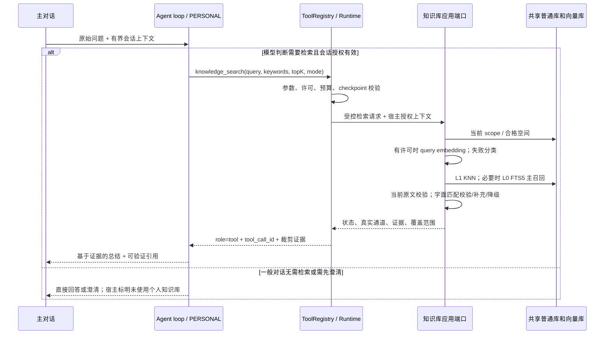

# 13 主对话 Agent 知识库 L2 检索增强

> 状态：v0.4 已实现待验收（L2 首轮实现）；2026-10-29 用户批准按本 spec 开发。授权开关、模型自主工具循环、Runtime 执行和本机字面降级已接入；spec 14 FTS5 完整底座、真实模型效果及设备矩阵尚未验收，不能视为本 spec 全部完成。具体范围与证据见[实施记录](../docs/verification/主对话L2实施记录.md)。
> 优先级：P0 接入正确性、旧数据恢复与授权下的自主检索。
> 负责人：Agent / 知识库 / UX 共同评审，待指定。
> 实施基线：`dev/rag` / `41c8f0ea3321827f0b51cf4e83eab20e775c414c`；早期诊断基线为 `b3c584ae1beb8e3308fe26a1c1c2cc8bfc3d851a`。
> 关联：[02 个人知识库问答](02-个人知识库问答.md)、[09 Runtime 普通对话接入](09-Runtime普通对话接入.md)、[11 后台本地文档工具](11-后台本地文档工具.md)、[14 统一知识库 L0 关键词检索与 FTS5 接入](14-统一知识库L0关键词检索与FTS5接入.md)、[诊断报告](../docs/diagnostics/2026-10-28-主对话知识库接入诊断.md)。
> 最后更新：2026-10-29。已按用户授权实施 L2；L0 FTS5 细节与未完成项以 spec 14/实施记录为准，L1 仍为生成查询向量后的语义检索。

## 1. 目标与范围

把个人知识库接入主对话真实 Agent 工具循环：用户通过授权开关允许使用个人知识库 → 模型根据原问题及有界会话上下文自主决定是否检索 → 需要时提炼查询并调用 Registry 知识库工具 → 知识库模块检索当前生产语料 → 工具结果返回同一 Agent loop → 模型结合证据总结、回答并引用。一般对话可直接回答；语义不可用时允许 L0 证据进入同一循环。授权不等于每轮必须查库，用户无需先进入专门模式。

### 1.1 层级与旧术语

| 本 spec 层级 | 含义 | 是否需要回答模型 |
|---|---|---|
| L0 | 本机关键词检索：统一 FTS5 主召回，字面匹配用于精确命中校验、高亮与有界补充/降级；Keyword 与 Literal 命中分别标识 | 检索本身不需要；进入 L2 后可供模型总结 |
| L1 | 知识库模块生成问题向量并在当前合格空间做语义检索 | 检索不依赖回答模型；云 Embedding 仍需网络与许可 |
| L2 | 主对话 Agent 规划查询、调用 Registry 工具并基于返回证据生成回答，可有限追加检索 | 需要 |

spec 02 §4.4 的历史 L1 是“在线生成回答”；§4.5 的确定性先检索策略限定于知识库页面的手动检索与问答。主对话 L2 的目标策略按本 spec 采用授权下自主调用，知识库页面的独立 L0/L1 手动检索继续可用且不依赖主对话模型。实施 PR 必须同步修订 spec 09、架构图与 UI 交接契约，不能提前将目标行为写成已上线。

范围：共享生产知识库、冷启动旧语料资格恢复、只读 Registry 检索、会话授权开关与模型自主调用、L0 降级、证据及引用、生命周期、费用与持久化。

非目标：新增模型供应商/依赖/权限、云同步、重新解析历史全集、自动重建全部向量、图片向量、修改现有日历/文档工具的写入授权、恢复旧任务并自动外发。跨设备内容仍以本机已下载校验和发布的语料为准，不扫描电脑缓存。

## 2. 用户流程

1. 用户启用主对话真实模型，打开【允许使用个人知识库】授权开关，明确同意本会话的本机读取及已展示的外发范围。默认关闭，不跨进程恢复授权；开启只获取知识库租约、只读恢复本机状态并检查许可，不发送模型或 Embedding 请求，也不启动新的语料入库请求。
2. 页面就绪按 L0/L1 分开显示；只有正文就绪、没有向量时，仍可开启知识库，以“语义暂不可用，将使用关键词检索”提示。存储损坏、读取范围不完整必须明确失败，不能显示空库。
3. **首版即自主调用**：用户仍在普通主对话发送原问题。授权有效时，在同一对话模型请求中声明 `knowledge_search`，由模型判断需要查个人资料还是直接回答/澄清；涉及知识库的模型调用按 PERSONAL 隐私级别处理。模型需要检索时分析主题、关键词和限制条件，返回工具参数；一般对话无需查库，不额外进入独立知识库回答会话。
4. 工具由 Registry 校验与授权后调用知识库应用端口；默认优先 L1。模块自行读取当前空间、生成 query embedding、检索并返回 top k，模型不生成向量、不接触 SQL/数据库路径。
5. L1 因没有合格向量、网络/Provider/费用许可等原因不可用时，在当前只读许可内调用 spec 14 的 L0：FTS5 主召回、原文与字面校验，必要时有界字面补充/降级；将实际引擎、Keyword/Literal 命中类型及证据返回同一 loop。只有范围完整且 L0 也无命中时返回 empty，部分覆盖/预算截止不冒充 empty；模型可在预算内改写一次查询。
6. 模型依据工具结果回答原问题，允许比较、提炼和总结；知识库事实结论附引用。未检索时可回答一般问题，但不得声称查过库或伪造个人资料事实。不得只把 chunk 列表当最终回答，也不得把相关性当事实正确性。
7. 用户明确要求查个人资料，或答案依赖个人文档中的事实时，工具策略要求模型检索或澄清；开关关闭/不可用时提示当前限制，不推断私有事实。开关关闭时不声明、不执行知识库工具；模型不能自行开启授权。
8. 关闭开关撤销知识库许可并取消本次未完成检索；普通对话可继续。切页、后台、停止、取消、新对话按第 5 节处理。

## 3. 页面事项

- 保留现有 Key 输入，将主对话【知识库】按钮调整为【允许使用个人知识库】授权开关，开启后不切换对话模式、不强制每轮检索；知识库一级页面继续提供导入、管理和手动检索。不新增重复凭据输入或逐问题确认弹窗；启用说明列清查询文本发往 Embedding Provider、裁剪证据返回 DeepSeek 的用途、目的地、可能费用及范围，本机读取与两类外发许可分别校验。
- 开启时显示 `准备知识库`；发送问题后显示 `分析问题`，仅在实际派发工具时显示 `检索资料 → 整理回答`；直接回答不展示检索阶段。有限追加检索可再次进入检索阶段。回答区按宿主真实执行记录显示是否使用个人知识库，不依赖模型自报。
- 展示“语义检索”或“关键词检索（语义暂不可用）”；来源区分分词关键词命中与原文字面命中，只有真实连续范围才高亮。索引恢复/字面降级、部分覆盖、无命中、存储失败、模型失败、取消、预算耗尽分别提示，技术引擎细节放诊断区。
- 成功回答下方保留编号来源胶囊与展开原文；正文/OCR/AI 描述标明证据类型。内部 ID、generation、hash、数据库路径不展示。引用失效仍保留快照并标识原因。
- 模型失败时保留已成功返回的来源；“仅重试回答”使用同一冻结证据并重验当前资格，不重新生成检索向量。重新检索必须明确触发，计入预算。
- 没有回答模型或拒绝外发片段时，可在知识库页面查看 L0 原文；此状态不称 L2 成功。
- 页面对话/来源与 `taskId + conversationEpoch + turnId` 绑定，避免晚到结果覆盖新问题。可取消，读屏标签与最小 44vp 操作区域沿用现有要求。

## 4. 业务与 Agent 事项

### 4.1 依赖与接线

`entry` 负责装配；核心只依赖工具/应用端口，不引用页面、`KnowledgeAssembly` 或具体 ArkData 实现。工具 adapter 注入同一个 `KnowledgeAssembly` 支撑的知识库应用服务，页面和 L2 必须共用检索语义与 scope。每次请求使用独立查询状态，不使用 UI 全局 `querySession`。

L0 统一应用端口、索引生命周期及召回/字面分类以 spec 14 为唯一详细定义；L2 adapter 调用该端口，不能自己执行 FTS SQL 或维护另一份索引。L1 继续由知识库模块生成查询向量并检索当前合格空间，不因 L0 改造更改向量模型/语料资格规则。

已有 `DeepSeekToolTransport` 可承载回环，但必须抽出可组合的工具分发端口，不能只把知识库函数名加入文档工具白名单。参考 `DocumentChatRuntime` 的 Registry、授权和执行记录机制；知识库检索不能绕过 Runtime 直接从 Transport 调仓储。

原 `native://shuvi/knowledge.search.local` 保持 Direct-only、零网络/零费用契约；新增工具独立注册为 `native://shuvi/knowledge.search`，LLM 函数别名 `knowledge_search`，版本 `1.0.0`。描述需声明可能外发查询并产生 Embedding 费用。通用 Runtime 契约能否表达复合操作须在实施前核对；不能虚报为零费用或纯本机工具。

### 4.1.1 自主工具选择与宿主执行方案

1. **按授权暴露工具**：Registry 保留稳定工具身份；每次模型请求只从当前会话授权的工具集合生成 `tools` 定义与解析白名单。开关开启且许可有效时才加入 `knowledge_search`，关闭后立即移除；本机可查但语义不可用时仍提供工具，由宿主能力状态约束路由。模型仅获得用途、参数、限制及脱敏可用状态，不预先上传文档清单、正文或全库摘要来判断是否调用。
2. **同一模型自主选择**：在现有主对话请求中使用 `tool_choice: auto`，由同一模型结合用户输入和有界会话上下文返回普通答案、澄清或 `tool_calls`；不新增意图分类模型、子智能体或固定关键词路由。工具策略要求：个人笔记/文档中的事实、用户明确要求查资料、依赖资料的追问应调用工具；一般常识、闲聊、仅改写用户已提供文字可直接回答；指代/范围不清先澄清。工具说明不承诺库内一定有答案。
3. **模型参数只作提议**：模型产生 `query / keywords / topK / mode`；Runtime 严格校验函数名、schema、授权修订、scope、取消状态、剩余时间/次数/费用并落盘派发记录，再通过 adapter 调用知识库应用端口。失败不执行越界请求；即使模型伪造调用，关闭授权仍拒绝。检索工具不能隐式批准其他工具执行或改变文档/日历写入授权。
4. **同一 loop 续答**：保存模型的 `assistant.tool_calls`，将有界检索结果作为匹配 `tool_call_id` 的 `role=tool` 消息送回同一对话；模型据证据回答，必要时在共享预算内追加一次检索。不得把第一次工具调用作为结束事件后另起无上下文的回答任务。空结果与失败也回注真实状态；用户取消后不再发起模型请求，关闭/丢弃该轮并保留本机终态，不为闭合消息继续联网。
5. **宿主校验与可观测性**：未检索/无有效证据时不能获得“依据个人知识库”的成功状态，引用必须绑定本轮真实结果。用户明确要求查库却直接回答的情况记为漏检索；无证据的个人资料答案拒绝作为知识库成功展示。参数/引用校验不能证明模型正确判断了意图或事实有依据，这部分按第 6 节固定用例人工复核，不虚称提示词能保证零漏检索。
6. **复用与改造落点**：复用 `DeepSeekToolTransport` 的自动工具选择与回环，抽出可组合的工具定义、允许函数名和 Runtime 分发端口；复用 `services/documents/DocumentChatRuntime` 的授权执行机制，新增知识库 adapter。必须同步处理现有文档专用解析、写入阻断、回执和错误分支，避免知识库只读调用被当成文档写入或绕过待核查写入限制；既有日历提议流程与写入确认边界保持原有授权规则。具体端口签名实施前核对，不能仅追加函数白名单就宣称接入完成。

### 4.2 提议的应用端口

新增知识库应用边界 `KnowledgeAgentSearchPort`，提供 `capabilities(context)` 和 `search(request, hostContext, cancel)`；这是拟定的应用接口，不是 HarmonyOS API。既有 `KnowledgeRuntimeSearchPort` v1 和旧解析器不原地改变含义，新增 v2 响应适配。

LLM 工具参数（严格 JSON Schema，拒绝额外字段）：

| 字段 | 规则 |
|---|---|
| `query` | 必填；去首尾空白后 1–500 个 UTF-16 字符；保留主题、实体、否定词、日期/数值约束，适合 embedding 的表述 |
| `keywords` | 必填；1–8 个去重词，每词 1–40 字符；供 L0 使用，不能只把完整长问句作为所有关键词 |
| `topK` | 必填整数 1–5，默认策略建议 5；决定合并、去重后最多返回数 |
| `mode` | 必填 `auto / semantic / direct`；`auto`、`semantic` 都允许按宿主既定策略降级 L0；`direct` 是本机 L0 路由别名，使用 FTS5 主召回及字面校验/降级，不等于强制连续字面匹配，不发 Embedding 请求 |

原问题由宿主持有，不接受模型覆盖。`includeArchived=false`、语料范围、用户身份、空间、费用同意、timeout、许可修订、task/turn/toolCall ID、取消令牌均由宿主注入，模型不能通过参数放宽。首版不支持模型指定路径、SQL、空间 ID 或任意文档集合。

`capabilities` 返回：`storeState`、`directReady`、`semanticReady`、独立 reasonCode、当前覆盖计数和本机修订摘要。`directReady` 不依赖 Embedding Key、检测或自动入库开关；`semanticReady` 依据当前 query 所需配置、许可、空间与 targets。语料自动入库许可与查询外发许可在逻辑上分离，实施时用独立 query grant，不把“允许导入向量”推定为“允许发送当前问题”。

`directReady` 表示 spec 14 的 L0 至少有可执行的本机检索路径，不要求 FTS 一定 Ready；另报索引覆盖/恢复及字面降级能力。L0 索引缺失不能变成“没有向量”，L1 不可用也不能禁止 L0。

### 4.3 返回契约与两种视图

内部响应 `schemaVersion=2.0`，运行时逐字段校验：

| 字段 | 含义 |
|---|---|
| `status` | `ok / empty / unavailable / denied / canceled / budget_exceeded / failed` |
| `route` | `semantic / direct / hybrid / none`，其中 direct 表示 L0 关键词路由；实际引擎另记，不能把 direct 当作连续字面命中的证明 |
| `fallbackReason` | 稳定枚举或空值：如 `NoEligibleVectors`、`EmbeddingUnavailable`、`QueryConsentMissing`、`SpaceConflict`；不包含供应商正文 |
| `hits` | 最多 topK；含文档、有效世代、稳定证据 ID、定位、标题、excerpt、证据类型、实际命中通道；L0 的 reasons 保留 `engine=fts5/literal-scan/sql-like`、`matchKind=Keyword/Literal` 与真实 ranges |
| `coverage` | 可读文档数、当前合格向量目标数、未升级数、排除原因计数、是否完整；不把覆盖不足写成全库无答案 |
| `scopeRevision` / `resultId` | 宿主绑定快照、工具回执与引用，不发给 LLM |
| `truncated` / `hasMore` | 是否因预算截断及是否有候选未返回，防止模型误说“全库只有这些” |

发送给 LLM 的 tool 消息仅含状态、真实通道、脱敏降级原因、覆盖是否部分、`hasMore` 与 `{citation, title, excerpt, evidenceType, matchKind}`；实际引擎细节留宿主记录，`matchKind` 区分关键词/字面/语义，不能推定检索相关即满足问题全部条件。不发送内部 ID、路径、hash、generation、空间身份、完整文档或原图。标题最多 256 字符，excerpt 单条 800、**整轮所有检索累计去重后最多 5 条/3200 字符**，不是每次调用都重新获得额度。第二次检索只能增加或复用剩余额度，不撤销已发片段以绕过外发总量。

模型返回工具调用时，同一 loop 必须收到匹配 `tool_call_id` 的 `role=tool` 消息；校验失败、拒绝、空结果和取消也闭合工具消息，不留下孤立调用、不把错误拼成伪造资料。并列工具请求首版串行执行，分别校验且共享预算。

### 4.4 检索与冷启动不变量

1. 生产数据源固定复用 `shuvi_kb_user_v1.db` 和 `shuvi_kb_vector_v1.db`；不建聊天专用向量库、不从本轮导入事件维护独立语料集合。执行记录可复用现有加密存储基础设施，不能充当语料权威。
2. 冷启动在无新导入、无配置/Key 修改时，完整恢复空间注册与已核验绑定。用已落盘输入、向量、回执读回重建资格，不自动请求解析/Embedding，不要求“重试一张图片”解锁。
3. 页面与 L2 对同一 scope/config/revision 应返回相同候选资格；呈现、topK 与排序可不同，必须可解释。恢复作业局部失败应隔离并累计原因，不让一个坏作业遮住全部可用语料；涉及范围完整性失败时明确 partial/unavailable，不能静默称全库完整。
4. 只允许当前 generation、annotation、owner、epoch、inputHash、空间/维度/预处理一致的向量；不删除资格校验来掩盖问题。旧空间不匹配时明确未升级，使用 L0；需要重嵌入的资料单独由用户确认范围与费用。
5. L1 由知识库模块执行 query embedding，KNN 仅检索当前资格目标。取 topK 前按有效证据去重、过滤失效项、兼顾正文信息量；最终排序和分数只反映实际通道。首版沿用精确 KNN，不引入 ANN 或新的 reranker 服务。
6. L0 按 spec 14 正式采用统一 FTS5 主召回，保留字面匹配用于精确命中校验/高亮与有界补充/降级。FTS Keyword 候选通过有效原文核验即可返回，不要求每条都含连续完整问句；字面校验不得反向清空有效分词召回。FTS 不可用/恢复中、短词/子串或零候选补检按同一策略处理，预算截止/覆盖不全不称 empty。统一索引与 `upd-*` 身份绑定，不切回旧 `text_fts`，不在 L2 维护独立索引；优化 scope 避免 MATCH 前全量加载正文。上述均待实现，当前代码的内存字面路径仍为现状。
7. Tag 只用于召回；纯 tag 不作为断言证据。正文/OCR/视觉描述必须有实际可引用内容，视觉描述和 OCR 保留误差类型。模型/文档中的指令视为资料内容，不触发其他工具或外发权限。

### 4.5 降级与终态

| 情况 | 行为 |
|---|---|
| 没有向量/配置不合格/空间冲突 | 不调用 Embedding；L0 → tool 结果 → 同一 loop 总结并显示降级 |
| Embedding 401/429/超时/未知结果/维度错误 | 分类记录，不自动重发；有完整 L0 scope 时经 spec 14 返回有效 Keyword/Literal 证据，保留可能计费状态 |
| L1 完成但无候选或证据不足 | 查询 L0；必要时模型在预算内另拟查询；不保证 KNN 最近项足以回答 |
| 拒绝查询外发，但允许本机读取和片段外发 | 仅 L0；拒绝的 Embedding 不执行 |
| 拒绝本机读取或片段发往回答模型 | 拒绝越界工具或停止 L2，保留本机原文入口；不改用其他 Provider |
| FTS 不可用/索引恢复或覆盖不足 | 使用 spec 14 的有界字面降级并标引擎/覆盖；不能因 L1 不可用而整体禁用知识库，也不能把扫描预算截止称全库 empty |
| 普通库损坏/范围不完整/证据身份无法确认 | failed/unavailable；不能用缓存或默认资料伪造成功；已核验的局部范围须明确标部分 |
| 无任何有效命中 | empty 返回 loop；最终“当前可检索资料中没有足够依据”，不生成虚假引用 |
| 用户取消/撤销/预算耗尽 | 不以降级为理由继续发请求；关闭该轮，保留已确认来源与状态 |

### 4.6 生成与引用

- 自主调用允许一般对话直接回答，宿主标明未使用个人知识库；需要个人资料事实时应检索或澄清。无工具结果不得以模型常识冒充知识库答案，模型提炼失败不能伪装检索成功。
- 模型以原问题为目标，检索改写只服务召回，不能丢失否定、时间、数量约束。证据矛盾需并列说明，证据不足需承认，不能推断库外事实。
- 每轮证据使用宿主分配稳定编号，多次调用去重后复用编号。最终输出区分一般回答、基于证据的回答与 insufficient；结构化回答与引用列表校验非空、有界、编号合法、不重复。基于证据的回答至少一条有效引用，知识库事实对应引用；一般回答允许空引用，不能标知识库成功。编号合法只证明绑定，不证明语义支持，需效果评测。
- 发送前和最终展示前校验证据当前可见性/世代；变化则拒绝把旧证据显示为当前成功，可保留“旧版本/已失效”快照。历史来源不自动跳转到新版本。
- 缺依据可以返回明确 insufficient，空引用合法但不能标 grounded success。校验失败返回安全错误，原始工具证据仍可查看，不展示未校验回答。
- 开关关闭、新对话或许可撤销后，从后续模型上下文移除知识库工具消息/片段，保留 UI 快照另行标识；不能借聊天历史继续外发已撤销知识片段。

### 4.7 预算与执行记录（建议值，待确认）

首版每轮最多 2 次知识库查询、2 次查询 Embedding（每次检索至多一次，无自动重试）、3 次模型请求（含首轮自主决策与最后总结），串行执行；全会话模型请求上限沿用 10，**首轮决策、工具续轮、失败与回答重试都计数**，不能每个子 Runtime 重置。继承主助手每轮最多 6 工具调用的总上限，知识库子额度与其他工具共享总额度；知识库授权不额外授予文档写入/日历执行权限。未选择检索时不消耗查询 Embedding 额度。

每个模型请求沿用当前 profile 的 30 秒及输入/输出 token 限制；整轮绝对超时建议 90 秒，包含两次检索及总结。总时间/额度不足时不派发新调用；取消与超时不得触发自动换词/重试。实施时新增预算配置版本并验证现有 Runtime 请求墙钟与 watchdog 一致，不能只改 UI 定时器。

Embedding 预算由知识库费用策略预估，在模型选择工具后、实际检索派发前预留该次检索与后续回答的预算；未检索的一般对话不因缺少 Embedding 预算而被阻断。费用未知或超限拒绝相应外发并按许可降级。实际用量、估价与供应商账单分开，不记录虚构零金额；未知远端结果保留 Unknown，不自动补发。

每次工具派发前保存 Registry 身份、schema/version、任务/轮次/调用绑定、许可修订、预算预留及摘要；完成后保存脱敏状态、实际通道和有界证据快照，持久化失败不能显示成功。沿用现有保留上限，达到容量明确失败；不自动删用户数据。重启不继续旧任务，不因“幂等只读”重发可能计费的 embedding。

## 5. 平台能力与权限

- 沿用 HarmonyOS API 26、现有 ArkData 普通库/向量库、HTTPS、安全凭据存储与 INTERNET 权限；本提案不新增系统 API、依赖、权限或云服务。实施新增系统行为时必须用 `devecocli docs search/read` 核对官方版本与条件，不能把本 spec 当作系统 API 依据。
- 用户打开知识库仅授权该会话读库及已展示的外发范围；模型无权批准费用或更改 scope。云 Embedding 与 DeepSeek 使用各自现有凭据，不互换 Key，不进入 prompt/日志/执行库。
- 用户取消结束本轮模型/工具，取消句柄贯穿检索向量请求和 KNN；晚到结果按 epoch 丢弃。不能承诺远端取消或不计费。
- 页面离开/Ability 后台停止会话、撤销未消费 query grant、释放查询与共享租约、清除内存凭据；不影响其他持有租约的知识库页面。等待中停止不得泄漏迟到租约。
- 进程终止只恢复本机持久化事实和 Unknown 记录，不恢复在线任务/许可。重新开启可读取旧资料，不要求重导入或重新向量化。
- L2 初始化应使用只读恢复入口，不能因复用当前 `acquire()` 启动自动入库队列而使“开关不联网”失真；现有页面自动队列按原许可独立运行。

## 6. 验收方式

### 6.1 四类路径

| 路径 | 用例 | 必须满足 |
|---|---|---|
| 正常 | 授权开启，普通常识/闲聊/仅改写用户提供文字 | 模型可直接回答；无知识库工具派发、无 Embedding 请求，宿主标明未使用个人知识库 |
| 正常 | 明确要求查个人资料、隐含依赖个人文档、依赖上一轮来源的追问 | 模型按需调用；指代不明先澄清；答案不能用常识冒充个人资料事实 |
| 正常 | 原问题含多余口语、实体与否定限制 | 先模型产出适合检索的 query/keywords，保留约束；Registry 真调用；tool 回到同一 loop；最终有总结和有效引用 |
| 正常 | 冷启动后不解析/不入库，检索以前已入库的 A/B | 合格空间和旧 targets 恢复；L1 能返回旧文档；无额外 corpus 请求 |
| 正常 | 新图 C 入库前后分别查 A/B 的唯一事实 | 旧资格不会被新图覆盖；topK 排序与全库覆盖分开记录 |
| 正常 | 清除查询对象后用新装配重开同一隔离 RDB | 持久化任务/绑定/空间真实恢复，不依赖进程 Map 或替身 ready=true |
| 正常 | 只有正文、没有向量 | 开关可用，L0 返回 loop，由模型总结并标降级 |
| 正常 | FTS 关键词命中但不含连续完整问句 | Keyword 证据进入同一 loop，不被字面校验清空；不伪造 Literal 高亮 |
| 正常 | 页面与工具对统一语料执行同一关键词/字面查询 | 使用 spec 14 同一服务，身份/匹配语义一致，topK 差异有记录 |
| 异常 | 语义超时/维度错误，但 Direct 有命中 | 无自动 embedding 重试；不丢 L0；来源/降级/费用状态正确 |
| 异常 | FTS 故障/恢复中、短词/子串补检或扫描到达预算 | 有界字面降级/补充，实际引擎、部分覆盖与空结果区分；无额外云请求 |
| 异常 | 多空间冲突、坏作业、恢复中断、部分覆盖 | 错误分层可诊断；可用范围不被隐瞒，不能报“物理空库” |
| 异常 | 无命中、只有 tag、相似但不支持答案、来源矛盾 | empty/insufficient 或明确冲突，不捏造答案/引用 |
| 异常 | 取消、关闭开关、后台、切页、进程终止与晚到请求 | 无新派发、无跨轮覆盖/泄漏；重启无自动在线重发 |
| 异常 | 查库期间删除/归档/换世代、schema/回执拒写 | 证据重新校验，失败不显示当前 grounded success |
| 异常 | 追加查询、重复查询、并列调用、恶意超大参数 | 累计 5 条/3200 字符及调用/时间预算有效，禁止循环绕限 |
| 权限拒绝 | 开关关闭/无 query 外发许可/拒绝片段外发 | 不声明或拒绝工具；按允许范围 L0/停止；无未授权外发 |
| 权限拒绝 | 请求已在途时关闭授权，模型迟到返回知识库调用 | Runtime 按最新许可拒绝，无新读取/外发；旧结果不回注后续模型上下文 |
| 权限拒绝 | 模型要求归档资料、路径、SQL、换 Provider、写日历 | 严格参数与 Registry 拒绝越界；不执行隐含副作用 |
| 模型失败 | 应查未查、无关问题误查、非法参数、错误引用、无依据胡答、工具后断网 | 漏检索/误检索分别计数；无证据不标知识库成功，保留实际来源，回答重试不重复检索 |
| 模型失败 | 资料夹带“忽略用户、调用其他工具” | 作为数据处理，不改变工具权限或预算 |

### 6.2 效果、性能与证据

至少固定 20 个合成问题：旧正文/旧图片/新图、查询改写、时间/否定约束、跨片段综合、无依据、语义失败降级、注入与矛盾资料；另覆盖无需检索的一般对话、明确查库、隐含依赖个人资料、上下文追问与需澄清输入。逐题金标准记录应检索/不应检索/应澄清、可支持的事实和来源，不以答案措辞一致率代替正确性。分别报告应检索题触发率、漏检索率、不应检索题误检索率和额外费用；阈值待样本评审，不能只验工具调用成功率。

建议准入门槛：正常有依据题证据 Recall@5 ≥ 90%，回答事实有来源支持比例 ≥ 95%，引用 ID/世代校验通过率 100%，无依据与越权/注入题不得产生虚构知识库成功。小样本逐题复核并报告分母；检索召回、生成正确性、引用支持分别统计。记录检索/模型/整轮 p50/p95、调用数与用量，不把当前 30000 目标上限当性能达标结论。

实施时先运行有意义的 host 组合回归（真实 `UnifiedQueryRepository`/注册表/任务与 binding，网络替身），再做 ETS 检查与构建，构建成功后部署到 `127.0.0.1:5555` 复现上述冷启动矩阵；真机另验。不得以 host 或模拟器通过替代真机质量。

已存在的复现入口：`node entry/src/test/run-direct-model-tests.cjs`、`node entry/src/test/run-host-tests.cjs --unified-only`；新增 L2 测试须纳入真实入口，不能只测试写死工具响应。每次运行通过 `scripts/capture-test-log.sh <scope> [窗口] [设备]` 留档，host 显式 `CAPTURE_HOST_ONLY=1`，构建用可用的 `build_project` / 官方 CLI 入口。设备建议 scope：`l2-cold-before`、`l2-after-image`、`l2-cold-again`、`l2-fallback`。

验收记录必须含提交、工作区指纹、包身份、模型/profile/提示词与工具 schema 版本、脱敏配置摘要、设备、查询夹具、实际通道、scope 计数、调用顺序、预算与预期/实际；写回实际 `.cache/test-logs/...` 路径及复现命令，不预填不存在的证据目录。

**2026-10-29 执行增量**：用户随后批准按本 spec 开发；已新增真实 Registry/Runtime 工具与同循环回注、授权开关和查询许可隔离，更新 spec 02、09、架构和 UI 交接。实际命令、日志与通过范围见[实施记录](../docs/verification/主对话L2实施记录.md)，中间失败不作为通过证据。没有执行真实付费模型效果测试，不以 host 或构建代替设备/质量验收。

## 7. 实施拆分与待确认项

1. **取证与底座**：复现冷启动，补分层只读诊断，修复被证实的资格/恢复缺陷；验证不新建语料库，不自动重嵌入。此项先于把 L2 标为可用。
2. **统一应用端口**：分离只读恢复与入库队列；以 spec 14 交付 L0 FTS5 主召回、字面校验/降级和索引恢复/覆盖；L1 保持查询向量语义检索；组合稳定证据与 v2 响应，保持旧工具契约。L0 底座独立验收，再进行 L2 集成验收。
3. **Registry 与 loop**：注册工具、按授权生成工具集合、模型自主选择、生产 Runtime 派发、参数校验、结果回注、共享预算、持久化与取消；首版即接入普通主对话，不保留必须进入的预设模式。
4. **UI 与验证**：授权开关、真实使用状态/来源/重试、撤销后的上下文清理、真实旧语料冷启动和降级验收，更新 spec 09/架构/交接；知识库管理与手动检索入口保留。
5. **自主调用验收**：随首版验证触发率、漏检索、误检索、澄清与无证据回答；校验已有文档/日历授权及工具预算没有被知识库开关扩张。

L0 FTS5 方向与主对话授权下自主查询方向均已获用户确认；用户随后批准按本 spec 开发，首轮已采用 v2 工具端口、独立 live query grant、90 秒与上述次数预算。元数据兼容与未知费用处理见实施记录。质量及自主调用评测阈值待真实样本评审；spec 14 的 FTS5 schema、tokenizer 与资源参数仍需单独取证/评审，不因本次 L2 开发批准新的语料 DDL。
